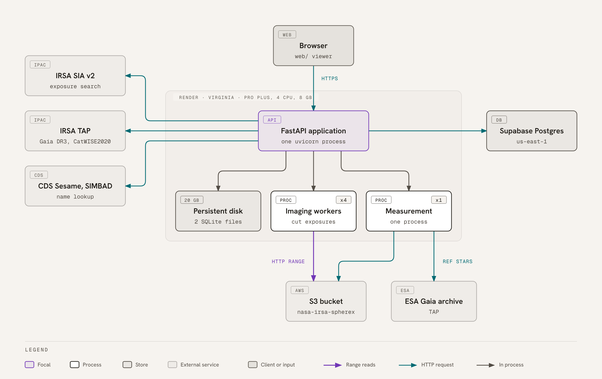
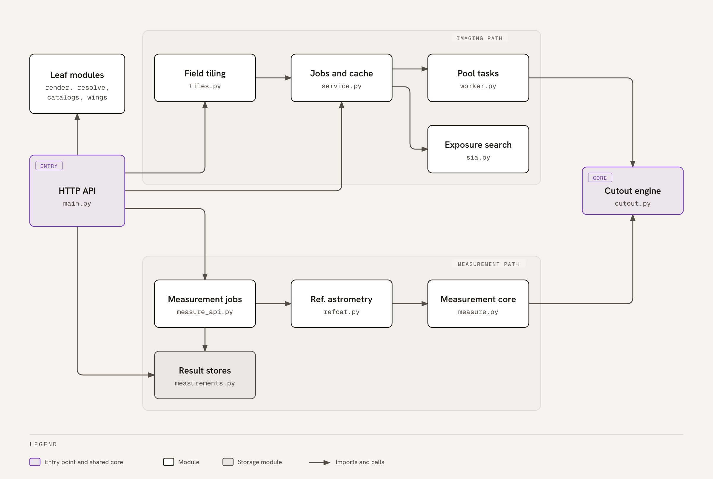
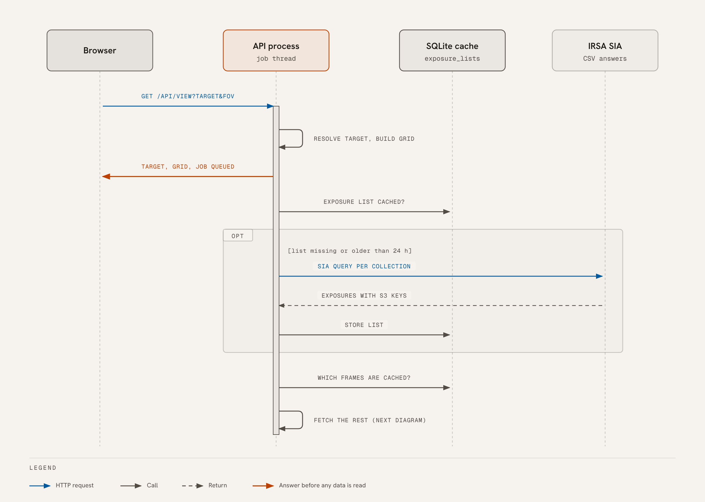
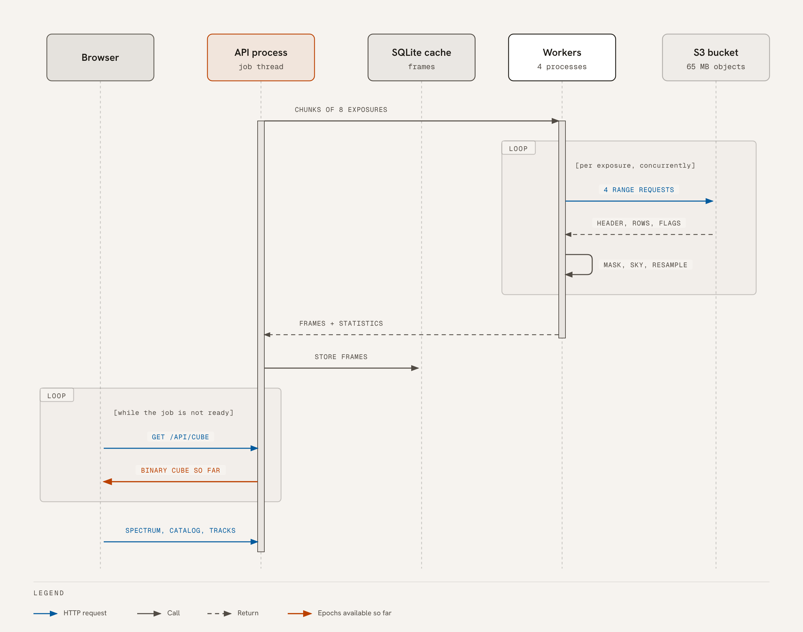
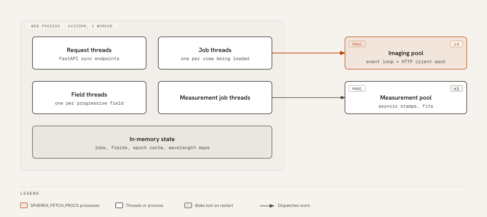

# Architecture

## System context

Vanilla Sphere is a single web service with a static browser client. It owns no
image data. Everything it shows is read on demand from public archives and
cached locally.

<picture>
  <source media="(prefers-color-scheme: dark)" srcset="img/diagrams/system-context-dark.png">
  
</picture>

*Figure: System context. Source: [`diagrams/system-context.html`](diagrams/system-context.html).*

| Component | Technology | Role |
| --- | --- | --- |
| Viewer | HTML, CSS, JavaScript without a framework or build step | Sky map, movie player, plots, overlays |
| API service | Python 3.12, FastAPI, uvicorn | HTTP API, job orchestration, rendering, static file serving |
| Imaging workers | `ProcessPoolExecutor` (spawn), `httpx` async, Astropy, NumPy, SciPy | Range-read and resample exposures in parallel |
| Measurement process | `ProcessPoolExecutor` with one worker | Stamps, PSF fits, stacks, track fit |
| Cutout cache | SQLite in WAL mode on a persistent disk | Exposure lists, frames, wavelength maps, catalogue results |
| Measurement store | SQLite (local) and Postgres (shared) | Pipeline results; team measurements |
| Hosting | Render web service, Virginia | Co-located with the SPHEREx bucket in AWS `us-east-1` |

## Component responsibilities

<picture>
  <source media="(prefers-color-scheme: dark)" srcset="img/diagrams/component-map-dark.png">
  
</picture>

*Figure: Components of the service. Source: [`diagrams/component-map.html`](diagrams/component-map.html). The leaf modules `render`, `resolve`, `catalogs` and `wings` are called only by `main` and are drawn as one box.*

The dependency direction is strict: `main` depends on everything, the numerical
modules (`cutout`, `render`, `measure`, `wings`, `tiles`) know nothing about
HTTP, and `measure` knows nothing about the database. See
[code structure](code-structure.md).

## Request flows

### Opening a view

<picture>
  <source media="(prefers-color-scheme: dark)" srcset="img/diagrams/view-request-search-dark.png">
  
</picture>

*Figure: Opening a view: request and exposure search. Source: [`diagrams/view-request-search.html`](diagrams/view-request-search.html).*

<picture>
  <source media="(prefers-color-scheme: dark)" srcset="img/diagrams/view-request-fetch-dark.png">
  
</picture>

*Figure: Opening a view: reading frames and serving the cube. Source: [`diagrams/view-request-fetch.html`](diagrams/view-request-fetch.html). The flow is drawn in two parts: the request and the exposure search, then the reading of frames and the polling for the cube.*

Key properties:

- **The first response is immediate.** `/api/view` returns the resolved target,
  the grid and a job handle; the work happens in the background.
- **Results stream.** `/api/cube` returns whatever has arrived, so the browser
  shows a growing movie. The cube carries the job status in its metadata and in
  the `X-Job` response header.
- **Idempotent by view.** A view is identified by `Grid.key()` (centre, pixel
  count, pixel scale). Requesting a view that is loading or loaded returns the
  same job. Concurrent users of a popular target share one fetch.

### Loading a progressive field

`/api/tiles` creates a `Field` with three stages (levels 0, 1 and N). A
background thread runs the stages in order, each as an ordinary view job, and
starts the exposure searches of the later stages while the first one loads. The
browser polls `/api/tiles` for stage status and fetches the cube of the widest
finished stage. See [imaging engine](imaging-engine.md#progressive-fields).

### Measuring an object

`/api/measure` starts a job in the web process that finds the exposures and
wavelength maps, then submits the numerical work to one of the measurement processes (waiting
in a queue when all are busy).
The result is written to the local SQLite store and, when a database is
configured, to Postgres. The browser polls the same URL until `status` is
`ready`. See [measurement pipeline](measurement-pipeline.md#job-execution).

## Concurrency model

<picture>
  <source media="(prefers-color-scheme: dark)" srcset="img/diagrams/process-model-dark.png">
  
</picture>

*Figure: Processes and threads. Source: [`diagrams/process-model.html`](diagrams/process-model.html).*

- **Exactly one web process.** Jobs, fields and their progress live in the
  memory of the web process. Running several uvicorn workers would give each its
  own copy: every view would be fetched once per worker and progress polls would
  be answered inconsistently. The start command pins `--workers 1` and
  `WEB_CONCURRENCY=1`. `/api/health` returns an `instance` identifier that must
  be the same on every call; a changing value reveals a multi-process deployment.
- **Parallelism comes from processes, not threads.** Cutting one exposure costs
  a few network waits plus about 40 ms of CPU (Rice decoding, WCS, resampling),
  and the Python interpreter lock limits one process to one core. The exposures
  of a view are therefore split into chunks of 16 (`SPHEREX_FETCH_WORKERS` /
  `SPHEREX_FETCH_PROCS`) and cut in worker processes, each with its own asyncio
  event loop and connection pool. The pool uses the `spawn` start method and is
  warmed at server start so the first view does not wait for Astropy to import.
- **One numeric thread per process.** `OMP_NUM_THREADS` and its equivalents are
  set to 1 before NumPy is imported. Inside a container the maths libraries
  otherwise start one thread per host core and contend for the few CPUs the
  container may use.
- **The pipeline works on a limited number of jobs; the rest wait in a queue.**
  `service.Scheduler` works on `SPHEREX_ACTIVE_VIEWS` views at a time (one per
  worker process), which together may hold `SPHEREX_ACTIVE_MB` of frames in
  memory: on the production machine that is two 7 x 7 fields of the largest
  size, or any four 8 arcmin views. The others wait first come, first served,
  with the callers taking turns (the first view of every caller comes before
  anybody's second one); a wide field that does not fit in the memory left
  waits for another to finish while lighter views go ahead. Every waiting job
  reports its position (`job.queue`), which the viewer shows. A
  waiting view still gets its first chunk of four exposures, so every visitor
  has a picture within seconds (`SPHEREX_QUEUE_PREVIEW`). A view does not
  hand all its chunks to the pool at once: the scheduler keeps a few chunks in
  the processes and chooses the next one each time a chunk returns, first for
  a view that has not been served yet, then for the active view with the
  least left to do, and every fourth chunk for the one that started first.
  The numbers are chosen from measurements of the production machine's size;
  see [performance](performance.md#how-many-jobs-at-once). They, and the
  limits per caller, can be changed while the server runs: they are rows of
  the table `settings` of the team database, read twice a minute by
  `settings.py`, inside ranges fixed in the code and with the environment
  variables as the values without a row
  ([deployment](deployment.md#settings-in-the-database)).
- **Requests wait in threads, the page does not.** Endpoints that wait (for
  the archive, a name service, a view being gathered) run in a pool of 160
  threads (`SPHEREX_REQUEST_THREADS`). The page, the health check and the
  static files are answered on the event loop and never wait for a thread.
  Cubes are gzip-compressed in the request's thread, not on the event loop.
- **Stages run one at a time.** The stages of a progressive field would only
  compete for the same worker processes, and the small one should finish first.
- **Measurements are isolated.** The measurement pool has
  `SPHEREX_MEASURE_PROCS` processes of its own, so a long measurement does not
  block the web process. A job that finds them busy waits its turn, first
  come, first served, and reports its position in the queue; the 600 s limit
  of a job counts from the moment it starts measuring, not from the request.
- **Searches are de-duplicated.** A per-key lock makes a second request for the
  same exposure search wait for the first instead of repeating it. The same
  pattern protects wavelength-map reads.

## Caching model

Four layers, from fastest to most durable:

| Layer | Location | Holds | Bound and eviction |
| --- | --- | --- | --- |
| Epoch cache | Web process memory | Stacked epochs of recent (view, band, grouping, diff) combinations | 500 MB, least recently used |
| Job frames | Web process memory | Decoded frames of recently opened views | `SPHEREX_RAM_BUDGET_MB` (2000 on Render) and at most 500 jobs; least recently used views are forgotten |
| Cutout cache | `cache.sqlite` on the persistent disk | Frames, exposure lists, wavelength maps, catalogue results | `SPHEREX_DISK_BUDGET_GB` (16 on Render); least recently opened views are dropped whole; the 8 arcmin views of the featured targets are never dropped |
| Sky photograph | `atlas/2mass/` on the persistent disk, one JPEG per tile in the HiPS layout | Tiles of the 2MASS atlas behind the sky map, as the archive sends them | `SPHEREX_ATLAS_BUDGET_GB` (12 on Render); orders up to `SPHEREX_ATLAS_KEEP_ORDER` (6) are fetched after a start and never dropped, deeper tiles least recently asked for go first; no new tile is stored with less than 1 GB free on the disk, and the kept orders are not filled further with less than 4 GB free |
| Measurement store | `measurements.sqlite`, Postgres | Pipeline results | Not evicted; re-measured after 7 days or a pipeline version change |

Details:

- **Frames** are keyed by SHA-1 of exposure identifier, collection, grid key and
  a format version. An exposure that turns out not to intersect the grid is
  stored as a "miss" row, so it is never read again.
- **Wide frames are stored in half precision.** Frames wider than 200 pixels are
  saved as `float16` (about four significant digits, far below the noise), which
  halves the largest items on disk.
- **Exposure lists** are fresh for 24 hours so that new data releases appear.
  An older list is still given at once, and the archive is asked for the
  current one in the background (`Service._refresh_later`): a place seen before
  opens the same whether the archive search is quick, slow or down. A refresh
  that failed is tried again after five minutes at the earliest.
- **Wavelength maps** are one small array per (collection, detector), read once
  ever and held in memory.
- **Views forgotten from memory stay on disk.** Reopening one reloads its frames
  from SQLite: under a second for an 8 arcmin view, a few seconds for a 7 x 7 field. The same path makes views survive a
  restart of the service.
- **Client caching.** Rendered PNG and GIF responses carry
  `Cache-Control: public, max-age=3600`. The cube is `no-store` because it grows
  while a job runs. JSON and cube responses above 2 kB are gzip-compressed.

## Data stores

| Store | Engine | Location | Tables |
| --- | --- | --- | --- |
| Cutout cache | SQLite, WAL, `synchronous=NORMAL` | `$SPHEREX_CACHE_DIR/cache.sqlite` | `exposure_lists`, `frames`, `wave_maps`, `catalogs` |
| Local measurements | SQLite, WAL | `$SPHEREX_CACHE_DIR/measurements.sqlite` | `results` |
| Shared measurements | Postgres 15+ (Supabase) | `DATABASE_URL` | `sources`, `detections`, `tracks`, function `sources_near` |
| Limits changed while the server runs | the same database | `DATABASE_URL` | `settings` (read only by the service, every 30 s) |

Schemas are in [data and sources](data-sources.md#data-model). The shared
database is optional: without `DATABASE_URL` the product works fully from the
local store.

## Failure handling

| Failure | Behaviour |
| --- | --- |
| IRSA SIA search fails | A place seen before never waits for the search (see above). For a new place each query is asked again after a passing failure (gateway error, timeout, dropped connection) with a growing pause, for up to 60 s (`retry.py`); only then does the job end in `error`, and the API answers 502 with a sentence fit for the page, which shows it with a "Try again" button |
| A range request fails or a file has an unexpected layout | The exposure is retried up to three times with increasing delay, then counted in `job.failed`; the view completes with the remaining exposures |
| Exposure does not intersect the view | Recorded as a miss; not an error |
| Catalogue service (IRSA TAP) fails | `/api/catalog` answers 502; the viewer retries three times and reports that the overlay did not load |
| Name services unreachable | Second Sesame host, then SIMBAD TAP on two hosts; if all fail, 503 with a message that distinguishes this from an unknown name |
| Gaia unreachable during a measurement | ESA archive first, IRSA second; if both fail the measurement proceeds without neighbour stars and records `gaia: false` |
| Postgres unreachable or read-only | The result stays in the local store and is served from there; it is written to Postgres at the next start (`sync_db`). The limits read last from the table `settings` stay in force (after a start without it: those of the environment); no request waits for the database |
| Service restart or deploy | In-memory jobs are lost; cached frames remain on disk and views resume from them; a measurement in progress is abandoned and can be requested again |

## Security and privacy

- The service has no user accounts and stores no personal data.
- All source data are public. No credentials are needed for the archive.
- The only secret is the Postgres connection string, set in the hosting
  dashboard and never committed.
- The Postgres tables have row level security enabled and are closed to the
  public REST interface; only named login roles can read or write. The web
  service connects as `blink_service`.
- Inputs are validated by FastAPI parameter types and ranges. Object names are
  limited to 80 characters and are URL-encoded or SQL-quoted before being sent
  to name services. Catalogue queries are built from numeric values only.
- CORS is open for `GET` and `HEAD` only, without credentials, so that images
  and data can be embedded.
- Every response carries security headers, and each caller has request
  limits; see [security and resilience](security.md).
- Response size is bounded: a cube above 40 million pixels is refused with 413.

## Key design decisions

| Decision | Alternatives considered | Reason |
| --- | --- | --- |
| Read FITS by HTTP range from S3 | Download whole files; IRSA cutout service | 1.3-1.9 MB instead of 65 MB per exposure at 8 arcmin; pixel-identical; no dependency on a cutout service's rate limits |
| On-demand processing with a cache | Pre-compute tiles for the sky | Any coordinates work immediately; storage stays bounded; new releases need no reprocessing |
| Host next to the data | Any region | The bucket is in `us-east-1`; measured read rates from Render Virginia are 85-220 MB/s |
| One web process with worker processes | Several web workers; an external queue | In-memory job state stays consistent with no extra infrastructure; a queue was unnecessary at this scale |
| SQLite on a persistent disk for the cache | Redis; object storage | Frames are small blobs keyed by hash; one file, no service to run; survives restarts |
| Postgres only for measurements | Postgres for everything | Images are reproducible from the archive and belong in a cache; measurements are the product's own data and are shared with the team |
| Binary cube with asinh-compressed `uint16` | PNG frames; JSON arrays | Keeps the dynamic range for client-side arithmetic and stretching at 2 bytes per pixel |
| Image arithmetic in the browser | Server-side rendering per mode | Switching mode, reference frame or contrast is instant and costs no request |
| Parallel point queries for wide views | One area query | A point query takes about 2 s; an area query 18-55 s |
| Plain JavaScript viewer, no build step | A front-end framework | One static folder served by the API; nothing to compile or deploy separately |
| Fixed cell grid shared with offline measurements | Free-form mosaics | Images and measurements address the same cells |
| Deterministic algorithms only | Learned detectors | Results are explainable and reproducible, in line with the design principles |
