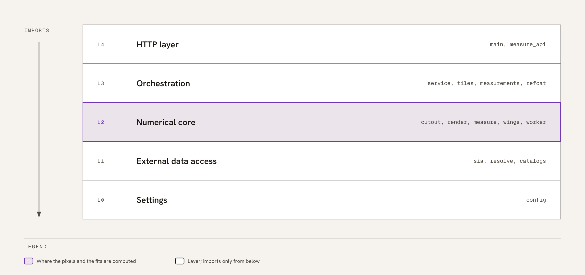

# Code structure

## Repository layout

```
sphere-blink/
├── sphereblink/            Python package: the service
│   ├── __init__.py         pins numeric libraries to one thread per process
│   ├── config.py           settings from environment variables
│   ├── settings.py         limits changed while the server runs (table settings of the database)
│   ├── sia.py              exposure search (IRSA SIA v2)
│   ├── retry.py            asking an archive again after a passing failure
│   ├── cutout.py           FITS range reader, masking, resampling, aperture photometry
│   ├── worker.py           tasks that run in the imaging worker processes
│   ├── service.py          SQLite cache, view jobs, process pool
│   ├── tiles.py            fixed 0.12 degree cell grid, progressive fields
│   ├── render.py           epochs, false colour, stretch, PNG, GIF, binary cube
│   ├── resolve.py          coordinates and object names to positions
│   ├── guard.py            caller identity, request limits, security headers
│   ├── catalogs.py         Gaia DR3 and CatWISE2020 overlays (IRSA TAP)
│   ├── wings.py            flux of saturated stars from their halo
│   ├── measure.py          native stamps, PSF fits, stacks, track fit, light curve
│   ├── refcat.py           reference astrometry for the measurement pipeline
│   ├── measure_api.py      measurement jobs and endpoints
│   ├── measurements.py     result stores: local SQLite and team Postgres
│   ├── movers.py           blind search for moving objects: detect, link, confirm
│   ├── mover_store.py      detections, moving objects and votes (local SQLite)
│   ├── movers_api.py       search jobs and the /api/movers endpoints
│   ├── known_objects.py    names of known asteroids and comets (SkyBoT, JPL)
│   ├── mover_completeness.py  fake moving objects in real frames: what the search finds
│   ├── distance.py         distance of a star, redshift of a galaxy, from catalogues
│   └── main.py             FastAPI application: endpoints and static files
├── web/                    the viewer (static; see viewer.md)
├── sql/                    schema and roles of the measurement database
├── scripts/                maintenance and calibration tools
├── tests/                  unit tests (no network)
├── docs/                   this documentation
├── render.yaml             hosting blueprint of production
├── render.dev.yaml         hosting blueprint of the dev site (see environments.md)
├── .github/workflows/      checks on pull requests (tests, branch names); UI tests after every merge
├── requirements.txt        Python dependencies
├── README.md
├── THIRD-PARTY-NOTICES.md licences of the fonts, data and design references that are not ours
└── LICENSE                 GNU Affero General Public License, version 3
```

About 4 300 lines of Python in the package, 850 lines of tests, and 2 100 lines
of HTML, CSS and JavaScript in the viewer.

## Modules

| Module | Lines | Responsibility | Main names |
| --- | --- | --- | --- |
| `config.py` | 59 | All tunable settings, read once from the environment | `COLLECTIONS`, `S3_HTTP_BASE`, `CACHE_DIR`, `MAX_FOV_ARCMIN`, `FETCH_PROCS`, `BAD_FLAG_NAMES` |
| `settings.py` | 262 | The limits that are rows of the table `settings`: the range each may take, the rule that holds the memory together, reading the table twice a minute in a thread of its own, the values that stay in force without the database | `SETTINGS`, `get`, `on_change`, `effective`, `refresh`, `status` |
| `sia.py` | 180 | Query the archive for exposures covering one or many points, asking again after a passing failure until one shared deadline; parse CSV or VOTable | `Exposure`, `find_exposures_at`, `parse_sia_csv` |
| `retry.py` | 108 | One GET of an outside archive that is repeated after a gateway error, a timeout or a dropped connection, with a growing and uneven pause, until a deadline; the failure as one sentence without the address asked | `get`, `Unavailable`, `transient`, `reason_of` |
| `cutout.py` | 455 | The view grid; four-request FITS reader; Rice decoding of flags; masking; sky plane; resampling; aperture flux; wavelength maps | `Grid`, `Frame`, `cut_async`, `detector_coords`, `aperture_flux`, `wave_map_from_file`, `cache_key` |
| `worker.py` | 77 | Code executed inside worker processes: per-process event loop and HTTP client, chunk cutting with retries, traffic metering | `init`, `cut_chunk`, `cut_one`, `Meter` |
| `service.py` | 408 | SQLite store; job lifecycle; exposure search with locks, older lists given at once and refreshed in the background; failures said in a sentence (`say`); process pool; memory and disk budgets | `Store`, `Job`, `Service` |
| `atlas.py` | 378 | The photograph behind the sky map: tiles of the 2MASS atlas fetched from the archive once and kept on disk; one fetch per tile whoever asks; kept orders and their filling after a start; least-recently-asked eviction; leaving a silent archive alone | `Atlas`, `NotThere`, `Away`, `address`, `tiles_in` |
| `tiles.py` | 202 | Cell arithmetic and identifiers; block and stage geometry; field lifecycle | `cell_of`, `tile_id`, `block`, `stage_grid`, `Field`, `Fields` |
| `render.py` | 393 | Grouping into epochs; colour composition with provenance; shared limits; asinh rendering; binning; cube, PNG and GIF encoding | `Epoch`, `build_epochs`, `build_color_epochs`, `difference`, `shared_limits`, `encode_cube` |
| `resolve.py` | 277 | Parse coordinates; featured targets and aliases; Sesame and SIMBAD lookups with mirrors; proper-motion propagation | `Target`, `resolve`, `FEATURED`, `NameNotFound`, `ResolverUnavailable` |
| `guard.py` | 200 | Who is calling (Cloudflare's address); token buckets and open-request counts per caller; the security headers; the ASGI middleware that applies them | `Guard`, `Buckets`, `Busy`, `charge`, `client_of` |
| `catalogs.py` | 78 | ADQL cone queries for the overlays; unit and epoch normalisation; motion significance | `query` |
| `wings.py` | 134 | Ring levels around a saturated star; calibration table; flux with systematic error | `ring_levels`, `measure`, `CALIBRATION` |
| `measure.py` | 1070 | The measurement algorithms; no HTTP endpoints, no database | `Body`, `Stamp`, `Detection`, `fit_psf`, `fit_wings`, `measure_stack`, `fit_track`, `light_curve`, `measure_all`, `fetch_stamps` |
| `refcat.py` | 117 | Catalogue astrometry of the featured targets; Gaia cone query with fallback; matching a request to a catalogue object | `TARGETS`, `gaia_cone`, `body_for` |
| `measure_api.py` | 204 | Measurement job runner, automatic measurement of the featured targets, the two measurement endpoints | `router`, `start`, `run`, `VERSION` |
| `measurements.py` | 280 | Local result store; Postgres reader and writer; merged cone search | `save_local`, `save_db`, `sync_db`, `near` |
| `movers.py` | 702 | The blind search; no HTTP, no storage | `Detection`, `Track`, `detect`, `link`, `confirm`, `candidates`, `chance_tracks`, `search`, `same_object` |
| `mover_store.py` | 298 | Stored detections by sky cell, objects, votes; identity of an object found again | `save_field`, `detections_around`, `listing`, `get`, `vote`, `coverage` |
| `memory.py` | 138 | What the container really holds: memory that cannot be given back against file cache, per process; read by `/api/health` and by the mover search before it starts | `container`, `free_mb`, `processes`, `usage` |
| `movers_api.py` | 330 | Search jobs in a process of their own, started when a field completes; the four mover endpoints | `router`, `attach`, `start`, `run` |
| `distance.py` | 490 | What lies at a position and how far it is: SIMBAD, NED and Gaia lookups with fallbacks, the choice of the object, the Planck 2018 cosmology; no HTTP endpoint of its own | `lookup`, `simbad_cone`, `pick`, `ned_redshift`, `gaia_star`, `parallax_distance`, `cosmology` |
| `known_objects.py` | 215 | Asks SkyBoT, then JPL, for the known objects of a field and matches tracks to them | `identify`, `match`, `parse_skybot`, `parse_jpl` |
| `mover_completeness.py` | 400 | The injection test of the blind search: fake objects (path, brightness per wavelength as reflected sunlight with or without an asteroid's own heat, shape through detector pixels and resampling), their recovery, and the statistics; no HTTP, no storage; not used by the server | `Fake`, `flux_mjy`, `heat_share`, `stamp`, `inject`, `draw`, `recover`, `trial`, `noise_maps`, `wilson`, `half_point` |
| `main.py` | 397 | Application object, middleware, parameter handling, all other endpoints, epoch cache, static mount | `app`, `svc`, `fields` |

## Dependency rules

<picture>
  <source media="(prefers-color-scheme: dark)" srcset="img/diagrams/code-layers-dark.png">
  
</picture>

*Figure: Dependency layers of the package. Source: [`diagrams/code-layers.html`](diagrams/code-layers.html).*

- Only `main.py`, `measure_api.py` and `movers_api.py` import FastAPI.
- `cutout`, `render`, `wings`, `tiles` and `measure` are pure functions and data
  classes over NumPy arrays; they can be used from a script or a notebook.
  `measure.measure_all` returns a plain dictionary.
- `measure.py` reuses the byte-level FITS helpers of `cutout.py` rather than
  duplicating them.
- Only `measurements.py` and `settings.py` talk to Postgres, and they import the
  driver lazily so the service runs without it when no database is configured.
- A limit that is a row of the table `settings` is read with
  `settings.get("active_views")` at the moment it is needed, never copied at
  import: that is what lets it change while the server runs. Its value
  without a row is still the name in `config`.
- State that must be shared (jobs, fields, caches) is held by the single
  `Service` and `Fields` instances created in `main.py`.

## Core data types

| Type | Module | Meaning |
| --- | --- | --- |
| `Exposure` | `sia` | One Level 2 file: identifiers, time range, wavelength range, S3 key, footprint |
| `Grid` | `cutout` | The image grid of a view; its `key()` identifies the view |
| `Frame` | `cutout` | One exposure on a grid, with wavelength, aperture flux and flags at the target |
| `Job` | `service` | The gathering of a view's frames: status, counters, statistics, frames so far |
| `Field` | `tiles` | A progressive field: seed cell, cells, stages |
| `Epoch` | `render` | One displayed image, its members and (for colour) channel provenance |
| `Target` | `resolve` | A resolved request: position at the SPHEREx epoch, catalogue position, motion, source |
| `Body` | `measure` | A catalogue object with position, epoch, proper motion and parallax; predicts positions |
| `Stamp` | `measure` | Native detector pixels around a position in one exposure, with WCS and flags |
| `Fit` | `measure` | Result of a PSF or wing fit in pixel coordinates |
| `Detection` | `measure` | A measured position and flux in one exposure or stack |

## Scripts

| Script | Purpose | Usage |
| --- | --- | --- |
| `scripts/prewarm.py` | Fill the cache of a running server for the featured targets and optional coordinate lists | `python scripts/prewarm.py https://server [--fov 4,8,15] [coords.txt]` |
| `scripts/calibrate_wings.py` | Measure how halo brightness scales with flux on 2MASS calibrators and print the table for `wings.CALIBRATION` | `collect` then `fit`, with `scripts/wing_calibrators.csv` |
| `scripts/wing_calibrators.csv` | The 81 isolated 2MASS stars used for the calibration | - |
| `scripts/build_sky.py` | Build `web/data/sky.json` from d3-celestial data | `python scripts/build_sky.py path/to/d3-celestial/data` |
| `scripts/build_redshift.py` | Build `web/data/redshift.json`, the galaxies and quasars of the redshift layer, from SIMBAD (about 4 minutes) | `python scripts/build_redshift.py` |
| `scripts/build_quasar_template.py` | Build `web/data/quasar-template.json`, the mean quasar spectrum the redshift estimate is compared with, from two composites in VizieR | `python scripts/build_quasar_template.py` |
| `scripts/validate_redshift.py` | Check the redshift estimate (`web/redshift.js`) against published redshifts on bright quasars, and on stars and nearby galaxies, with a local engine | `python scripts/validate_redshift.py --keep DIR` |
| `scripts/mover_completeness.py` (with `mover_completeness_report.py`, `mover_completeness_plot.py`) | Measure the completeness of the blind search with fake objects in real fields and write `web/data/mover-completeness.json` (hours of computing; see [how much the search finds](mover-completeness.md)) | `fetch`, `prepare`, `run`, `shuffle`, `report` |
| `scripts/build_readme_art.py` | Draw the pictures of the README and of the organisation page that are not screenshots: the banner, the strip of numbers, the award, the buttons and the repository cards (`docs/readme/*.svg`); needs `fonttools` and `brotli` | `python scripts/build_readme_art.py` |
| `scripts/build_dev_site.sh` | Lay `web/` out as the static dev site (see [environments](environments.md)) | `sh scripts/build_dev_site.sh [output dir]` |
| `scripts/wait_for_deploy.sh` | Wait until a site serves the viewer of the checkout, and on production until the engine has restarted; the check of the deploy after a merge to `main` (see [environments](environments.md#ui-tests-after-every-merge)) | `sh scripts/wait_for_deploy.sh https://site [engine]` |
| `scripts/start_local_site.sh` | Start the service of the checkout on this machine and wait until it answers and holds the featured targets; the UI tests after a merge run against it (see [environments](environments.md#ui-tests-after-every-merge)) | `sh scripts/start_local_site.sh [stop]` |

## Database files

| File | Content |
| --- | --- |
| `sql/schema.sql` | Tables `sources`, `detections`, `tracks`; indexes; function `sources_near`; row level security; pipeline columns |
| `sql/roles.sql` | Login roles `blink_loader` (read and write), `blink_web` (read only), `blink_service` (the web service) and their policies |
| `sql/example_insert.sql` | Example upserts for loading measurements by hand |
| `sql/README.md` | How to load data |

## Tests

92 unit tests in five files, run with `pytest`. They use synthetic data and
stubbed HTTP clients, need no network, and finish in about three seconds.

| File | Tests | Covers |
| --- | --- | --- |
| `tests/test_guard.py` | 27 | Caller identity; token buckets; security headers and CORS; refusal of non-positions; the measurement name rule; job and queue caps; the pipeline queue (views worked on at a time, positions, callers taking turns, the first exposures of a waiting view, the memory budget for wide fields, two measurements at a time); disk cache eviction and pinning; name cache; second source for files; older exposure lists given at once and refreshed in the background; asking an archive again until a deadline; the sentence a failed view shows |
| `tests/test_settings.py` | 18 | The limits kept in the database: a row sets the value, one outside its range is moved to the nearest end, one that is not a number is ignored; the three settings that fill the memory never come to more than the machine was sized for; a database that does not answer changes nothing; a changed limit reaches the queue of views, the allowances of a caller and the measuring processes; `sql/settings.sql` is the list of the code with the values of `render.yaml`. One test runs against a real Postgres when `SPHEREX_TEST_DATABASE_URL` is set |
| `tests/test_offline.py` | 29 | Coordinate parsing; proper-motion propagation of the featured targets; grid geometry; FITS header scanning; aperture photometry; sky plane; epoch grouping; median difference; cube round trip; PNG and GIF rendering; colour borrowing and white balance; disk and memory eviction; cell grid and stages; exactness of the coarse-lattice pixel mapping; binning; half-precision storage; SIA CSV parsing; wing photometry |
| `tests/test_atlas.py` | 10 | The sky photograph kept on disk: one fetch then disk; addresses outside the atlas; answers that are not pictures; shared fetches; a silent archive; eviction that spares the kept orders; filling after a start; a nearly full disk; the two endpoints, their headers and allowances; the page's two sources |
| `tests/test_measure.py` | 18 | Parallax factors; PSF fit accuracy; neighbour handling; wing fallback; track recovery with parallax; stacks for faint movers; light curve; storage and database synchronisation; saturated stars |
| `tests/test_overtime_js.py` | 1 | Runs `tests/overtime_cases.js` with node on `web/overtime.js`: groups of days, the cut time axis, and the comparison of visits (steady, fading, saturated star, long stay, one visit, too few points, noise only) |
| `tests/test_resolve_names.py` | 12 | Name resolution paths: Sesame, mirrors, redirects, SIMBAD fallback, spellings, "not found" against "unavailable", no network for built-in targets |
| `tests/test_redshift.py` | 40 | The redshift from the lines (`web/redshift.js`, run under Node by `tests/redshift_runner.js`): 14 real quasar spectra kept in `tests/data/redshift/` (nine with lines from z = 0.16 to 6.5 give their published redshift, four blazars and one with a single line give none), the star spectra of `tests/data/spectra/` give none, and made-up spectra (lines at five redshifts, bare continuum, one line, a flare at one visit, noise, flagged points) |
| `tests/test_insight.py` | 27 | The preliminary reading of a spectrum (`web/insight.js`, run under Node by `tests/insight_runner.js`) and its reference wavelengths (`web/linelist.js`: every entry names a source, hydrogen lines agree with the Rydberg formula, every feature of a reading comes from the catalogue); four quasars read with their published redshift, a made-up redshifted source read with the right and a wrong redshift; a quasar whose SIMBAD redshift is wrong, read at the redshift from its lines; 17 real spectra kept in `tests/data/spectra/` (brown dwarf, ices, planetary nebula, white dwarf, cold neighbour, cool star, quasar, extended galaxy, saturated stars, empty sky) and made-up curves (blackbodies, a power law, ice bands, emission lines, noise); no band or line from noise; nothing claimed from too few points. Skipped where Node is not installed |
| `tests/test_mover_completeness.py` | 10 | The injection test: brightness by magnitude and spectrum, an asteroid's heat; a fake holds its light and has the shape of a star; trails; fakes land where told and only in their pass; a bright fake is found and a faint one is not; any search with the same input is measured; the statistics; the result file the viewer reads |

```bash
pip install -r requirements.txt pytest
SPHEREX_AUTO_MEASURE=0 pytest -q
```

Numerical claims that matter for correctness are tests rather than comments: for
example that the coarse-lattice mapping is exact to 1/1000 pixel, that ignoring
parallax biases the fitted motion, and that half-precision storage preserves the
image within the noise.

## Dependencies

| Package | Used for |
| --- | --- |
| `fastapi`, `uvicorn[standard]` | HTTP service |
| `astropy` | FITS headers, WCS with SIP distortion, Rice codec, time and ephemeris, coordinate parsing |
| `numpy`, `scipy` | Array arithmetic; interpolation, labelling, least squares, error function |
| `httpx` | HTTP client, synchronous and asynchronous, for range requests and services |
| `fsspec`, `aiohttp` | Remote FITS access for the one-time wavelength-map read |
| `pillow` | PNG and GIF encoding, annotation |
| `psycopg[binary]` | Postgres driver (only when a database is configured) |

The viewer has no runtime dependencies.

## Conventions

- **Python.** Type hints throughout; `from __future__ import annotations`; data
  classes for records; module docstrings state the design intent. Functions that
  are not part of a module's interface start with an underscore.
- **Comments explain why.** In-code comments record the reason for a choice and,
  where relevant, the measurement behind it.
- **Units in names.** `_ujy`, `_um`, `_arcsec`, `_deg`, `_mjd`, `_masyr`, `_s`.
- **No hidden globals.** Settings come from `config.py`; mutable service state
  belongs to `Service`, `Fields` or the module-level job table of `measure_api`.
- **Cache keys are versioned.** `cutout.cache_key` and the catalogue cache key
  include a version tag; `measure_api.VERSION` versions measurement results.
  Raise the tag when the stored format or the method changes.
- **Branches and review.** Work happens on a branch and reaches `main` through a
  pull request; `main` deploys automatically.
- **Parallel workstreams.** The imaging engine, the viewer, the measurement
  pipeline and the documentation are developed in parallel; changes to shared
  files (`main.py`, `web/app.js`) start from the latest `main`.

## Where to make common changes

| Change | Place |
| --- | --- |
| Support a new SPHEREx data release | `SPHEREX_COLLECTIONS` (no code change) |
| Add an endpoint | `main.py`; reuse `_view`, `_frames`, `_epochs` |
| Change masking, background or resampling | `cutout.cut_async`; raise the version tag in `cache_key` |
| Change colour mapping | `render.RGB_CHANNELS`, `build_color_epochs`; mirror the stretch in `web/app.js` `draw` |
| Add an overlay catalogue | `catalogs.QUERIES`; a checkbox and a style in the viewer |
| Change the measurement method | `measure.py`; raise `measure_api.VERSION` |
| Add a built-in target | `resolve.FEATURED` and `ALIASES`; `refcat.TARGETS`; text in `web/i18n.js` |
| Add a name-service mirror | `resolve.SESAME_URLS`, `SIMBAD_TAP_URLS` |
| Add interface text | `web/i18n.js` (`STR.en`) |
