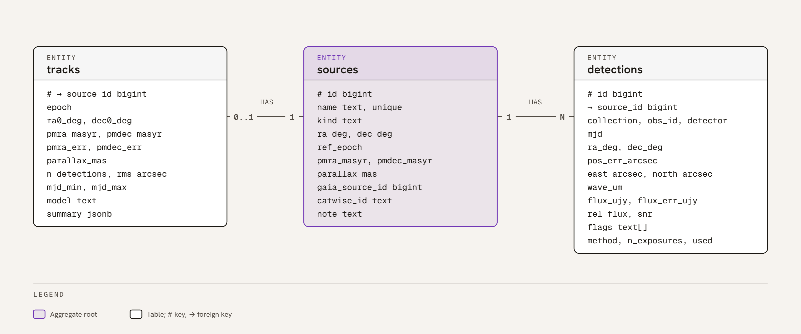

# Data and sources

## Datasets

| Dataset | Provider | Used for | Access |
| --- | --- | --- | --- |
| SPHEREx Level 2 spectral images, releases DR1 and QR3 | NASA / Caltech IPAC, Infrared Science Archive (IRSA) | Every image, spectrum and measurement in the product | Exposure search through IRSA SIA v2; pixels from the AWS Open Data mirror |
| Gaia DR3 | European Space Agency (ESA), Gaia mission | Overlay; reference astrometry and neighbour stars for measurements | ESA Gaia archive TAP (`gaiadr3.gaia_source`); IRSA TAP (`gaia_dr3_source`) as the fallback |
| CatWISE2020 | NASA WISE / NEOWISE; IRSA | Overlay of infrared sources with proper motions | IRSA Gator cone search (`catwise_2020`); IRSA TAP as the fallback |
| 2MASS Point Source Catalog | NASA / IPAC, University of Massachusetts | Calibration and validation of photometry (81 stars, offline) | Values stored in `scripts/wing_calibrators.csv` |
| SIMBAD, NED, VizieR through Sesame | CDS Strasbourg; NASA/IPAC Extragalactic Database | Resolving object names to positions and proper motions | CDS Sesame; SIMBAD TAP |
| AllWISE position and Kirkpatrick et al. 2021 (ApJS 253, 7) | NASA WISE; published literature | Astrometry of WISE 0855-0714, which is not in Gaia | Constants in `refcat.py` |
| d3-celestial star, constellation and Milky Way data | Olaf Frohn (BSD 3-Clause) | The drawn sky map | Reduced to `web/data/sky.json` at build time |
| 2MASS colour atlas (J, H, K) in HiPS format | University of Massachusetts and IPAC/Caltech, funded by NASA and NSF; HiPS by CDS | The photograph behind the zoomed-in sky map, a backdrop only | Tiles fetched by the visitor's browser from IRSA (`irsa.ipac.caltech.edu/data/hips/CDS/2MASS/Color`) |

No data are bundled with the product apart from the sky-map chart, the
calibration star list and the catalogue rows of the five featured targets.

## SPHEREx Level 2 images

SPHEREx carries six detector arrays of 2040 x 2040 pixels behind linear variable
filters. Together they cover 0.75-5.0 um in 102 spectral channels. A Level 2
product is one calibrated exposure of one detector.

| Property | Value | Where used |
| --- | --- | --- |
| Pixel size | 6.15 arcsec | `config.NATIVE_PIXEL_ARCSEC` |
| Image | 2040 x 2040, 32-bit float, MJy/sr, uncompressed | `cutout.DET_SIZE`, `ROW_BYTES` |
| Quality flags | One bit plane per condition, Rice-compressed row by row; plane names in `MSKN` header cards | `cutout.flag_planes`, `config.BAD_FLAG_NAMES` |
| Astrometry | TAN projection with SIP distortion | Astropy `WCS` |
| Wavelength | Spectral WCS (key `W`): central wavelength and bandwidth as a function of detector position | `cutout.wave_map_from_file` |
| File size | About 65 MB | - |
| Cadence | A position is revisited about every six months and observed many times during each visit | Epoch grouping, pass splitting |

Detector wavelength ranges:

| Detector | Range (um) | False-colour role |
| --- | --- | --- |
| D1 | 0.75-1.09 | Blue (fallback) |
| D2 | 1.10-1.62 | Blue |
| D3 | 1.63-2.42 | Green (fallback) |
| D4 | 2.42-3.82 | Green |
| D5 | 3.83-4.41 | Red (fallback) |
| D6 | 4.42-5.00 | Red |

Quality flags treated as unusable for display and measurement: `TRANSIENT`,
`OVERFLOW`, `SUR_ERROR`, `NONFUNC`, `MISSING_DATA`, `HOT`, `COLD`, `NONLINEAR`,
`PERSIST`, `OUTLIER`, `SNOWBALL`. The flag `SOURCE` (pixel on a known source) is
kept. `OVERFLOW` and `NONLINEAR` in a connected group identify the saturated
core of a bright star.

### Releases

The service searches the collections listed in `SPHEREX_COLLECTIONS`, by default
`spherex_dr1` then `spherex_qr3`. Where an exposure exists in both, the first
listed (newest processing) is used. Adding a release is a configuration change.

### Storage location

The files are read from the public AWS Open Data bucket `nasa-irsa-spherex` in
region `us-east-1`, over HTTPS, without credentials:

```
https://nasa-irsa-spherex.s3.us-east-1.amazonaws.com/<s3_key>
```

The key of each file is taken from the `cloud_access` column of the archive's
search result. If that column is empty the IRSA download URL is used instead.

## External services

| Service | Endpoint | Called by | Timeout | On failure |
| --- | --- | --- | --- | --- |
| IRSA SIA v2 | `https://irsa.ipac.caltech.edu/SIA` | `sia.py` | 60 s for a new position, 10 s when an older list is stored | One retry; then the stored list of any age; else the view fails with 502 |
| AWS S3 (SPHEREx bucket) | `https://nasa-irsa-spherex.s3.us-east-1.amazonaws.com` | `cutout.py`, `measure.py` | 60 s (8 s connect) | The same byte range is read from IRSA (`https://irsa.ipac.caltech.edu/ibe/data/spherex/<key>`), which is about five times slower; after three failures in a row the bucket is skipped for a minute. Three attempts per exposure; the exposure is then counted as failed |
| ESA Gaia archive TAP | `https://gea.esac.esa.int/tap-server/tap/sync` | `catalogs.py`, `refcat.py` | 25 s / 40 s | Falls back to IRSA TAP |
| IRSA Gator | `https://irsa.ipac.caltech.edu/cgi-bin/Gator/nph-query` | `catalogs.py` | 25 s | CatWISE overlay; falls back to IRSA TAP |
| IRSA TAP | `https://irsa.ipac.caltech.edu/TAP/sync` | `catalogs.py`, `refcat.py` | 25 s / 40 s | Second choice for both overlays and for measurement. Overlay: 502 and client retry when both services fail |
| CDS Sesame | `https://cds.unistra.fr/cgi-bin/nph-sesame`, then `https://vizier.cfa.harvard.edu/viz-bin/nph-sesame` | `resolve.py` | 8 s (4 s connect) | Next host, then SIMBAD TAP |
| SIMBAD TAP | `https://simbad.cds.unistra.fr/simbad/sim-tap/sync`, then `https://simbad.cfa.harvard.edu/simbad/sim-tap/sync` | `resolve.py` | 8 s | A stored answer of any age; else 503 "name services are not answering" |

All of these are public and need no key. Results are cached: exposure lists for
24 hours (and kept for when the archive is away), catalogue overlays per view,
name lookups on disk for 30 days and in memory (2000 entries),
Gaia reference rows of the featured targets in the source code.

## Data model

### Cutout cache (SQLite, `cache.sqlite`)

| Table | Key | Columns | Content |
| --- | --- | --- | --- |
| `exposure_lists` | `key` (position or view, plus collections) | `created`, `payload` (JSON) | The exposures of a search |
| `frames` | `key` (SHA-1 of exposure, collection, grid, version) | `uid`, `grid`, `created`, `meta` (JSON), `image` (NumPy blob, or NULL for a miss) | One exposure on one grid. Index on `grid` |
| `wave_maps` | `key` (`collection_Ddetector`) | `created`, `map` (NumPy blob, 2 x 41 x 41 float32) | Wavelength and bandwidth over a detector |
| `catalogs` | `key` (catalogue, version, grid) | `created`, `payload` (JSON) | Overlay sources of a view |

### Local measurement store (SQLite, `measurements.sqlite`)

| Table | Key | Columns |
| --- | --- | --- |
| `results` | `key` (target key or `pos_<ra>_<dec>`) | `name`, `ra`, `dec`, `updated`, `payload` (the full result as JSON) |

### Team measurement database (Postgres)

<picture>
  <source media="(prefers-color-scheme: dark)" srcset="img/diagrams/data-model-dark.png">
  
</picture>

*Figure: Measurement database. Source: [`diagrams/data-model.html`](diagrams/data-model.html). Columns that belong together share a line; `sql/schema.sql` is the authoritative definition.*

| Table | One row per | Notes |
| --- | --- | --- |
| `sources` | Object being followed | `kind` is one of `star`, `brown_dwarf`, `variable`, `moving`, `candidate`, `artifact`. `name` is unique. Index on (`dec_deg`, `ra_deg`) |
| `detections` | Object per exposure (or stack) per method | Unique on (`source_id`, `obs_id`, `detector`, `method`). `obs_id` and `detector` identify the SPHEREx file |
| `tracks` | Object | The fitted linear motion; `summary` holds the full fit, the light curve and run statistics |

`sources_near(ra, dec, radius_deg)` returns the sources in a cone, with a
declination pre-filter on the index and an exact great-circle test.

The images are deliberately not in this database. They are reproducible from
the archive and live in the cache; the database holds only what is measured on
top of them.

**Access control.** Row level security is enabled on all three tables and the
cone function is not executable by the public role, which closes the tables to
the hosting provider's public REST interface. Three login roles exist:

| Role | Rights | Used by |
| --- | --- | --- |
| `blink_service` | Read and write | The web service: reads for `/api/tracks`, writes pipeline results |
| `blink_loader` | Read and write | Team members loading measurements made by other means |
| `blink_web` | Read only | Read-only clients |

**Row ownership.** The pipeline writes and replaces only rows whose `method` is
`psf`, `wings` or `stack`. Measurements loaded under another method name are
preserved and served alongside.

## Units and conventions

| Quantity | Unit | Convention |
| --- | --- | --- |
| Positions | Decimal degrees | ICRS |
| Field of view | Arcminutes | Side of the square view |
| Pixel scale, offsets, position errors | Arcseconds | `east` is positive toward increasing RA |
| Proper motion | mas/yr | `pmra` includes the factor cos(dec) |
| Parallax | mas | |
| Time of an exposure | Modified Julian Date (MJD) | Mid-exposure; dates shown to users are UTC |
| Epochs of positions | Julian year | For example 2016.0 for Gaia DR3; MJD 51544.5 is 2000.0 |
| Wavelength, bandwidth | Micrometres (um) | At the target's detector position |
| Flux density | Microjansky (uJy) in the API; mJy or Jy in plots | |
| Surface brightness | MJy/sr | Internal; frames are sky-subtracted |
| Cube pixel values | Units of per-exposure sky noise (sigma) | See [binary cube format](api-reference.md#binary-cube-format) |
| Image orientation | North up, east left | Cube rows run south to north |

The SPHEREx reference epoch for placing a moving target at the centre of a view
is 2025.9 (`resolve.SPHEREX_EPOCH`), the middle of the data available in late 2026.

A note on WISE 0855-0714: the coordinates given in the challenge text
(133.795129, -7.245147) are the AllWISE position, which is where the object was
in mid 2010. With a motion of about 8 arcsec/yr it has moved two arcminutes
since. The service propagates from epoch 2010.5 and its own stacks confirm the
object at the propagated position.

## Credits and licences

| Item | Credit | Licence or terms |
| --- | --- | --- |
| SPHEREx images | NASA / Caltech / IPAC; SPHEREx Science Team; NASA/IPAC Infrared Science Archive; AWS Open Data | Public NASA data |
| Gaia DR3 | European Space Agency (ESA), Gaia Data Processing and Analysis Consortium (DPAC) | Gaia archive terms |
| CatWISE2020, AllWISE | NASA WISE and NEOWISE; IRSA | Public NASA data |
| 2MASS | University of Massachusetts and IPAC/Caltech, funded by NASA and NSF | Public |
| SIMBAD, Sesame, VizieR | CDS, Strasbourg, France | CDS terms |
| WISE 0855-0714 astrometry | Kirkpatrick et al. 2021, ApJS 253, 7 | Published literature |
| Sky map data | d3-celestial by Olaf Frohn | BSD 3-Clause (notice in `web/data/`) |
| Interface design reference | Hallmark "Rim" theme; Impeccable layout rules | MIT |
| Typefaces | Hanken Grotesk, Geist Mono | SIL Open Font License (`web/fonts/`) |
| Libraries | Astropy, NumPy, SciPy, FastAPI, uvicorn, httpx, Pillow, psycopg | Their respective open-source licences |
| Product source code | Team Vanilla Sphere | MIT |

### Use of AI tools

The project was built with the help of an AI assistant, Claude (Anthropic), used
through Claude Code, and this is disclosed in the repository README in line with
the challenge rules. Most of the source code, tests and documentation were
written by the assistant under the team's direction and review. No AI or
machine-learning model runs inside the product: every image shown is NASA
SPHEREx data processed by deterministic code, and no image, video or audio in
the project is AI-generated.
