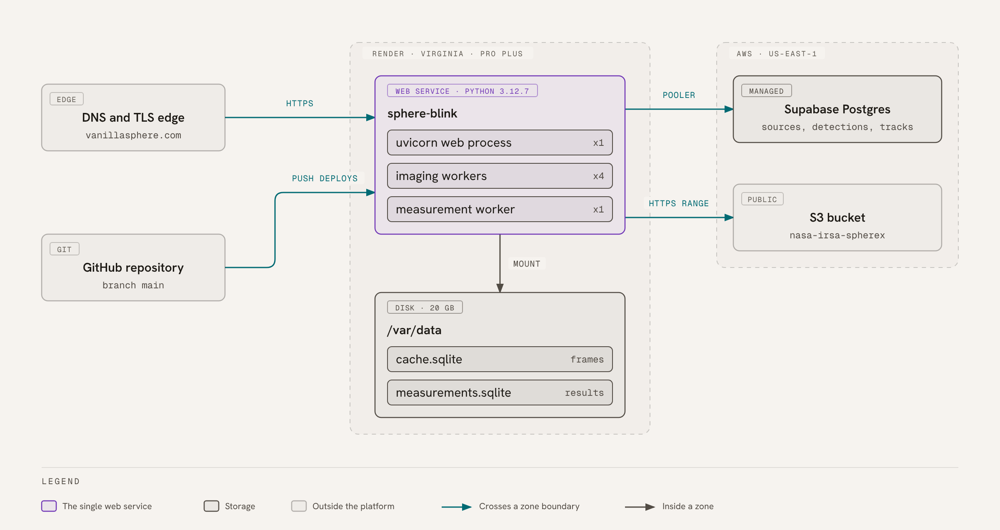
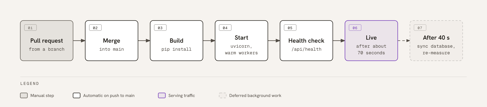

# Deployment and operations

This document describes the production service. The dev site in front of it,
and the path a change takes from a branch to production, are in
[environments](environments.md).

## Production environment

| Item | Value |
| --- | --- |
| Public address | <https://vanillasphere.com> (primary), <https://www.vanillasphere.com> (redirects to the primary) |
| Hosting | Render web service, defined by the blueprint `render.yaml` |
| Region | Virginia (US East), the same AWS region as the SPHEREx bucket |
| Plan | Pro Plus: 4 CPU, 8 GB memory |
| Runtime | Python 3.12.7 |
| Persistent disk | 40 GB mounted at `/var/data` |
| Measurement database | Supabase Postgres in `us-east-1`, reached through the transaction pooler |
| TLS | Certificates issued and renewed by the hosting platform |
| DNS | Apex `A` record and `www` `CNAME` to the hosting platform, at the domain registrar |

<picture>
  <source media="(prefers-color-scheme: dark)" srcset="img/diagrams/deployment-dark.png">
  
</picture>

*Figure: Production environment. Source: [`diagrams/deployment.html`](diagrams/deployment.html).*

### Why this placement

The service reads hundreds of megabytes to several gigabytes from S3 for every
cold view. Placing it in the same AWS region as the bucket gives read rates of
85-220 MB/s and no cross-region latency on the four requests made per exposure.
The measurement database is in the same region for the same reason.

## Blueprint

`render.yaml` is the source of truth for the service:

```yaml
services:
  - type: web
    name: sphere-blink
    runtime: python
    region: virginia
    plan: pro plus
    buildCommand: pip install -r requirements.txt
    startCommand: uvicorn sphereblink.main:app --host 0.0.0.0 --port $PORT --workers 1
    healthCheckPath: /api/health
    domains: [vanillasphere.com, www.vanillasphere.com]
    disk: {name: cache, mountPath: /var/data, sizeGB: 20}
```

(Abbreviated; see the file for the environment variables and comments.)

Three points are essential:

1. **`--workers 1` and `WEB_CONCURRENCY=1`.** The application keeps jobs in the
   memory of the web process and starts its own worker processes for the heavy
   work. The platform otherwise sets `WEB_CONCURRENCY` to the CPU count, which
   would start four independent servers. See
   [architecture](architecture.md#concurrency-model).
2. **The cache directory is on the persistent disk.** `SPHEREX_CACHE_DIR` points
   to `/var/data/sphereblink`, so cached frames and stored measurements survive
   deploys and restarts.
3. **Process count, memory budget and disk budget follow the plan.** Keep
   `SPHEREX_FETCH_PROCS` equal to the CPUs of the plan, `SPHEREX_RAM_BUDGET_MB`
   well below its memory, and `SPHEREX_DISK_BUDGET_GB` plus
   `SPHEREX_ATLAS_BUDGET_GB` (the sky photograph's tiles share the disk) at about
   85 % of the disk at most (28 of the 40 GB in production).

## Configuration

All settings are environment variables, read in `sphereblink/config.py` unless
noted.

| Variable | Default | Production | Meaning |
| --- | --- | --- | --- |
| `SPHEREX_SIA_URL` | `https://irsa.ipac.caltech.edu/SIA` | default | Exposure search service |
| `SPHEREX_COLLECTIONS` | `spherex_dr1,spherex_qr3` | default | Collections to search, newest first |
| `SPHEREX_S3_HTTP_BASE` | `https://nasa-irsa-spherex.s3.us-east-1.amazonaws.com` | default | Where files are read from |
| `SPHEREX_CACHE_DIR` | `.cache/sphereblink` | `/var/data/sphereblink` | Location of the SQLite files |
| `DATABASE_URL` | empty | set in the dashboard | Postgres connection string; empty means local storage only |
| `SPHEREX_MAX_FOV_ARCMIN` | `51` | default | Largest field of view |
| `SPHEREX_WIDE_FOV_ARCMIN` | `12` | default | Above this a view is a mosaic and searches on a lattice |
| `SPHEREX_MAX_FRAMES` | `1200` | default | Exposures per view before thinning |
| `SPHEREX_FETCH_WORKERS` | `64` | default | Concurrent exposure reads, shared by the worker processes |
| `SPHEREX_MIRROR_HTTP_BASE` | `https://irsa.ipac.caltech.edu/ibe/data/spherex` | default | Second source of the same files, used when the bucket fails |
| `SPHEREX_KEEP_FEATURED` | `1` | default | After start, fetch the 8 arcmin views of the featured targets if they are not on disk; they are never evicted |
| `SPHEREX_REQUEST_THREADS` | `160` | default | Threads that answer requests |
| `SPHEREX_NAME_TTL_DAYS` | `30` | default | How long a resolved object name is kept on disk |
| `SPHEREX_RATE_*`, `SPHEREX_MAX_*` | see [security](security.md#request-limits) | default | Request limits per caller |
| `SPHEREX_ACTIVE_VIEWS` | `SPHEREX_FETCH_PROCS` | `4` | Views whose exposures are cut at the same time; the next ones wait in a queue. `0` removes the limit. Sized to the machine: see [performance](performance.md#how-many-jobs-at-once) |
| `SPHEREX_ACTIVE_MB` | `1200` | `2400` | Frames (MB) the views being cut may hold in memory together; a wide field that does not fit waits for another to finish. `0` removes the limit |
| `SPHEREX_QUEUE_PREVIEW` | `1` | default | A view in the queue gets its first four exposures at once; `0`: nothing before its turn |
| `SPHEREX_MEASURE_PROCS` | `2` | `2` | Measurements running at the same time, each in a process of its own; the next ones wait in a queue |
| `SPHEREX_MOVER_SEARCH` | `1` | default | `0` turns the blind search for moving objects off; the log stays readable |
| `SPHEREX_MOVER_MIN_FREE_MB` | `1800` | default | Memory that must be free in the container before a field is searched |
| `SPHEREX_FETCH_PROCS` | `min(4, CPU count)` | `4` | Imaging worker processes |
| `SPHEREX_RAM_BUDGET_MB` | `600` | `2000` | Frames kept in memory |
| `SPHEREX_DISK_BUDGET_GB` | `4` | `16` | Size of the frame cache on disk |
| `SPHEREX_ATLAS_BUDGET_GB` | `1` | `12` | Tiles of the sky photograph kept on disk, in all; above it the deep tiles least recently asked for are deleted |
| `SPHEREX_ATLAS_KEEP_ORDER` | `3` | `6` | Tiles of this HiPS order and below are never deleted (orders 0-5 are 1.65 GB, 0-6 about 7.2 GB; one more is 29 GB more) |
| `SPHEREX_ATLAS_SEED` | `0` | `1` | After start, fetch every tile of those orders that is not on disk yet (about 40 minutes the first time, nothing afterwards; it stops with less than 4 GB free on the disk) |
| `SPHEREX_ATLAS_URL` | IRSA's 2MASS colour HiPS | default | Where the tiles are fetched from |
| `SPHEREX_ATLAS_FETCHES` | `8` | default | Tiles fetched from the archive at the same time |
| `SPHEREX_AUTO_MEASURE` | `1` | default | Measure the featured targets after start; `0` disables (read in `measure_api.py`) |
| `SPHEREX_AUTO_MEASURE_DELAY` | `40` | default | Seconds after start before automatic measurement begins |
| `SPHEREX_WARM_CATALOGS` | `1` | default | After start, store the Gaia and CatWISE overlays of the featured targets for every field size the viewer offers; `0` disables (read in `config.py`) |
| `WEB_CONCURRENCY` | - | `1` | Must be 1 |
| `PYTHON_VERSION` | - | `3.12.7` | Runtime version for the platform |

### Secrets

`DATABASE_URL` is the only secret. It is entered in the hosting dashboard
(`sync: false` in the blueprint) and never appears in the repository. It uses the
role `blink_service` through the provider's transaction pooler; the driver is
configured without prepared statements (`prepare_threshold=None`), as that
pooling mode requires. To rotate the password, change the role's password in
the database and update the variable in the dashboard together.

## Database setup

On a fresh Postgres 15+ database, once:

```bash
psql "$OWNER_URL" -f sql/schema.sql    # tables, indexes, sources_near, row level security
psql "$OWNER_URL" -f sql/roles.sql     # roles blink_service, blink_loader, blink_web and policies
```

Then set a password for each role that will be used (`alter role ... password
'...'`) and share it privately. The scripts are idempotent for the tables and
columns (`create table if not exists`, `add column if not exists`).

The service does not need the database to run. Without `DATABASE_URL`,
measurements are kept in the local SQLite store and `/api/tracks` serves them
from there. When a database is connected later, results stored locally are
written to it at the next start.

## Release process

<picture>
  <source media="(prefers-color-scheme: dark)" srcset="img/diagrams/release-flow-dark.png">
  
</picture>

*Figure: Release process. Source: [`diagrams/release-flow.html`](diagrams/release-flow.html).*

1. Changes are made on a branch (`feat/...`, `fix/...` or `chore/...`), merged to
   `develop` through a pull request, looked at on the dev site, and promoted
   by a pull request from `develop` to `main`. See
   [environments](environments.md).
2. A push to `main` triggers a deploy. Build and start take about 70 s. This
   applies to every merge, including one that changes only `docs/`, unless the
   deploy is skipped (see below).
3. Because the service has an attached disk, the old instance stops before the
   new one starts: there is an interruption on each deploy. On 2026-11-14 the
   site answered HTTP 502 for at least 35 s during a deploy; the logs showed
   that 30 s of it was the old server waiting for open connections until the
   host killed it. The server now leaves at once
   (`--timeout-graceful-shutdown 3` and `main._stop_fast`): at the deploy of
   08:23 UTC the same day it was gone 0.1 s after the stop signal, and the
   site was away for 27 s. That remainder is the host's: 17 s until the new
   instance's process starts and 10 s until its health check passes. It
   cannot be shortened from the code while one instance holds the disk. The
   viewer waits and retries by itself while the site is away.
4. Jobs in memory are lost on a deploy. Cached frames remain on disk, so open
   views resume from the cache when requested again. A measurement in progress
   is abandoned and can be requested again.
5. Forty seconds after start, the service pushes any locally stored results the
   database lacks and re-measures featured targets whose results are missing,
   older than seven days, or from an earlier pipeline version.

### Merging without a deploy

A change that does not affect the running service, such as an edit to `docs/`,
does not need a deploy. Render skips the automatic deploy when the commit
message contains `[skip render]` (its documentation also lists `[render skip]`,
`[skip deploy]` and `[skip cd]`). Put the phrase in the commit message and in
the title of the merge commit. The skipped deploy is listed on the service's
Events page, and the next ordinary merge deploys as usual.

`render.yaml` also lists `docs/`, `tests/`, `scripts/`, `.github/`, `render.dev.yaml`
and Markdown files under `buildFilter.ignoredPaths`, so a merge that touches nothing else is skipped even
without the phrase.

Do not use the phrase on a change to code, `web/`, `requirements.txt` or
`render.yaml`: the service would keep running the previous build.

### Post-deploy checks

The UI tests run by themselves after every merge to `main`, once the site
serves the merged commit ([environments](environments.md#ui-tests-after-every-merge));
their result is the check `ui-tests / production` on the merge commit. The
checks below look at the engine.

| Check | Expected |
| --- | --- |
| `GET /api/health` twice | `ok: true` and the same `instance` value both times |
| `GET /api/view?target=barnard&fov=8` | `job.status` reaches `ready`; `failed` is 0 |
| `GET /api/frame.png?target=barnard&fov=8` | A PNG image |
| `GET /api/measured` | `database: true`; the five featured targets listed after a few minutes |
| Open `/` | The sky map draws; a click opens a view |

### Warming the cache

After a deploy to a new disk, or when a new data release appears:

```bash
python scripts/prewarm.py https://vanillasphere.com --fov 4,8,15 [coords.txt]
```

This opens every featured target (and every `ra dec` line of the optional file)
at each field of view, waits for the server to read all exposures, and prints
the time taken.

## Running locally

```bash
python -m venv .venv && . .venv/bin/activate
pip install -r requirements.txt
uvicorn sphereblink.main:app --port 8000
# open http://localhost:8000/?target=barnard
```

Requirements: Python 3.12 (the production version; the tests also pass on 3.13)
and outbound HTTPS to the archive services.
No account, key or database is needed. The cache is created under
`.cache/sphereblink`. Set `SPHEREX_AUTO_MEASURE=0` to prevent the automatic
measurement of the featured targets during development, and
`SPHEREX_FETCH_PROCS` to the number of cores available.

Tests:

```bash
pip install pytest
SPHEREX_AUTO_MEASURE=0 pytest -q
```

## Monitoring

| Signal | Source | Meaning |
| --- | --- | --- |
| Liveness | `/api/health`, polled by the platform | The web process answers |
| Single-process invariant | `instance` in `/api/health` | Must not change between calls except across a restart |
| Job statistics | `job.stats` in `/api/view`, `/api/cube`, `/api/tiles` | Seconds by phase, megabytes read, request count, failed exposures |
| Measurement state | `/api/measured` | Pipeline version, database connection, running jobs, stored results |
| Application log | Platform log stream | Warnings for failed name lookups, database write failures, failed measurements |
| Resource use | Platform metrics | CPU, memory, disk |

## Runbook

| Symptom | Likely cause | Action |
| --- | --- | --- |
| Progress jumps backward or differs between polls; views load several times slower than expected | More than one web process | Confirm with `/api/health` (`instance` changes); restore `--workers 1` and `WEB_CONCURRENCY=1` |
| Views fail with 502 "data archive error" | IRSA SIA unreachable and no cached exposure list | Check the archive's status; previously opened views keep working from the cache |
| Many exposures counted as `failed` | S3 or network errors | The job completes with the rest. Failed exposures are not cached, so they are read again the next time the view is loaded from disk (after it has left memory, or after a restart) |
| Name search answers 503 | CDS name services unreachable | Coordinates and featured targets still work; add a mirror in `resolve.SESAME_URLS` if an outage persists |
| Overlays do not load | IRSA TAP slow or down | The viewer retries three times; untick and tick the overlay to retry |
| `/api/measured` shows `database: false` or results with `in_database: false` | `DATABASE_URL` missing, wrong, or the role cannot write | Fix the variable; results are written at the next start |
| Memory pressure | Frame budget too high for the plan | Lower `SPHEREX_RAM_BUDGET_MB`; views are reloaded from disk when needed |
| Disk full | The two disk budgets together above the disk size, or other files on the disk | Lower `SPHEREX_DISK_BUDGET_GB` or `SPHEREX_ATLAS_BUDGET_GB`; each cache trims itself after its next fetch. `/api/atlas` reports the free space; below 1 GB no new sky tile is stored |
| Stored measurements look outdated after a method change | Pipeline version not raised | Raise `measure_api.VERSION` and deploy |
| A view shows stale pixels after a change to the cutout code | Frame cache key not versioned | Raise the version tag in `cutout.cache_key` and deploy |

## Changing capacity

| Change | Steps |
| --- | --- |
| Larger plan | Change `plan` in `render.yaml`; set `SPHEREX_FETCH_PROCS` to the new CPU count and raise `SPHEREX_RAM_BUDGET_MB` accordingly |
| Larger disk | Change `sizeGB`; raise `SPHEREX_DISK_BUDGET_GB` and `SPHEREX_ATLAS_BUDGET_GB` to about 85 % of it together |
| New data release | Add the collection name at the front of `SPHEREX_COLLECTIONS`; exposure lists refresh within 24 hours |

## Cost drivers

The running cost is the hosting plan, the disk and the database tier. The
archive data are free to read: the bucket is public and needs no account. No
per-request third-party service is used.
