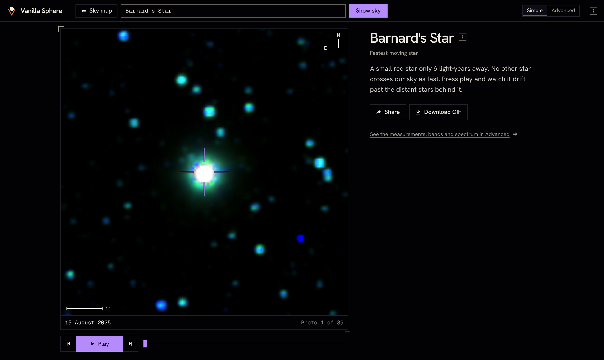

# Features

Functional specification of the user-facing features. Each section states what
the feature does, how the user reaches it, and which part of the system
implements it. Implementation detail is in [imaging engine](imaging-engine.md),
[measurement pipeline](measurement-pipeline.md) and [viewer](viewer.md).

## Feature summary

| # | Feature | Mode | Implemented in |
| --- | --- | --- | --- |
| 1 | Sky map start screen | Simple, Advanced | `web/starmap.js`, `web/data/sky.json` |
| 2 | Search by coordinates or object name | Simple, Advanced | `sphereblink/resolve.py` |
| 3 | Simple and Advanced modes | - | `web/app.js` (`setUi`) |
| 4 | Blink movie of on-demand cutouts | Simple, Advanced | `cutout.py`, `service.py`, `render.py`, `web/app.js` |
| 5 | False colour and detector bands D1-D6 | Advanced (Simple shows false colour) | `render.py` (`build_color_epochs`, `build_epochs`) |
| 6 | Frame grouping: exposure, day, sky pass | Advanced | `render.py` (`_groups`) |
| 7 | Image arithmetic | Advanced | `web/app.js` (client side), `render.difference` (server side) |
| 8 | Progressive fields, up to 7 x 7 cells | Advanced | `tiles.py`, `web/app.js` (`loadField`) |
| 9 | Spectrum and flux over time at the crosshair, with a preliminary reading of the spectrum | Advanced (Simple shows one sentence of the reading) | `main.api_spectrum`, `cutout.aperture_flux`, `wings.py`, `web/insight.js` |
| 10 | Gaia DR3 and CatWISE2020 overlays | Advanced | `catalogs.py`, `web/app.js` (`drawOverlays`) |
| 11 | Automatic measurement of position, motion, brightness | Advanced | `measure.py`, `refcat.py`, `measure_api.py` |
| 12 | "Measure motion and brightness" | Advanced | `web/app.js` (`measureHere`), `/api/measure` |
| 13 | Measured tracks overlay | Advanced | `measurements.py`, `/api/tracks` |
| 14 | Per-frame quality flags and provenance | Advanced | `cutout.py`, `render.Epoch.meta` |
| 15 | Share links, embeddable GIF and PNG, data API | Simple, Advanced | `main.py`, `web/app.js` (`writeUrl`) |
| 16 | Featured targets | Simple, Advanced | `resolve.FEATURED`, `refcat.TARGETS` |
| 17 | Blind search for moving objects, with a log ("Discoveries"), names, follow and votes | Advanced | `movers.py`, `mover_store.py`, `movers_api.py`, `known_objects.py`, `web/movers.js` |
| 18 | Distance and redshift: the object of a view, the sky map by redshift, comparing spectra in the rest frame, a redshift read from the emission lines of the spectrum | Simple, Advanced | `distance.py`, `/api/object`, `scripts/build_redshift.py`, `web/depth.js`, `web/redshift.js` |

## 1. Sky map start screen

The product opens on a drawn map of the sky, the same for both modes. The
first view looks at the centre of the Milky Way, close enough that the
photograph of the real sky shows behind the chart: Sagittarius to the left of
the dust lanes, Antares and Scorpius to the right. About 64 degrees of sky
fit across the screen. The whole-sky button (or zooming out) shows the entire
sky as one oval with the featured targets marked.

*The start screen: the map opens on the centre of the Milky Way.*

- **Projection.** Hammer equal-area, east to the left as on the sky. Dragging
  turns the sphere; near the centre the scale is uniform, so a zoomed-in map is
  an undistorted local chart.
- **Content.** Stars to magnitude 6 (fainter stars appear as the map is
  zoomed), proper names of stars to magnitude 3, constellation figures and
  names, and the Milky Way as a soft glow. Each star has the colour of its
  measured colour index and, when the map is zoomed in, looks like a star in
  a photograph: a bright core, a soft glow and, for the brightest, thin
  spikes.
- **The real sky behind it.** Zoomed in past about twice the whole-sky view, a
  photograph of the real sky fades in behind the chart: the 2MASS
  near-infrared atlas, served by the NASA/IPAC Infrared Science Archive. The
  Milky Way's dust lanes, the Orion Nebula, clusters and countless faint
  stars lie exactly under the drawn ones. A line on the map names the survey
  and says it is a backdrop, not SPHEREx data. If the archive does not
  answer, the drawn map stays as it is.
- **Interaction.** Drag to turn, scroll or pinch to zoom, click to open a view
  at that point. Pointing and clicking snap to the nearest star on the map, so
  a click on a star opens that star (by its name when it has one); holding Alt
  picks the exact point under the pointer instead. Keyboard: arrow keys pan, `+` and `-` zoom, Enter opens the
  centre. Buttons zoom in, zoom out, reset to the whole sky and fill the screen with the map alone (full screen; Esc or the same button leaves it).
- **Readout.** The coordinates under the pointer and the constellation they
  fall in (from IAU boundaries precomputed on a 1 degree grid).
- **Featured targets** are pinned on the map and listed in a "Start here"
  panel (Simple) or "Featured targets" panel (Advanced).
- **No dependencies.** The map is drawn on a canvas by `web/starmap.js` from a
  single compact data file, `web/data/sky.json`, built by `scripts/build_sky.py`.
  The photograph behind it (`web/atlas.js`) is an extra: the map is complete
  without it.
- **A sky that moves.** The space around the map is a deep field of faint
  stars over a muted Milky Way (a band of violet cloud with dust lanes, drawn
  in code), with a violet glow around the rim of the sky; the map turns slowly
  while nobody uses it; an aiming frame follows the pointer and closes on the
  picked point, with its coordinates; the featured targets ping; now and then
  a meteor crosses. All of it is in `web/ambient.js`, stops for people who ask
  for reduced motion, and never gets in the way of the map (see
  [Viewer](viewer.md#motion-on-the-map-screen)).

Returning from a view to the map centres the map on the position just viewed
and marks it.

### What you can do here

Under the map, between the start list and the zoom buttons, a strip of six
cards says what the product does, and each card opens a live example instead
of describing one (added 2026-11-14 on a teammate's request to list the
features on the first screen):

| Card | Opens |
|---|---|
| Blink the sky | Barnard's Star, in the mode the reader is in |
| Catch what moves | the Discoveries log of the blind search |
| Read a spectrum | Epsilon Indi B in Advanced, on the spectrum and its reading |
| Watch it change | R Draconis in Advanced, on the plot over time |
| See how far | the redshift layer of the map, from z > 1 |
| Take the data | the "About the data" page |

The strip fades when the map is zoomed in and is hidden in full screen. On a
phone it is a row of its own above the start list, scrolled sideways, with the
titles only. The code is `web/showcase.js`.

## 2. Search by coordinates or object name

The search box accepts three kinds of input, resolved by
`sphereblink/resolve.py`:

| Input | Example | Resolution |
| --- | --- | --- |
| Decimal degrees | `269.4486 +4.7387` or `269.4486, 4.7387` | Parsed locally; RA in [0, 360), Dec in [-90, 90] |
| Sexagesimal | `08h55m10.831s -07d14m42.53s` | Parsed locally with Astropy, hours and degrees |
| Featured target or alias | `barnard`, `GJ 699`, `WISE 0855`, `R Dra` | Built-in table, no network |
| Any other object name | `Vega`, `M31`, `TRAPPIST-1` | CDS Sesame (SIMBAD, then NED, then VizieR), with SIMBAD TAP as fallback |

Objects with a known proper motion are placed where they are at the SPHEREx
epoch (2025.9), not at their catalogue epoch. For Barnard's Star this moves the
view centre by 4.5 arcmin from its J2000 position, which is the difference
between the star being in the picture and not.

Error handling distinguishes two cases: an unknown name is a user error (HTTP
400, "check the spelling or give coordinates"), while unreachable name services
are a service error (HTTP 503, "try again shortly or give coordinates"). A
mistyped name leaves the current view on screen.

## 3. Simple and Advanced modes

A two-position switch in the top bar selects the interface. The choice is
stored in the browser (`localStorage` key `vs.ui`) and carried in links as
`ui=simple` or `ui=adv`. Simple is the default for a first visit.

*Simple mode: one picture, a short description, play, share and download.*

*Advanced mode on Barnard's Star at 8 arcmin: bands, grouping, image arithmetic,
overlays, the measured track and the spectrum at the crosshair.*

| | Simple | Advanced |
| --- | --- | --- |
| Audience | Everyone | Astronomers, the search team |
| Picture | False colour, one frame per day, 8 arcmin | Any band, grouping, field size or progressive field |
| Text | Object name, kind, a short description in plain language | Coordinates, epoch metadata, flags |
| Controls | Play, slider, Share, Download GIF | Bands, grouping, image arithmetic, contrast, overlays, speed, timeline |
| Analysis | - | Spectrum, flux over time, measured tracks, "Measure motion and brightness", cross-links |
| Search placeholder | "Search a star or galaxy by name" | "RA Dec or an object name" |

Switching keeps the target and the frame on screen. Settings chosen in Advanced
are restored when the user returns to it. A link that carries display
parameters (`det`, `group`, `mode`, `gaia`, `catwise`, `levels`) opens in
Advanced even without `ui=adv`.

For the five featured targets, Simple mode shows a two- or three-sentence
description written for a general reader. For any other position it names the
constellation and explains what to look for.

## 4. Blink movie of on-demand cutouts

The core feature. For a requested position and field of view the server:

1. asks the archive which exposures cover the position;
2. reads the needed pixels of each exposure by HTTP range request;
3. masks bad pixels, subtracts the sky background, and resamples each exposure
   onto one north-up grid centred on the target;
4. combines the frames into epochs and sends them to the browser as one binary
   cube.

The browser plays the epochs in time order.

- **Field of view.** 4, 8 (default), 15 or 30 arcmin in the Field menu; any
  value from 1 to 51 arcmin through the API. Views up to 12 arcmin are drawn at
  half the native pixel (3.075 arcsec) so that sub-pixel shifts between epochs
  are visible; wider views use the native 6.15 arcsec.
- **Progressive loading.** The cube is requested repeatedly while exposures are
  still arriving, so the movie grows on screen and a progress bar reports
  "Reading exposure N of M from NASA's archive".
- **Shared stretch.** One asinh contrast stretch is computed across all epochs,
  so an object that brightens in the movie has brightened in the data. A
  contrast slider adjusts it; Reset returns to automatic.
- **Transport.** Play and pause, previous and next frame, a time slider, speed
  of 1, 3, 6 or 12 frames per second (Advanced). Keyboard: space bar plays or
  pauses, left and right arrows step. The movie pauses on the last frame before
  looping.
- **Timeline.** A strip of the real observation dates (UTC); clicking or
  dragging jumps to that date. It makes the six-month cadence of the survey visible.
- **Orientation aids.** North up, east left, with a compass, a scale bar, and a
  crosshair on the target. Double-clicking the image recentres the view on that
  point.
- **Zoom.** The image can be magnified up to 16 times: the mouse wheel or a
  trackpad pinch zooms about the pointer, the `+` and `-` buttons at the lower
  right (and the same keys) about the middle, and dragging moves the magnified
  image. Zooming out stops at the whole view (1.0): the image is never shown
  smaller than that. A readout shows the factor and returns to the whole view
  on a press (key `0`). Overlays, the scale bar and the pointer's coordinates
  follow the zoom; a new position starts whole, a progressive field that grows
  keeps what is on screen.
- **No data.** Pixels without data are drawn in a distinct warm dark tone, never
  as black sky.

## 5. False colour and detector bands D1-D6

SPHEREx has six detectors:

| Detector | Wavelength range (um) |
| --- | --- |
| D1 | 0.75-1.09 |
| D2 | 1.10-1.62 |
| D3 | 1.63-2.42 |
| D4 | 2.42-3.82 |
| D5 | 3.83-4.41 |
| D6 | 4.42-5.00 |

The Bands control offers:

- **RGB (default).** False colour with the longest wavelengths in red:
  red = D6 (or D5), green = D4 (or D3), blue = D2 (or D1). Each channel uses
  its preferred detector and falls back to the neighbouring one.
- **All bands.** The six detectors averaged after per-frame noise normalisation.
- **Any subset of D1-D6.** For example D5 and D6 to look for very cold objects.

Because a position is observed by only one or two detectors on a given day, a
colour channel missing on a date is borrowed from the nearest date that has it,
and masked pixels are filled from neighbouring dates of the same channel. The
metadata of each epoch records the detector and date of every channel and
whether it was borrowed; the interface shows this under "This frame", and
rendered PNG and GIF frames mark a borrowed channel with an asterisk. A frame is
never presented as a simultaneous three-colour observation.

Each detector is put on a common display scale (its median sky at zero, its
bright stars at one) so that a channel keeps its level when the detector feeding
it changes from one date to the next. Brightness follows an asinh curve of the
mean of the three channels while the channel ratios are preserved, so a star
keeps its colour from its faint wings to its core.

## 6. Frame grouping

"One frame per" selects how exposures are combined into epochs:

| Grouping | Definition | Use |
| --- | --- | --- |
| Exposure | One epoch per exposure | Finest time sampling; inspect individual frames |
| Day (default) | Exposures of the chosen detectors on the same UTC day, averaged | Good signal-to-noise with day resolution |
| Sky pass | Exposures separated by gaps of at most 20 days, averaged | Deepest images; one epoch per six-month visit |

Before averaging, each frame is divided by its own robust noise level, so
exposures at different wavelengths and background levels contribute comparably.

## 7. Image arithmetic

Four modes, computed in the browser on the decoded cube so that switching is
immediate:

| Mode | Operation | Shows |
| --- | --- | --- |
| Blink | The epochs as they are | The scene; whatever moves appears to jump |
| - Median | Each epoch minus the per-pixel median of all epochs | Static stars vanish; a mover appears where it is now |
| - Reference | Each epoch minus a chosen reference epoch | What changed since that date |
| Sum all | Mean of all epochs scaled by the square root of their number | One deep image of the field |

Difference modes use a symmetric stretch around zero (white brighter, black
fainter). The server implements the median difference as well
(`diff=true` on `/api/frame.png` and `/api/movie.gif`) so that shared GIFs can
show it.

## 8. Progressive fields

Wide-area inspection on the team's measurement grid. The sky is divided into a
fixed ICRS grid of 3000 x 1500 cells of 0.12 degrees, named
`icrs012-v1-XXXX-YYYY`. A progressive field of level N is the seed cell that
contains the requested position plus N rings of cells around it:

| Level | Cells | Width | Field menu entry |
| --- | --- | --- | --- |
| 0 | 1 | 7.2 arcmin | - |
| 1 | 3 x 3 = 9 | 21.6 arcmin | "22' - 3x3 cells" |
| 3 | 7 x 7 = 49 | 50.4 arcmin (0.84 degrees) | "50' - 7x7 cells" |

*A level 3 field (7 x 7 cells, 50.4 arcmin) with the cell grid overlay. The
minimap at the top left shows which cells have arrived.*

- **Staged loading.** The field loads in stages: the seed cell, then its first
  ring, then the whole block. The centre is on screen after seconds while the
  rings fill in behind it; the picture is always the widest stage that has
  finished.
- **One mosaic per stage.** Each stage is one view centred on the seed cell, so
  an exposure is read once for the whole block, not once per cell.
- **Cell grid overlay.** The outlines of the cells are drawn on the image, with
  a small block map that fills in as rings arrive. The pointer readout shows
  the cell identifier under the cursor.
- **Drill-down.** A 7 x 7 mosaic is sent to the browser at overview resolution
  (2 x 2 binning). Double-clicking a cell opens it as a plain 8 arcmin view at
  full detail.
- **Shared addressing.** Cell identifiers are identical to those of the team's
  offline measurement runs, so images and measurements refer to the same cells.

The stages are ordinary views, so every other endpoint (cube, PNG, GIF, epochs,
spectrum) works on a stage by passing its `ra`, `dec` and `fov`.

## 9. Spectrum and flux over time

Each exposure sees the target through one narrow slice of a linear variable
filter. The exposures of a position therefore sample the whole 0.75-5.0 um
range, and the product assembles them into a spectrum without any dedicated
spectral data product.

- **Measurement.** A sky-subtracted circular aperture of radius 2 native pixels
  at the centre of the view, on the detector pixels (before resampling), with an
  empirical error from the scatter of the surrounding sky annulus.
- **Wavelength.** The central wavelength and bandwidth at the target's detector
  position, from a per-detector wavelength map read once from the file's
  spectral WCS.
- **Spectrum plot.** Flux density against wavelength, coloured by sky pass. A
  change between passes at the same wavelength indicates variability. The axis
  switches from mJy to Jy for bright stars.
- **Over time plot.** Flux density of every exposure against its date, coloured
  by detector (the tab was called "Light curve" until 2026-11-14). SPHEREx
  returns to a place about every six months and stays for days to weeks, so the
  exposures fall into groups of days with empty months between them. The time
  axis gives every group its own stretch and cuts the empty months out, marked
  by a double stroke (`groupedAxis` in `web/overtime.js`; groups are separated
  by gaps of more than 20 days). Since each exposure samples a different
  wavelength, the spread inside a group is the object's spectrum; a change of
  the object shows as one colour shifting from group to group. Inside each
  group a line joins the points of one detector in order of time (Duy's idea),
  so a colour can be followed; no line crosses the months cut out.
- **One group at a time.** A click on a group of days enlarges it to the whole
  width of the plot, at the same flux scale; a second click brings all groups
  back. The row under the plot (`#otnav`: previous, next, "All groups") steps
  through the groups and names the one on screen with its dates (`showGroups`,
  `stepGroup`, `plotClick` in `web/app.js`; the enlarged group is the one that holds the date `S.otZoom`,
  forgotten when a new view is loaded). The PNG export saves what is on screen.
- **Did it change?** A line under the Over time plot answers in words
  (`brightnessChange` in `web/overtime.js`, the method of the pipeline's
  [light curve](measurement-pipeline.md#6-light-curve) applied to the points of
  `/api/spectrum`): every flux is divided by the object's own spectrum at its
  wavelength, the visits (groups of days, a long stay cut into parts of about
  30 days) are compared, and the brightest is set against the faintest.
  "Brightness changed" needs 3 sigma, with a floor of 5 % per visit for aperture
  fluxes and 12 % for the halo fluxes of saturated stars; otherwise the line
  says "No significant change" and by how much the visits differ, "One visit
  so far", or "Too faint to compare" (median signal to noise below 3). When
  the object changed, the Over time tab carries a small mark, whichever plot is
  open. On 2026-11-14: R Draconis about x1.9 between 2025-06 and 2026-06
  (3.8 sigma); Barnard's Star, Vega and Epsilon Indi B steady within 4-7 %;
  RW Aurigae 23 % (1.2 sigma, not significant).
- **Quality marks.** A point is flagged when a pixel of its aperture was left
  out of the sum (`PARTIAL`) or carries a defect flag such as `HOT` or
  `PERSIST`. The flags a bright source sets on its own core (`OVERFLOW`,
  `TRANSIENT`, `SUR_ERROR`, `BLOOM`) do not count: those pixels are measured
  ([why](imaging-engine.md#flagged-pixels-in-the-aperture)). Flagged points
  are left out of the plot by default, on the advice of an outside researcher
  (2026-11-14). A button in the legend ("Show N flagged") brings them back,
  drawn hollow. If a plot has no other points they are shown anyway. The CSV
  always holds every point with its flags; the PNG shows what is on screen and
  says how many points were left out.
- **Saturated stars.** Where the core saturates the detector, the flux is
  measured from the star's halo instead (see
  [bright-star photometry](measurement-pipeline.md#bright-star-photometry)).
  These points are drawn as diamonds with a 20-25 % systematic error; hollow
  diamonds lie above the calibrated range and are to be read as relative
  brightness only.

The same data are served as JSON by `/api/spectrum`.

Two buttons under the plot save it (`web/exports.js`): **CSV** writes one row
per exposure (wavelength, bandwidth, flux and error in µJy, MJD and UTC date,
detector, method, flags, the exposure id and the address of its Level 2 file at
IRSA), under comment lines that give the target, the position, the data
credit and the link of the view. **PNG** saves the plot on screen, spectrum
or flux over time (with its line on the change), with its key and the NASA credit.

### Preliminary reading of the spectrum

Under the plot the viewer writes what the curve shows, in sentences, with the
numbers behind each one (`web/insight.js`, run in the browser on the points of
`/api/spectrum`). It is labelled "Preliminary reading" and carries a
confidence level (low, moderate or good) and the limits that apply. Every
statement is a fixed test on the measured points: no language model and no
training set is involved, so the same curve always gives the same reading and
each sentence can be checked against the plot. The wavelengths it looks at
are not its own: they come from a catalogue of reference wavelengths
(`web/linelist.js`, described below), and every name on the plot can be
traced to its source there.

The tests, in order:

1. **Which points can be read.** Halo ("wings") points are compared with
   direct aperture points at the same wavelengths. If they differ by more
   than a third, only one kind is read and the reading says how many points
   were left out and why. A halo three or more times too bright is not one
   star (a galaxy, a nebula, a crowded field): the direct points are kept.
2. **Change between sky passes.** Each pass is compared with the
   best-sampled one at the same wavelengths. A pass that differs by more than
   10 % is brought to its level, so that a variable source does not leave
   steps in the curve that look like bands.
3. **Whether a source is there.** If four in five points are below 3σ the
   reading says so and stops.
4. **Continuum.** Where the binned curve peaks, its slope in log-log (the
   whole range, below 1.7 µm, above 2.3 µm), and the blackbody closest to it
   with the range of temperatures that fit nearly as well.
5. **Bands and lines at the wavelengths of the catalogue.** Water vapour at
   1.4, 1.9 and 2.7 µm, methane at 3.3 µm, water ice at 3.0 µm, carbon
   dioxide at 4.27 µm; in emission, the hydrogen lines of the Paschen,
   Brackett and Pfund series, helium, [S III], [Fe II] and the 3.3 µm PAH
   band (18 lines between 0.9 and 4.7 µm). A band is the flux inside a
   window against a continuum drawn between a window on each side; a line is
   the points whose passband holds the wavelength against the points just
   outside. The noise is taken from the differences of neighbouring points.
   A feature counts at 4σ and above; names of the detected ones are drawn
   along the top of the plot, with a question mark when they are not firm.
   Lines closer than 1.3 channels are one measurement at this resolution
   (He I 1.083 µm and Paschen γ, the PAH band and Pfund δ): it is given to
   the line that is usually the stronger and the other is named with it. A
   weak member of a series (Paschen δ, Pfund γ, the second line of a
   doublet) is only named when the strong lines are there: alone it is
   listed as a bump.
6. **With a published redshift.** When the catalogues give the object a
   redshift of 0.01 or more (feature 18), the lines are looked for at
   rest wavelength × (1 + z). That brings Lyman α, C IV, C III], Mg II,
   H β, [O III] and H α into range, and the bands of cool stars and of ices
   are left out. The redshift is the published one and the reading says so:
   it uses the redshift, it never measures it.

The reading then names the kinds of object that give such a curve:

| Reading | Rests on |
| --- | --- |
| Emission lines of ionised gas | Two strong hydrogen lines, or one with another strong line beside it or standing 1.6 times above the continuum |
| Emission lines at the published redshift | Two strong lines where the redshift puts them, or one standing 1.6 times above the continuum |
| Ice absorption | The 3.0 µm band deepest at 3.0 µm, or carbon dioxide on a rising curve |
| Brown dwarf atmosphere | Methane at 3.3 µm together with water vapour |
| Cool star with water vapour | Two water bands or more |
| Two components | A falling curve with extra light beyond 4 µm |
| Red source | Flux still rising beyond 2.3 µm |
| Hot photosphere | A smooth fall from the blue end, about λ^−2 |
| Cool photosphere | A peak inside the range; a blackbody temperature if one fits within about a third |
| Flat spectrum | No slope and no peak |
| Too bright, only part readable, no source | More than half the points above the calibrated range of the halo method; less than 45 % of the range sampled; nothing above the noise |

What it does not do: it does not classify the object or measure a redshift,
and without a published redshift it does not look for lines away from their
rest wavelengths (a single line is reported as possible, "or another line
moved there by redshift"). Between deep molecular
bands the continuum stands up in narrow peaks that this resolution cannot
tell from emission lines, so with such bands no line is claimed. Confidence
drops with saturation, noise, gaps in the curve, changes between passes and
points left out; a reading that rests on a strong band or line does not
depend on the brightness scale and keeps its level.

Checked on 14 real spectra (`tests/data/spectra/`): Epsilon Indi B (water and
methane), Elias 16 and Elias 29 (water and carbon dioxide ice), NGC 7027
(hydrogen lines, PAH), G191-B2B (hot tail), WISE 0855 (a background star plus
the cold dwarf's light beyond 4 µm), Barnard's Star (3,000 to 3,700 K;
catalogue 3,200 K), 3C 273 (red, a possible line at 2.17 µm), RW Aurigae
(red), R Draconis (water bands, low confidence), Vega (too bright), NGC 3379
and Sgr A* (only part readable), an empty field (no source). On 14,400
made-up featureless spectra with noise, with and without a 30 % change
between passes, no firm band or line appeared, at rest and at seven
redshifts from 0.16 to 6.3.

Checked with published redshifts on four quasars (three more spectra in
`tests/data/spectra/`). Read at rest wavelengths, each is "a red source, no
band or line". Read at its redshift:

| Quasar | z | Lines found where the redshift puts them |
| --- | --- | --- |
| 3C 273 | 0.158 | He I 1.083 µm with Paschen γ at 1.25 µm (×1.4, 6.9σ), Paschen α at 2.17 µm (×1.2, 4.5σ): the "possible line at 2.17 µm" of the reading at rest |
| PG 1634+706 | 1.337 | H α at 1.53 µm (×3.1, 96σ), H β with [O III] at 1.14 µm (11σ), He I at 2.53 µm (20σ), Paschen α at 4.38 µm (11σ) |
| APM 08279+5255 | 3.911 | H α at 3.22 µm (×2.5, 98σ), H β at 2.39 µm (11σ), C IV at 0.76 µm (6.6σ), C III] at 0.94 µm (5.3σ) |
| SDSS J0100+2802 | 6.327 | H α at 4.81 µm (×2.1, 4.4σ), the only line, so the confidence is moderate |

#### Reference wavelengths

`web/linelist.js` holds every wavelength the reading looks at, with the
source of each, and nothing else in the reading uses a wavelength. Under the
reading, "Reference wavelengths" opens a table with one row per band or
line: its name, species and transition, the reference wavelength (and where
the redshift puts it), what the curve shows there (found with its strength
and significance, possible, not seen, not separated from a neighbour, no
usable points), and the source. The full references follow the table.

| Kind | Entries | Source |
| --- | --- | --- |
| Atomic lines (25: H I Lyman α, Balmer α and β, Paschen α to δ, Brackett α to δ, Pfund β to δ; He I 1.0833 and 2.0587 µm; [S III] 0.9071 and 0.9533 µm; [Fe II] 1.2570 and 1.6440 µm; [O III] 0.4960 and 0.5008 µm; Mg II, C III], C IV) | Vacuum wavelengths, Ritz values where given, to 0.01 nm | NIST Atomic Spectra Database, version 5.12 (Kramida, Ralchenko, Reader and NIST ASD Team 2024, doi:10.18434/T4W30F), read on 2026-11-14 |
| Water vapour bands (1.38, 1.88, 2.7 µm), methane ν₃ (3.31 µm) | Band positions | HITRAN2020 (Gordon et al. 2022, JQSRT 277, 107949); the bands in M, L and T dwarfs: Cushing, Rayner and Vacca 2005, ApJ 623, 1115 |
| Water ice (3.05 µm), carbon dioxide (4.27 µm) | Band positions | Boogert, Gerakines and Whittet 2015, ARA&A 53, 541; Gibb et al. 2004, ApJS 151, 35 |
| PAH band (3.29 µm) | Band position | Tielens 2008, ARA&A 46, 289 |

The atomic wavelengths were read from the NIST database on the date given
and the hydrogen lines are checked in the tests against the Rydberg formula
(they agree to 0.002 %). A band seen at a resolving power of 40 has no single
wavelength: the catalogue gives the position the literature quotes to
0.01 µm, and the windows in which the band and its continuum are measured,
which are ours. The bibliographic details of the five papers were checked
against Crossref on 2026-11-14. The air wavelengths familiar from optical
spectra (H α 6563 Å, [O III] 5007 Å) are not used: SPHEREx wavelengths are
in vacuum (H α 0.65646 µm, [O III] 0.50082 µm).

In Simple mode one plain sentence of the reading is shown beside the
pictures ("What its light says"), and only when the reading names something
and its confidence is not low.

## 10. Catalogue overlays

Two optional overlays, queried through IRSA TAP and cached per view:

| Overlay | Catalogue | Mark | Magnitude shown |
| --- | --- | --- | --- |
| Gaia DR3 | `gaia_dr3_source`, positions at epoch 2016.0 | Circle | G |
| CatWISE | `catwise_2020`, positions at the mean observation epoch | Square | W2 |

- Every source is **moved by its proper motion to the date of the frame on
  screen**, so a catalogue mark follows a moving star through the movie.
- The 250 brightest sources of the field are fetched; the 40 brightest are
  marked to keep the image readable.
- **Fast movers are always marked**: a source with proper motion above
  150 mas/yr and a motion significance (`pm_snr`) of at least 5 is highlighted,
  with a line along its path over the time span of the movie and a label giving
  its motion in arcsec/yr. The significance test suppresses the large but
  meaningless motions that faint CatWISE entries often carry.

## 11. Automatic measurement

For any object the pipeline finds its position on the native detector pixels of
every exposure, compares it with the catalogue prediction for that date, and
fits a track. It runs without human input. Summary of the method (full
description in [measurement pipeline](measurement-pipeline.md)):

1. Read a small native stamp of each exposure by range request.
2. Predict the position from catalogue astrometry, with proper motion and parallax.
3. Fit a pixel-integrated Gaussian point-spread function, together with
   neighbouring Gaia stars so that a bright neighbour cannot capture the fit.
4. For an object too faint for single exposures, add the exposures of each sky
   pass along the predicted path and measure the stack.
5. Fit position and proper motion through all positions, with outlier rejection
   and jackknife errors.
6. Derive a light curve that is independent of wavelength.

The five featured targets are measured automatically shortly after the service
starts and again when the pipeline version changes or a week has passed.

## 12. Measure motion and brightness

In Advanced mode the "Measured in this field" card offers a "Measure this
object" button whenever nothing has been measured at the centre of the view. It
starts the pipeline for that position, reports progress ("Measuring N
exposures"), and after typically 20 to 45 seconds (63 s was observed for
Proxima Centauri on 2026-11-14) shows:

- the kind of object and the number of positions measured, with the time span;
- the fitted motion with its 1σ error and its significance (speed divided by
  error), next to the catalogue motion;
- the direction of the motion as a position angle (from north through east)
  with its error, and the two components μα* (east, μα cos δ) and μδ (north)
  with theirs;
- when the motion is below 3σ: "No significant motion detected" and an upper
  limit (speed + 3σ) instead of a speed, with no direction;
- the scatter of the positions around the fit;
- whether the brightness is steady or varies between sky passes, with the
  amplitude and its significance.

The pipeline measures what is at the crosshair. When it finds no source there
it says so ("No source at the crosshair, so there is no motion to measure").
When the light it found belongs to a source more than 3 arcsec away, the card
names the distance and direction of that source and offers "Measure that
source", which centres the view on it and measures it.

If the position matches a Gaia star within 4 arcsec, the star's astrometry is
used for the prediction; otherwise the position itself is measured as an object
of unknown motion. Results are stored and shown to every later visitor of the
field.

The (i) next to the name of a measured object opens a small chart of the sky
(north up, east left, in arcsec): the centroid of the object's light in every
exposure, faint for early and bright for late exposures, the fitted motion as
an arrow and the catalogue motion as a dashed arrow. Its note states what the
numbers are: the motion of the centroid on each exposure's WCS, across the sky
only (radial velocity would need Doppler shifts in spectra), with larger errors
for saturated or distorted stars. All of this is computed in the viewer
(`motionOf`, `trackTip` in `web/app.js`) from the fields `/api/tracks` already
returns.

## 13. Measured tracks overlay

Objects measured in the field are drawn on the image: every measured position
as a dot, the fitted track as a line, and a diamond on the positions measured
in the frame being shown. An arrow from the object shows where it is heading
when its motion is significant (3σ or more). The overlay reads `/api/tracks`, which merges the
pipeline's results with any measurements the team has loaded into the shared
database by other means.

## 14. Quality flags and provenance

For the frame on screen, the "This frame" card lists the UTC date, the
detectors, the source of each colour channel, the number of exposures combined,
the fraction of the field covered, and the SPHEREx quality flags present in the
aperture at the target. Every epoch also carries the identifiers of its
exposures, so any displayed image can be traced to the archive files it came
from (`/api/epochs`, `/api/exposures`).

The "Source files" card (Advanced, `web/exports.js`) shows that trace on the
page: the SPHEREx Level 2 exposures of the frame on screen, or all exposures
that cover the position, each with its UTC time, detector, wavelength range
and a link to the original FITS file at NASA/IPAC IRSA. The note under the
switch gives the size of the listed files (about 63 MB each; a file is 62 to 65 MB).

Three buttons take the list away. All three are written in the browser, and
every address in them is the archive's own, so no FITS file ever passes
through this service:

- **Download script** saves a POSIX shell script that fetches the listed files
  (the frame, or all) with curl, or wget where curl is missing, into a folder
  named after the target. Each file is written as `name.part` and renamed when
  complete, so a second run resumes a broken download and skips finished
  files. Only addresses that are plainly `https://` archive addresses are
  written, and the target name appears in comment lines only.
- **URL list** saves the same addresses, one per line, for `wget -i` or a
  download manager.
- **CSV** saves every exposure with its times, wavelength range, whether it is
  in the frame on screen, and its IRSA and S3 addresses.

"About the data" (in the same card, and on the data line of the start screen)
opens a page over the app: the structure of a Level 2 file (extensions IMAGE,
FLAGS, VARIANCE, ZODI, EPSF, WCS-WAVE), the six bands, the steps from file to
picture (find, cut out, mask, subtract the background, align, group, show),
how the photometry is done and what its limits are. Its text is fixed in
`index.html` and must follow [imaging engine](imaging-engine.md) when the
processing changes. The start screen states the source in one line: SPHEREx
Level 2 exposures, 0.75-5 µm, NASA/IPAC IRSA, processed on the fly.

## 15. Sharing, embedding and data access

- **Page link.** The address bar always reflects the view; "Share" copies it
  (or opens the system share sheet on touch devices).
- **GIF.** "Download GIF" and the "GIF" link return the movie as an animated
  GIF from `/api/movie.gif`, embeddable anywhere.
- **PNG.** `/api/frame.png` returns any single epoch.
- **Data.** `/api/spectrum`, `/api/epochs`, `/api/exposures`, `/api/measure`
  and `/api/tracks` return JSON.
- **Cross-links.** The position of the crosshair is given in decimal and
  sexagesimal form with links to the same field in WiseView, SIMBAD and Aladin Lite.

All endpoints allow cross-origin requests. See [API reference](api-reference.md).

## 16. Featured targets

The five test objects named by the challenge are built in. Their positions and
motions are held in the service so that they resolve without any network call:

| Key | Object | Why it is a test case |
| --- | --- | --- |
| `barnard` | Barnard's Star | Highest proper motion of any star (10.4 arcsec/yr) |
| `eps-indi-b` | Epsilon Indi B | Pair of brown dwarfs, 4.7 arcsec/yr |
| `wise-0855` | WISE 0855-0714 | Coldest known brown dwarf, about 8 arcsec/yr, invisible in single exposures |
| `rw-aur` | RW Aurigae | Young variable star with dimming events |
| `r-dra` | R Draconis | Mira variable, period about 246 days |

## 17. Blind search for moving objects

Every progressive field that a visitor opens completely is searched for
objects that move between its exposures, with nothing known beforehand. What
is found is kept in a log on the server (`/api/movers`): path, speed and
direction, the exposures it was seen in, and the name when it is a known
asteroid or comet. Visitors can say whether a path looks real
(`POST /api/movers/{id}/vote`), without an account. The algorithm, its
validation on 3I/ATLAS and twelve asteroid tracks, and its limits are in
[moving objects](moving-objects.md).

In the viewer (Advanced, `web/movers.js`):

- **"Moving objects" card** of a progressive field, under "Measured in this
  field". While the field is searched it says so; then it lists what was
  found in two groups, **fast** (20 arcsec per hour and more) and **slow**
  (below 20), fastest first. A row gives the name (or the id `VS-...` when no
  catalogue knows the object), "known asteroid", "known comet", "not in the
  catalogues" or "not yet compared with the
  catalogues", the speed, the position angle of the motion,
  at how many exposure times it was seen, the date, and the votes.
- **Paths on the image** (overlay "Moving objects"): a line with an arrowhead
  along the part of the path that was seen, and a ring where the object is in
  the frame on screen. Selecting a row opens the object: the movie goes to the
  frame nearest to it, its detections are drawn, and the address gains
  `mover=<id>`, so the link opens the same object.
- **To the frame it was seen in**: the open object lists every exposure that
  looked at its path, in the order of time: date and time (UTC), detector,
  wavelength, the signal to noise of the object there (or "not seen"), and a
  link to the exposure's Level 2 file at IRSA. Selecting an exposure opens
  the object's place as a view of its own at full detail (8 arcmin, centred
  on where the object was in that exposure), with one frame per exposure and
  only the band that exposure was taken in, and goes to that frame. A wide
  field is shown at overview resolution, where a faint object is lost; this
  view is not. The object stays in its card with the other exposures and a
  "Back to the field" button, the ring and the path stay on the image, and
  the address gains `seen=<exposure>`, so the link opens that very frame.
  Nothing is drawn inside the ring, so the marks never cover the object; when
  the bands on screen are not those of the selected exposure, a line under
  the list says which detector to choose. Going back to the field restores
  the grouping and bands the field was shown with, because a wide field with
  one frame per exposure exceeds the size limit of `/api/cube` (413); a link
  that asks for it anyway is shown by day.
- **Votes**: "Real motion" and "False alarm". One vote per browser; choosing
  the same button again takes it back.
- **Follow**: kept in this browser only (`localStorage`), marked with a star.
- **"Discoveries"** (top bar, and "All discoveries" in the card): everything
  found so far anywhere on the map, with the tabs All, Fast, Slow and
  Following. Selecting an object opens the field it was found in.

Objects slower than 2 arcsec per hour (which need two passes of the telescope
months apart) are not searched.

## 18. Distance and redshift

How far away the object of a view is, which galaxies and quasars lie at a
given redshift, and how their SPHEREx spectra compare. Distances and
redshifts are published values with their source. One value is our own and
labelled so: the redshift read from the emission lines of a SPHEREx spectrum.
The rules, the sources and the checks are in
[distance and redshift](distance-redshift.md).

**The object of a view** (`/api/object`):

- **Advanced**, card "Distance and redshift" under the spectrum. For a star:
  the object and its type, the distance in parsec and light-years with its
  range, the parallax, the method, the source and the radial velocity. For a
  galaxy or a quasar: the redshift with its error and kind (spectroscopic or
  photometric), when the light set out, how old the universe was then, the
  distance today, and the paper of the redshift as a link to NASA ADS. For a
  galaxy below z = 0.01 the redshift is shown as a velocity, with the
  distances measured by other methods. Nothing catalogued at the crosshair is
  said in one sentence.
- **Simple**, one sentence under the description: "About 5.96 light-years
  away, from the parallax in Gaia DR3." or "Its light set out 12.9 billion
  years ago, when the universe was 868 million years old (redshift 6.327,
  from SIMBAD)."
- When the lookup does not answer, the card falls back to the all-sky list
  below for the objects it holds, and says so.

**A redshift from the lines** (`web/redshift.js`, in the browser):

- Where the spectrum of the view shows emission lines, the card gets the rows
  "From its lines" (for example "z = 1.343 ± 0.009 · quality 4 of 4 · within
  0.2 % of the published value") and "Lines found" (each line and where it
  stands). Two methods have to agree on at least two lines, Hα among them;
  otherwise nothing is shown.
- With no published redshift, Simple says it in one sentence that ends "Our
  own reading, not a published value."
- Stars never get one. Blazars, faint objects and spectra with a single line
  get none either.

**The sky map by redshift** (button "Redshift" on the map, both modes):

- Lowest redshift to show: Off, All, z > 0.1, 1, 3, 5, 6 or 7.
- 10 037 galaxies (dots) and quasars (diamonds) with spectroscopic redshifts
  from SIMBAD, coloured by redshift; the chart behind dims. The panel gives
  the count and how old the light of the chosen range is at least.
- Pointing at an object shows its name, kind, redshift, light-travel time and
  whether it is bright enough for a SPHEREx spectrum. A click opens it.

**Compare spectra** ("Enlarge · compare" under the spectrum, "Compare spectra"
on the distance card and on the redshift panel):

- Up to six objects, added by name or coordinates; the object of the view on
  screen is added first, so the sheet is also the large plot of one spectrum.
- Observed or rest-frame wavelength, relative or absolute flux, markers of
  twelve emission lines, zoom with the wheel, pan by dragging.
- Each object has its redshift in a field and on a slider, starting at the
  published value. Moving it shows where the lines would fall; "Reset" goes
  back to the published value.
- "from its lines" next to the published value is the redshift the spectrum's
  own lines give, where they give one; pressing it moves the spectrum there.
- Example "four quasars, z = 0.16 to 6.3": in the rest frame their Hα lines
  fall on one marker.
