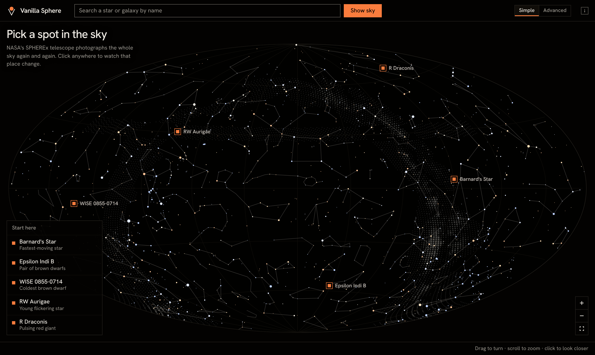
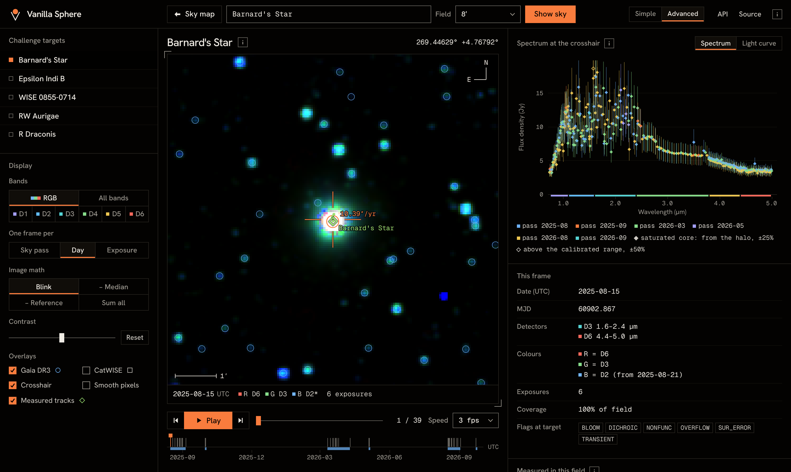
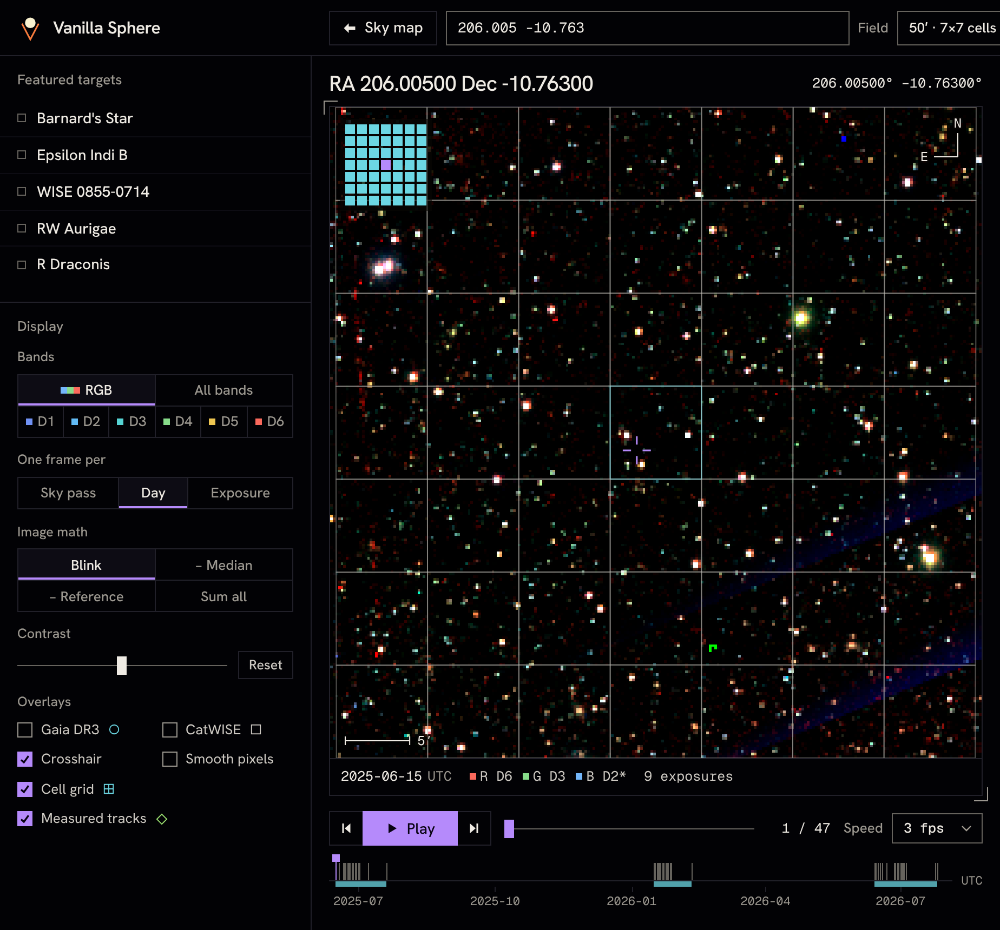

# Features

Functional specification of the user-facing features. Each section states what
the feature does, how the user reaches it, and which part of the system
implements it. Implementation detail is in [imaging engine](imaging-engine.md),
[measurement pipeline](measurement-pipeline.md) and [viewer](viewer.md).

## Feature summary

| # | Feature | Mode | Implemented in |
| --- | --- | --- | --- |
| 1 | Sky map start screen | Simple, Advanced | `web/starmap.js`, `web/data/sky.json` |
| 2 | Search by coordinates or object name | Simple, Advanced | `sphereblink/resolve.py` |
| 3 | Simple and Advanced modes | - | `web/app.js` (`setUi`) |
| 4 | Blink movie of on-demand cutouts | Simple, Advanced | `cutout.py`, `service.py`, `render.py`, `web/app.js` |
| 5 | False colour and detector bands D1-D6 | Advanced (Simple shows false colour) | `render.py` (`build_color_epochs`, `build_epochs`) |
| 6 | Frame grouping: exposure, day, sky pass | Advanced | `render.py` (`_groups`) |
| 7 | Image arithmetic | Advanced | `web/app.js` (client side), `render.difference` (server side) |
| 8 | Progressive fields, up to 7 x 7 cells | Advanced | `tiles.py`, `web/app.js` (`loadField`) |
| 9 | Spectrum and light curve at the crosshair | Advanced | `main.api_spectrum`, `cutout.aperture_flux`, `wings.py` |
| 10 | Gaia DR3 and CatWISE2020 overlays | Advanced | `catalogs.py`, `web/app.js` (`drawOverlays`) |
| 11 | Automatic measurement of position, motion, brightness | Advanced | `measure.py`, `refcat.py`, `measure_api.py` |
| 12 | "Measure this object" | Advanced | `web/app.js` (`measureHere`), `/api/measure` |
| 13 | Measured tracks overlay | Advanced | `measurements.py`, `/api/tracks` |
| 14 | Per-frame quality flags and provenance | Advanced | `cutout.py`, `render.Epoch.meta` |
| 15 | Share links, embeddable GIF and PNG, data API | Simple, Advanced | `main.py`, `web/app.js` (`writeUrl`) |
| 16 | Featured targets | Simple, Advanced | `resolve.FEATURED`, `refcat.TARGETS` |

## 1. Sky map start screen

The product opens on a drawn map of the whole sky, the same for both modes.

*The start screen: a drawn map of the whole sky with the featured targets marked.*

- **Projection.** Hammer equal-area, east to the left as on the sky. Dragging
  turns the sphere; near the centre the scale is uniform, so a zoomed-in map is
  an undistorted local chart.
- **Content.** Stars to magnitude 6 (fainter stars appear as the map is
  zoomed), proper names of stars to magnitude 3, constellation figures and
  names, and the Milky Way as a dot field.
- **Interaction.** Drag to turn, scroll or pinch to zoom, click to open a view
  at that point. Pointing and clicking snap to the nearest star on the map, so
  a click on a star opens that star (by its name when it has one); holding Alt
  picks the exact point under the pointer instead. Keyboard: arrow keys pan, `+` and `-` zoom, Enter opens the
  centre. Buttons zoom in, zoom out, reset to the whole sky and fill the screen with the map alone (full screen; Esc or the same button leaves it).
- **Readout.** The coordinates under the pointer and the constellation they
  fall in (from IAU boundaries precomputed on a 1 degree grid).
- **Featured targets** are pinned on the map and listed in a "Start here"
  panel (Simple) or "Featured targets" panel (Advanced).
- **No dependencies.** The map is drawn on a canvas by `web/starmap.js` from a
  single compact data file, `web/data/sky.json`, built by `scripts/build_sky.py`.
- **A sky that moves.** The space around the map is a deep field of faint
  stars with a violet glow around the rim of the sky; the map turns slowly
  while nobody uses it; an aiming frame follows the pointer and closes on the
  picked point, with its coordinates; the featured targets ping; now and then
  a meteor crosses. All of it is in `web/ambient.js`, stops for people who ask
  for reduced motion, and never gets in the way of the map (see
  [Viewer](viewer.md#motion-on-the-map-screen)).

Returning from a view to the map centres the map on the position just viewed
and marks it.

## 2. Search by coordinates or object name

The search box accepts three kinds of input, resolved by
`sphereblink/resolve.py`:

| Input | Example | Resolution |
| --- | --- | --- |
| Decimal degrees | `269.4486 +4.7387` or `269.4486, 4.7387` | Parsed locally; RA in [0, 360), Dec in [-90, 90] |
| Sexagesimal | `08h55m10.831s -07d14m42.53s` | Parsed locally with Astropy, hours and degrees |
| Featured target or alias | `barnard`, `GJ 699`, `WISE 0855`, `R Dra` | Built-in table, no network |
| Any other object name | `Vega`, `M31`, `TRAPPIST-1` | CDS Sesame (SIMBAD, then NED, then VizieR), with SIMBAD TAP as fallback |

Objects with a known proper motion are placed where they are at the SPHEREx
epoch (2025.9), not at their catalogue epoch. For Barnard's Star this moves the
view centre by 4.5 arcmin from its J2000 position, which is the difference
between the star being in the picture and not.

Error handling distinguishes two cases: an unknown name is a user error (HTTP
400, "check the spelling or give coordinates"), while unreachable name services
are a service error (HTTP 503, "try again shortly or give coordinates"). A
mistyped name leaves the current view on screen.

## 3. Simple and Advanced modes

A two-position switch in the top bar selects the interface. The choice is
stored in the browser (`localStorage` key `vs.ui`) and carried in links as
`ui=simple` or `ui=adv`. Simple is the default for a first visit.

*Simple mode: one picture, a short description, play, share and download.*

*Advanced mode on Barnard's Star at 8 arcmin: bands, grouping, image arithmetic,
overlays, the measured track and the spectrum at the crosshair.*

| | Simple | Advanced |
| --- | --- | --- |
| Audience | Everyone | Astronomers, the search team |
| Picture | False colour, one frame per day, 8 arcmin | Any band, grouping, field size or progressive field |
| Text | Object name, kind, a short description in plain language | Coordinates, epoch metadata, flags |
| Controls | Play, slider, Share, Download GIF | Bands, grouping, image arithmetic, contrast, overlays, speed, timeline |
| Analysis | - | Spectrum, light curve, measured tracks, "Measure this object", cross-links |
| Search placeholder | "Search a star or galaxy by name" | "RA Dec or an object name" |

Switching keeps the target and the frame on screen. Settings chosen in Advanced
are restored when the user returns to it. A link that carries display
parameters (`det`, `group`, `mode`, `gaia`, `catwise`, `levels`) opens in
Advanced even without `ui=adv`.

For the five featured targets, Simple mode shows a two- or three-sentence
description written for a general reader. For any other position it names the
constellation and explains what to look for.

## 4. Blink movie of on-demand cutouts

The core feature. For a requested position and field of view the server:

1. asks the archive which exposures cover the position;
2. reads the needed pixels of each exposure by HTTP range request;
3. masks bad pixels, subtracts the sky background, and resamples each exposure
   onto one north-up grid centred on the target;
4. combines the frames into epochs and sends them to the browser as one binary
   cube.

The browser plays the epochs in time order.

- **Field of view.** 4, 8 (default), 15 or 30 arcmin in the Field menu; any
  value from 1 to 51 arcmin through the API. Views up to 12 arcmin are drawn at
  half the native pixel (3.075 arcsec) so that sub-pixel shifts between epochs
  are visible; wider views use the native 6.15 arcsec.
- **Progressive loading.** The cube is requested repeatedly while exposures are
  still arriving, so the movie grows on screen and a progress bar reports
  "Reading exposure N of M from NASA's archive".
- **Shared stretch.** One asinh contrast stretch is computed across all epochs,
  so an object that brightens in the movie has brightened in the data. A
  contrast slider adjusts it; Reset returns to automatic.
- **Transport.** Play and pause, previous and next frame, a time slider, speed
  of 1, 3, 6 or 12 frames per second (Advanced). Keyboard: space bar plays or
  pauses, left and right arrows step. The movie pauses on the last frame before
  looping.
- **Timeline.** A strip of the real observation dates (UTC); clicking or
  dragging jumps to that date. It makes the six-month cadence of the survey visible.
- **Orientation aids.** North up, east left, with a compass, a scale bar, and a
  crosshair on the target. Double-clicking the image recentres the view on that
  point.
- **No data.** Pixels without data are drawn in a distinct warm dark tone, never
  as black sky.

## 5. False colour and detector bands D1-D6

SPHEREx has six detectors:

| Detector | Wavelength range (um) |
| --- | --- |
| D1 | 0.75-1.09 |
| D2 | 1.10-1.62 |
| D3 | 1.63-2.42 |
| D4 | 2.42-3.82 |
| D5 | 3.83-4.41 |
| D6 | 4.42-5.00 |

The Bands control offers:

- **RGB (default).** False colour with the longest wavelengths in red:
  red = D6 (or D5), green = D4 (or D3), blue = D2 (or D1). Each channel uses
  its preferred detector and falls back to the neighbouring one.
- **All bands.** The six detectors averaged after per-frame noise normalisation.
- **Any subset of D1-D6.** For example D5 and D6 to look for very cold objects.

Because a position is observed by only one or two detectors on a given day, a
colour channel missing on a date is borrowed from the nearest date that has it,
and masked pixels are filled from neighbouring dates of the same channel. The
metadata of each epoch records the detector and date of every channel and
whether it was borrowed; the interface shows this under "This frame", and
rendered PNG and GIF frames mark a borrowed channel with an asterisk. A frame is
never presented as a simultaneous three-colour observation.

Each detector is put on a common display scale (its median sky at zero, its
bright stars at one) so that a channel keeps its level when the detector feeding
it changes from one date to the next. Brightness follows an asinh curve of the
mean of the three channels while the channel ratios are preserved, so a star
keeps its colour from its faint wings to its core.

## 6. Frame grouping

"One frame per" selects how exposures are combined into epochs:

| Grouping | Definition | Use |
| --- | --- | --- |
| Exposure | One epoch per exposure | Finest time sampling; inspect individual frames |
| Day (default) | Exposures of the chosen detectors on the same UTC day, averaged | Good signal-to-noise with day resolution |
| Sky pass | Exposures separated by gaps of at most 20 days, averaged | Deepest images; one epoch per six-month visit |

Before averaging, each frame is divided by its own robust noise level, so
exposures at different wavelengths and background levels contribute comparably.

## 7. Image arithmetic

Four modes, computed in the browser on the decoded cube so that switching is
immediate:

| Mode | Operation | Shows |
| --- | --- | --- |
| Blink | The epochs as they are | The scene; whatever moves appears to jump |
| - Median | Each epoch minus the per-pixel median of all epochs | Static stars vanish; a mover appears where it is now |
| - Reference | Each epoch minus a chosen reference epoch | What changed since that date |
| Sum all | Mean of all epochs scaled by the square root of their number | One deep image of the field |

Difference modes use a symmetric stretch around zero (white brighter, black
fainter). The server implements the median difference as well
(`diff=true` on `/api/frame.png` and `/api/movie.gif`) so that shared GIFs can
show it.

## 8. Progressive fields

Wide-area inspection on the team's measurement grid. The sky is divided into a
fixed ICRS grid of 3000 x 1500 cells of 0.12 degrees, named
`icrs012-v1-XXXX-YYYY`. A progressive field of level N is the seed cell that
contains the requested position plus N rings of cells around it:

| Level | Cells | Width | Field menu entry |
| --- | --- | --- | --- |
| 0 | 1 | 7.2 arcmin | - |
| 1 | 3 x 3 = 9 | 21.6 arcmin | "22' - 3x3 cells" |
| 3 | 7 x 7 = 49 | 50.4 arcmin (0.84 degrees) | "50' - 7x7 cells" |

*A level 3 field (7 x 7 cells, 50.4 arcmin) with the cell grid overlay. The
minimap at the top left shows which cells have arrived.*

- **Staged loading.** The field loads in stages: the seed cell, then its first
  ring, then the whole block. The centre is on screen after seconds while the
  rings fill in behind it; the picture is always the widest stage that has
  finished.
- **One mosaic per stage.** Each stage is one view centred on the seed cell, so
  an exposure is read once for the whole block, not once per cell.
- **Cell grid overlay.** The outlines of the cells are drawn on the image, with
  a small block map that fills in as rings arrive. The pointer readout shows
  the cell identifier under the cursor.
- **Drill-down.** A 7 x 7 mosaic is sent to the browser at overview resolution
  (2 x 2 binning). Double-clicking a cell opens it as a plain 8 arcmin view at
  full detail.
- **Shared addressing.** Cell identifiers are identical to those of the team's
  offline measurement runs, so images and measurements refer to the same cells.

The stages are ordinary views, so every other endpoint (cube, PNG, GIF, epochs,
spectrum) works on a stage by passing its `ra`, `dec` and `fov`.

## 9. Spectrum and light curve

Each exposure sees the target through one narrow slice of a linear variable
filter. The exposures of a position therefore sample the whole 0.75-5.0 um
range, and the product assembles them into a spectrum without any dedicated
spectral data product.

- **Measurement.** A sky-subtracted circular aperture of radius 2 native pixels
  at the centre of the view, on the detector pixels (before resampling), with an
  empirical error from the scatter of the surrounding sky annulus.
- **Wavelength.** The central wavelength and bandwidth at the target's detector
  position, from a per-detector wavelength map read once from the file's
  spectral WCS.
- **Spectrum plot.** Flux density against wavelength, coloured by sky pass. A
  change between passes at the same wavelength indicates variability. The axis
  switches from mJy to Jy for bright stars.
- **Light curve plot.** Flux density against date, coloured by detector. Since
  each exposure samples a different wavelength, points of one colour are compared.
- **Quality marks.** Points with flagged pixels in the aperture are drawn hollow.
- **Saturated stars.** Where the core saturates the detector, the flux is
  measured from the star's halo instead (see
  [bright-star photometry](measurement-pipeline.md#bright-star-photometry)).
  These points are drawn as diamonds with a 20-25 % systematic error; hollow
  diamonds lie above the calibrated range and are to be read as relative
  brightness only.

The same data are served as JSON by `/api/spectrum`.

## 10. Catalogue overlays

Two optional overlays, queried through IRSA TAP and cached per view:

| Overlay | Catalogue | Mark | Magnitude shown |
| --- | --- | --- | --- |
| Gaia DR3 | `gaia_dr3_source`, positions at epoch 2016.0 | Circle | G |
| CatWISE | `catwise_2020`, positions at the mean observation epoch | Square | W2 |

- Every source is **moved by its proper motion to the date of the frame on
  screen**, so a catalogue mark follows a moving star through the movie.
- The 250 brightest sources of the field are fetched; the 40 brightest are
  marked to keep the image readable.
- **Fast movers are always marked**: a source with proper motion above
  150 mas/yr and a motion significance (`pm_snr`) of at least 5 is highlighted,
  with a line along its path over the time span of the movie and a label giving
  its motion in arcsec/yr. The significance test suppresses the large but
  meaningless motions that faint CatWISE entries often carry.

## 11. Automatic measurement

For any object the pipeline finds its position on the native detector pixels of
every exposure, compares it with the catalogue prediction for that date, and
fits a track. It runs without human input. Summary of the method (full
description in [measurement pipeline](measurement-pipeline.md)):

1. Read a small native stamp of each exposure by range request.
2. Predict the position from catalogue astrometry, with proper motion and parallax.
3. Fit a pixel-integrated Gaussian point-spread function, together with
   neighbouring Gaia stars so that a bright neighbour cannot capture the fit.
4. For an object too faint for single exposures, add the exposures of each sky
   pass along the predicted path and measure the stack.
5. Fit position and proper motion through all positions, with outlier rejection
   and jackknife errors.
6. Derive a light curve that is independent of wavelength.

The five featured targets are measured automatically shortly after the service
starts and again when the pipeline version changes or a week has passed.

## 12. Measure this object

In Advanced mode the "Measured in this field" card offers a "Measure this
object" button whenever nothing has been measured at the centre of the view. It
starts the pipeline for that position, reports progress ("Measuring N
exposures"), and after typically 20 to 45 seconds (63 s was observed for
Proxima Centauri on 2026-11-14) shows:

- the kind of object and the number of positions measured, with the time span;
- the fitted motion with its error, next to the catalogue motion;
- the scatter of the positions around the fit;
- whether the brightness is steady or varies between sky passes, with the
  amplitude and its significance.

If the position matches a Gaia star within 4 arcsec, the star's astrometry is
used for the prediction; otherwise the position itself is measured as an object
of unknown motion. Results are stored and shown to every later visitor of the
field.

## 13. Measured tracks overlay

Objects measured in the field are drawn on the image: every measured position
as a dot, the fitted track as a line, and a diamond on the positions measured
in the frame being shown. The overlay reads `/api/tracks`, which merges the
pipeline's results with any measurements the team has loaded into the shared
database by other means.

## 14. Quality flags and provenance

For the frame on screen, the "This frame" card lists the UTC date, the
detectors, the source of each colour channel, the number of exposures combined,
the fraction of the field covered, and the SPHEREx quality flags present in the
aperture at the target. Every epoch also carries the identifiers of its
exposures, so any displayed image can be traced to the archive files it came
from (`/api/epochs`, `/api/exposures`).

## 15. Sharing, embedding and data access

- **Page link.** The address bar always reflects the view; "Share" copies it
  (or opens the system share sheet on touch devices).
- **GIF.** "Download GIF" and the "GIF" link return the movie as an animated
  GIF from `/api/movie.gif`, embeddable anywhere.
- **PNG.** `/api/frame.png` returns any single epoch.
- **Data.** `/api/spectrum`, `/api/epochs`, `/api/exposures`, `/api/measure`
  and `/api/tracks` return JSON.
- **Cross-links.** The position of the crosshair is given in decimal and
  sexagesimal form with links to the same field in WiseView, SIMBAD and Aladin Lite.

All endpoints allow cross-origin requests. See [API reference](api-reference.md).

## 16. Featured targets

The five test objects named by the challenge are built in. Their positions and
motions are held in the service so that they resolve without any network call:

| Key | Object | Why it is a test case |
| --- | --- | --- |
| `barnard` | Barnard's Star | Highest proper motion of any star (10.4 arcsec/yr) |
| `eps-indi-b` | Epsilon Indi B | Pair of brown dwarfs, 4.7 arcsec/yr |
| `wise-0855` | WISE 0855-0714 | Coldest known brown dwarf, about 8 arcsec/yr, invisible in single exposures |
| `rw-aur` | RW Aurigae | Young variable star with dimming events |
| `r-dra` | R Draconis | Mira variable, period about 246 days |
