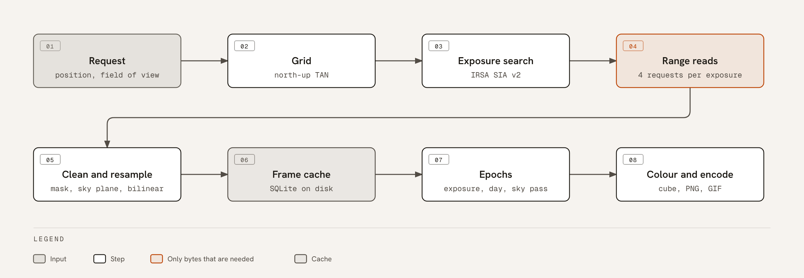
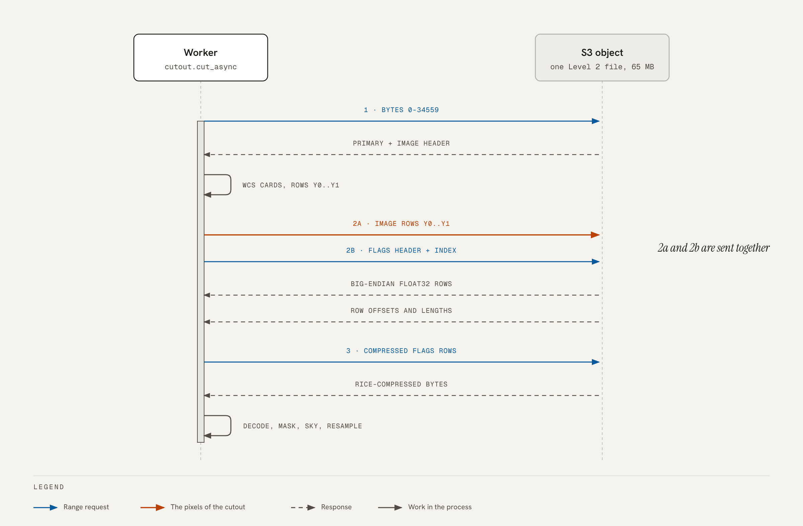

# Imaging engine

How a request for "this position, this field of view" becomes a time-ordered
set of sky-aligned images. The engine is the modules `sia.py`, `cutout.py`,
`worker.py`, `service.py`, `render.py` and `tiles.py`.

<picture>
  <source media="(prefers-color-scheme: dark)" srcset="img/diagrams/imaging-pipeline-dark.png">
  
</picture>

*Figure: From a position to pixels. Source: [`diagrams/imaging-pipeline.html`](diagrams/imaging-pipeline.html).*

## 1. The grid

`cutout.Grid` is a north-up gnomonic (TAN) grid centred on the target and shared
by every frame of a view.

| Property | Rule |
| --- | --- |
| Field of view | Clamped to 1 arcmin ... `SPHEREX_MAX_FOV_ARCMIN` (51) |
| Pixel scale | 3.075 arcsec (half the native pixel) for views up to 12 arcmin; 6.15 arcsec (native) for wider views |
| Size | `round(fov / scale)` pixels, forced odd so the target sits on the centre pixel; at least 9 |
| Orientation | North up, east left (`CDELT1` negative) |
| Identity | `Grid.key()` = `ra_dec_npix_scale`; this string identifies a view everywhere |

Examples: an 8 arcmin view is 157 x 157 pixels at 3.075 arcsec; a 7 x 7 cell
field (50.4 arcmin) is 493 x 493 pixels at 6.15 arcsec.

Small fields are oversampled by a factor of two so that a shift of a fraction
of a native pixel between epochs is visible when blinking.

## 2. Exposure search

`sia.find_exposures_at` queries the IRSA Simple Image Access v2 service once per
(collection, point):

```
GET https://irsa.ipac.caltech.edu/SIA
    ?COLLECTION=spherex_dr1
    &POS=circle <ra> <dec> 0.0005
    &RESPONSEFORMAT=csv
```

- **Collections** are searched newest first (`spherex_dr1`, then `spherex_qr3`).
  When an exposure appears in several releases the first listed wins. A new
  release only needs its name added to `SPHEREX_COLLECTIONS`.
- **Filtering.** Only rows with product type `image` and subtype `image` or
  `science` are kept. The detector is read from the bandpass name.
- **The S3 key** of each file comes from the `cloud_access` column, or is
  derived from the IRSA download URL when that column is empty. The file is then
  read from `https://nasa-irsa-spherex.s3.us-east-1.amazonaws.com/<key>`.
- **CSV instead of VOTable.** The CSV answer is under half the size and parses
  in milliseconds instead of about 0.2 s, which matters when a wide view asks at
  9 or 25 points per release. A VOTable answer is still accepted.
- **Wide views use a lattice of points.** Views up to 12 arcmin use the
  exposures that contain the centre. Wider views are mosaics and also need
  exposures that cover only part of the view: every exposure containing any
  point of a 3 x 3 lattice (up to 26 arcmin) or 5 x 5 lattice (beyond) over the
  view. The detector footprint is 3.5 degrees wide, so it cannot fall between
  points about 12 arcmin apart except by a corner tip. The point queries run in
  parallel (up to 12 at a time) and are about ten times faster than one query
  for the whole area.
- **Deep fields are thinned.** If more than `SPHEREX_MAX_FRAMES` (1200)
  exposures cover a view, they are thinned evenly in time, keeping the first and last.

Each result is an `Exposure`: observation identifier, detector, collection,
start and end MJD, wavelength range, S3 key, footprint polygon and centre.

## 3. Reading a cutout by range request

A SPHEREx Level 2 file is a multi-extension FITS file of about 65 MB (the
image, its quality flags, variance, a zodiacal light model, the point-spread
function and the wavelength description). The engine needs a
few dozen rows of IMAGE and the matching rows of FLAGS. `cutout.cut_async` gets
them with four HTTP range requests in three steps:

<picture>
  <source media="(prefers-color-scheme: dark)" srcset="img/diagrams/range-reads-dark.png">
  
</picture>

*Figure: Four range requests for one exposure. Source: [`diagrams/range-reads.html`](diagrams/range-reads.html).*

What makes this possible:

- **The IMAGE extension is uncompressed** 2040 x 2040 32-bit floats, so row `y`
  starts at a computable byte offset (header end + `y` x 8160 bytes).
- **The FLAGS extension is tile-compressed one row per tile** (`RICE_1`, tile
  width 2040). Its binary table holds, for each row, the length and heap offset
  of the compressed bytes, so the needed rows can be located and fetched as one
  contiguous range, then decoded with Astropy's Rice codec.
- **Headers have a fixed position.** The first 12 FITS blocks (34 560 bytes)
  hold the primary and IMAGE headers in DR1 and QR3; the reader fetches more if
  a header turns out to be longer. The FLAGS header follows the IMAGE data at a
  computable offset.
- **Only the needed header cards are parsed.** A Level 2 header has about 300
  cards; a regular expression keeps the WCS and compression cards and discards
  the rest before Astropy parses them.

The layout is verified on every file (image size, `BITPIX`, compression type,
tile width). A file that does not match raises an error for that exposure
instead of producing wrong pixels.

Cost: 1.3-1.9 MB per exposure for an 8 arcmin view instead of 65 MB. The result
was compared with a cut from the fully downloaded file and is identical pixel
for pixel.

### Mapping grid pixels to detector pixels

The exposure's WCS includes SIP distortion polynomials. Every output pixel is
mapped into the detector frame by inverting them (`detector_coords`):

- Grids up to 200 pixels wide are mapped exactly, pixel by pixel.
- Wider grids are mapped exactly on a lattice every 16 pixels and interpolated
  with a bicubic spline between. The mapping is a smooth low-order polynomial;
  the interpolation error is below 1/1000 pixel (verified by a test). This
  removes what was a third of all CPU time for a 7 x 7 field.

The bounding box of the mapped pixels, padded by 12 pixels for the photometry
sky annulus, gives the rows and columns to read. An exposure whose footprint
does not intersect the grid returns no frame.

## 4. From detector pixels to a frame

Applied in order to the rows that were read:

1. **Mask.** Pixels carrying any of the flags `TRANSIENT`, `OVERFLOW`,
   `SUR_ERROR`, `NONFUNC`, `MISSING_DATA`, `HOT`, `COLD`, `NONLINEAR`,
   `PERSIST`, `OUTLIER`, `SNOWBALL` become NaN, as do non-finite pixels. The
   `SOURCE` flag is deliberately not masked: it marks pixels on known stars,
   which are what the viewer is for. Flag bit positions are read from the
   `MSKN` cards of each file, not hard-coded.
2. **Subtract the sky.** A robust plane (level plus gradient) is fitted with
   iterative 2.5 sigma clipping and subtracted. The zodiacal light varies with
   date and, through the variable filter, across the detector; removing it makes
   frames from different dates match. Cutouts smaller than 60 pixels get a
   constant level only. The plane is fitted on about 40 000 evenly spread pixels
   regardless of cutout size.
3. **Restore saturated cores for display.** Connected groups of at least four
   `OVERFLOW` or `NONLINEAR` pixels are the cores of bright stars. They are
   painted at the brightest level of the cutout instead of leaving a hole. Lone
   overflow pixels are cosmic-ray hits and stay masked.
4. **Resample.** Bilinear interpolation onto the grid. The image and its
   validity mask are interpolated separately and divided, so masked pixels do
   not bleed into their neighbours; an output pixel is kept where more than 60 %
   of its weight comes from valid pixels.
5. **Photometry at the target.** A circular aperture of radius 2 native pixels
   on the unresampled, sky-subtracted detector pixels, with a sky annulus from
   5 to 10 pixels. The flux is converted from MJy/sr to microjansky with the
   pixel solid angle; the error is the robust scatter of the annulus scaled to
   the aperture area. The names of all flags set inside the aperture are kept.
6. **Wavelength at the target.** Interpolated from the detector's wavelength map
   (next section).

The result is a `Frame`: the image (float32, MJy/sr above the sky, NaN where
there is no data), the wavelength and bandwidth at the target, the aperture
flux and error, the flags at the target, and the fraction of valid pixels.

## 5. Wavelength maps

SPHEREx uses linear variable filters, so the wavelength recorded by a pixel
depends on where it is on the detector. The Level 2 files describe this with a
spectral WCS (key `W`). `wave_map_from_file` evaluates it once per
(collection, detector) on a 41 x 41 lattice over the detector, giving central
wavelength and bandwidth; lookups interpolate linearly. The six maps per
release are cached on disk and in memory, so this read happens once ever.

## 6. Orchestration and caching

`service.Service.start(grid)` starts, or returns, the background job of a view:

1. Search exposures (`status: searching`).
2. Look up every exposure in the frame cache. Hits are added to the job
   immediately; misses form the work list (`status: fetching`).
3. Ensure the wavelength maps of the detectors involved.
4. Submit the work list to the worker pool in chunks; collect results as chunks
   finish; write frames to the cache in batches.
5. Trim the disk cache to its budget, never dropping the view just loaded.
6. `status: ready`, then forget least recently used views from memory if the
   memory budget is exceeded.

The job records where the time went (`search_s`, `wave_s`, `fetch_s`,
`store_s`) and the archive traffic (`requests`, `mb`, `net_s`, `cpu_s`). These
appear in the `job.stats` object of API responses and are the basis of the
figures in [performance](performance.md).

## 7. Epochs

`render.build_epochs` turns frames into displayable epochs.

- **Selection.** Frames of the chosen detectors with at least 20 % valid pixels.
- **Grouping.** By exposure, by UTC day (integer part of the MJD), or by sky
  pass (a gap of more than 20 days starts a new pass).
- **Normalisation.** Each frame is divided by its robust noise (1.4826 x median
  absolute deviation), then the group is averaged ignoring NaN. The unit of an
  epoch image is therefore "sigma of the per-exposure sky noise". This is what
  allows frames at different wavelengths and background levels to be combined.
- **Metadata.** Label (UTC date or date range), mean MJD, number of exposures,
  detectors, coverage fraction, wavelength range, flags at the target, and the
  identifiers of the member exposures.

### False colour

`render.build_color_epochs` builds three-plane epochs:

| Channel | Preferred detector | Fallback |
| --- | --- | --- |
| Red | D6 (4.42-5.00 um) | D5 |
| Green | D4 (2.42-3.82 um) | D3 |
| Blue | D2 (1.10-1.62 um) | D1 |

1. For every group and channel, average the frames of the preferred detector,
   or of the fallback when the preferred one did not observe.
2. **White balance.** Put every detector on one display scale across the whole
   view: subtract its median and divide by the larger of its 99.7th percentile
   span and ten times its noise. A channel then keeps its level when the
   detector feeding it changes between dates.
3. **Borrow missing channels.** A channel not observed in an epoch is taken
   from the nearest epoch in time that has it. Masked pixels of an observed
   channel are filled from up to 8 neighbouring epochs of the same channel.
4. **Record provenance.** `Epoch.channels` lists, for R, G and B, the detector,
   the date, and whether the channel was borrowed.

### Shared stretch and colour rendering

- One pair of limits is computed for all epochs of a movie (1st to 99.7th
  percentile; symmetric 99.5th percentile of absolute values for differences).
  Colour channels start one sigma above the sky so that noise does not appear
  as coloured speckle.
- Grey images use `asinh(10 t) / asinh(10)`.
- Colour images apply the asinh curve to the mean of the three channels and
  keep the channel ratios, then normalise so no channel clips before the others.
  A pixel missing in one channel takes the mean of the other two; missing in all
  three it is drawn as "no data".

### Server-side difference

`render.difference` subtracts the per-pixel median of all epochs. It backs the
`diff=true` option of the PNG and GIF endpoints. The interactive viewer performs
the same operation client-side.

## 8. Output formats

| Output | Function | Notes |
| --- | --- | --- |
| Binary cube | `render.encode_cube` | All epochs in one response for the viewer; format in [API reference](api-reference.md#binary-cube-format) |
| PNG | `render.frame_image`, `png_bytes` | One epoch, nearest-neighbour scaled, with date, detectors, target name, crosshair and orientation label drawn on it |
| Animated GIF | `render.gif_bytes` | All epochs (thinned evenly to `max_frames`), shared limits, a 1.2 s pause on the last frame, infinite loop |

The cube stores `asinh(value)` quantised to 16 bits between the minimum and
maximum of the cube, with zero reserved for "no data". The asinh compression
keeps both the faint sky and bright stars at 2 bytes per pixel. For wide
mosaics `render.binned` averages 2 x 2 (up to 4 x 4) pixels, ignoring pixels
without data, before encoding.

## Progressive fields

`tiles.py` addresses the sky by the fixed grid `icrs012-v1`:

```
x = int(ra / 0.12) mod 3000          ra in degrees, [0, 360)
y = min(1499, int((dec + 90) / 0.12))
tile_id = "icrs012-v1-XXXX-YYYY"     zero-padded to four digits
centre  = ((x + 0.5) * 0.12, (y + 0.5) * 0.12 - 90)
```

A field of level N is the seed cell plus N rings: (2N + 1)^2 cells, wrapping in
right ascension and clipped at the poles. The maximum level is 3.

```
level 3: 7 x 7 = 49 cells, 0.84 deg      . . . . . . .
level 1: 3 x 3 =  9 cells, 0.36 deg      . . . . . . .
level 0: 1 cell,           0.12 deg      . . 1 1 1 . .
                                         . . 1 0 1 . .
                                         . . 1 1 1 . .
                                         . . . . . . .
                                         . . . . . . .
```

**Stages.** `stage_levels(N)` returns the levels loaded as stages: 0, 1 and N.
Each stage is a `Grid` centred on the seed cell with a field of view of
(2 x level + 1) x 7.2 arcmin:

| Stage | Field of view | Grid | Search points per collection |
| --- | --- | --- | --- |
| Level 0 | 7.2 arcmin | 141 px at 3.075 arcsec | 1 |
| Level 1 | 21.6 arcmin | 211 px at 6.15 arcsec | 9 |
| Level 3 | 50.4 arcmin | 493 px at 6.15 arcsec | 25 |

Design points:

- **A stage is a mosaic, not a set of tiles.** One view covers the whole block,
  so each exposure is read once per stage. Loading 49 cells separately would
  read most exposures many times, because one detector frame covers many cells.
- **The centre first.** Loading the intermediate stages costs about 20 % more
  reading than loading the block in one go, and puts the centre on screen many
  times sooner.
- **Searches run ahead.** While stage 0 loads, the exposure searches of the
  later stages run in the background and are cached.
- **Cells are bookkeeping.** `/api/tiles` reports each cell with its corners and
  a status (`done`, `loading`, `queued`) derived from the stage that covers it.
  The frames live in the view jobs, so the service remains free to drop them
  from memory.
- **Overview resolution.** A 493-pixel colour cube of all epochs is large, so
  the viewer requests it with `bin=2` and offers the full-resolution view of any
  cell on double-click.
