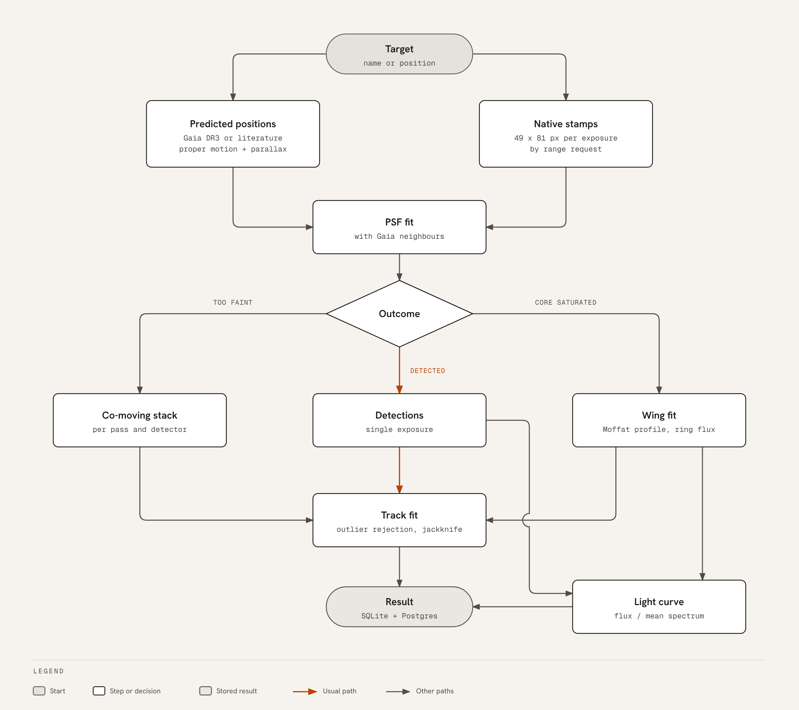
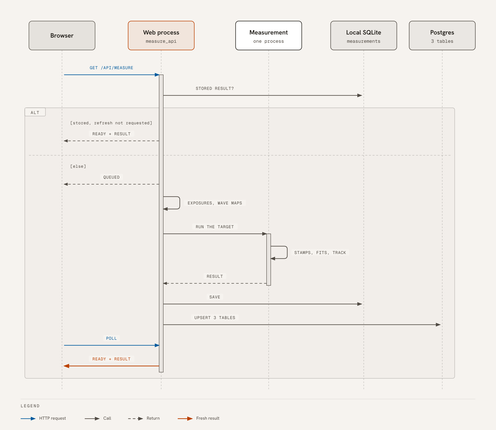

# Measurement pipeline

The pipeline answers three questions about an object, automatically and for any
position: where is it in each SPHEREx exposure, how does it move, and does its
brightness change. It is implemented in `measure.py` (numerical work),
`refcat.py` (reference astrometry), `measure_api.py` (jobs and endpoints),
`measurements.py` (storage) and `wings.py` (photometry of saturated stars in
spectra).

The viewer shows resampled pictures. A measurement instead works on the pixels
the detector recorded, without resampling.

<picture>
  <source media="(prefers-color-scheme: dark)" srcset="img/diagrams/measurement-pipeline-dark.png">
  
</picture>

*Figure: Measuring one object. Source: [`diagrams/measurement-pipeline.html`](diagrams/measurement-pipeline.html). The light curve uses the single-exposure detections and the wing fits; stacks contribute to the track only.*

## 1. Reference astrometry

To find an object in an exposure the pipeline must know where to look on that
date. `refcat.body_for` supplies a `Body`: position at a reference epoch, proper
motion, parallax, magnitude and catalogue identifier.

| Case | Source |
| --- | --- |
| Challenge target | Built-in table `refcat.TARGETS`. Gaia DR3 rows (epoch 2016.0) for Barnard's Star, Epsilon Indi B, RW Aurigae and R Draconis. For WISE 0855-0714, which Gaia cannot see: the AllWISE position (mean epoch 2010.5) with motion and parallax from Kirkpatrick et al. 2021 (ApJS 253, 7). |
| Any other position | The Gaia DR3 star within 4 arcsec of the requested position, evaluated at the date of the SPHEREx data |
| No Gaia match | The position itself, as an object of unknown motion (`kind: candidate`) |

Gaia sources within 4.5 arcmin of the target (G < 19.5, up to 400) are fetched
with one cone query, from the ESA Gaia archive first and IRSA second. They serve
as neighbour stars in the fits and as reference stars for the pointing check.

**Prediction.** `Body.at(mjd)` moves the catalogue position by proper motion
and adds the parallax displacement from the barycentric position of the Earth
(Astropy's built-in ephemeris). SPHEREx is in low Earth orbit, 5 x 10^-5 au from
the geocentre, which is negligible for parallax.

Parallax cannot be ignored: SPHEREx revisits a position every six months, from
opposite sides of the Earth's orbit, so the parallax shift changes sign from
pass to pass and would otherwise be absorbed into the proper motion. A unit
test demonstrates the bias.

## 2. Native stamps

`measure.read_stamp` reads, for each exposure, a piece of the detector of 49
rows by 81 columns (2.5 by 4 arcmin half-widths) around the predicted position,
with the same range-request technique as the imaging engine (about 0.4 MB per
exposure). Up to 16 stamps are read concurrently, each with up to three attempts.

`make_stamp` then:

- masks pixels with the same bad-pixel flags as the imaging engine;
- identifies saturated cores (connected groups of at least three `OVERFLOW` or
  `NONLINEAR` pixels);
- subtracts a clipped median sky and records the per-pixel sky noise.

An exposure in which the prediction falls within 5 pixels of the detector edge
is skipped.

## 3. PSF fit

`measure.fit_psf` fits, by bounded non-linear least squares in a 7 x 7 pixel
window:

- a circular Gaussian **integrated over each pixel** (the SPHEREx PSF is
  undersampled, so sampling the Gaussian at pixel centres would bias the result);
- a constant sky;
- the Gaussian width as a free parameter between 0.3 and 2.5 pixels;
- **neighbour stars at fixed positions.** Gaia stars within 30 arcsec of the
  target's path are predicted for the date and fitted simultaneously (up to
  four with free flux), so that a brighter star beside the target does not pull
  the fit toward itself. A neighbour whose flux is known from another pass is
  held at that flux, which keeps the fit determined when the two are closer
  than the PSF is wide.

The position may move at most 1.5 pixels from the prediction. A fit that ends at
that limit, or at a width limit, is rejected: it did not find the object.
Formal errors come from the Jacobian, scaled by the reduced chi-square when
that exceeds one. A single-exposure position counts as a detection at
signal-to-noise 6 or more.

### Saturated stars

When the core is masked, `fit_psf` cannot run. `fit_wings` fits a round Moffat
profile to the remaining wings in a 25 x 25 pixel window, with a robust loss.
This gives a position but no flux. These positions are less exact (the wings
are not perfectly round) and are used in the track fit only when fewer than 20
core positions exist.

Brightness for saturated stars comes from `ring_flux`: the light in a ring 3
pixels wide just outside the largest masked core. It is not the total flux but
is proportional to it as long as the same ring is used throughout, which is what
a light curve needs. When more than half of a star's exposures are saturated,
every exposure is measured with the ring, including the clean ones, so the whole
light curve is on one scale.

A PSF fit to what is left of a partly saturated core reads 2-5 times low
(checked against 2MASS). Such exposures therefore contribute a position but no
core flux, and are flagged `SATURATED`.

## 4. Stacks for faint objects

An object too faint for single exposures is recovered by adding exposures along
its predicted path.

- Exposures are grouped by **sky pass** (gaps over 45 days separate passes) and
  **detector**. A group where at least half of the exposures (and at least
  three) gave a single detection keeps its single detections. Otherwise the
  group is stacked.
- Each stamp is resampled onto a north-up 21 x 21 grid of half-native pixels
  centred on **where the target should be on that exposure's date**, so a moving
  object stays in the centre while background stars smear.
- The stack is a 3 sigma clipped mean. It is fitted with the same PSF model,
  with a wider search (3 pixels) and width range.
- **Errors by bootstrap.** The pixels of a resampled stack are correlated, so
  the fit's formal errors are not valid. The fit is repeated on 16 stacks of
  exposures drawn at random with replacement; the scatter of the results is the
  error. With fewer than five exposures the formal errors are tripled instead.
- **Neighbour priors.** The flux of each neighbour star is measured in the pass
  where the moving target is farthest from it, and held fixed when fitting the
  passes where they overlap.
- A stack counts as a detection at signal-to-noise 5 or more. Its record carries
  `method: "stack"`, an identifier `stack:<first mjd>-<last mjd>`, and the
  number of exposures combined.

This is how WISE 0855-0714 is found: it is invisible in every single exposure
and appears in the 4-5 um stacks at the position its 2010 epoch and published
motion predict.

## 5. Track fit

`measure.fit_track` fits, in arcseconds east and north of a reference point,
with `t` in Julian years:

```
east(t)  = E0 + pm_east  * (t - t0) + parallax * P_east(t)
north(t) = N0 + pm_north * (t - t0) + parallax * P_north(t)
```

| Aspect | Treatment |
| --- | --- |
| Weights | Position error of each detection, with a floor of 0.15 arcsec added in quadrature |
| Reference epoch `t0` | Weighted mean date, which decorrelates position and motion |
| Proper motion | Fitted when there are at least two sky passes spanning at least 0.25 years; otherwise the catalogue motion is held and only the position is fitted |
| Parallax | The catalogue value is held fixed in the main fit |
| Outliers | Up to four passes of rejection at 4 robust sigma in each coordinate (a cosmic ray, a neighbour, a bad pixel); rejected detections are marked `used: false` |
| Errors | The larger of the formal errors (scaled by reduced chi-square) and a delete-one jackknife over groups of (sky pass, detector), which also captures offsets shared by a whole pass |
| Free parallax | With three or more passes the parallax is also fitted freely and reported as `parallax_fit_mas` with its error, as a consistency check, with an error floor of 0.15 arcsec |

The output also states how the fit compares with the catalogue: the offset of
the fitted position from the prediction and the difference in proper motion.

**Pointing check.** In every stamp, up to four isolated Gaia stars brighter than
G = 15.5 are fitted and their measured-minus-predicted offsets recorded. The
median offset and its scatter are reported in `stats` (`pointing_east`,
`pointing_north`, `pointing_scatter`). It is a quality figure, not a correction:
the WCS of Level 2 images already agrees with Gaia to about 0.05 arcsec, and
applying a per-exposure correction from so few stars did not improve results.

## 6. Light curve

Each exposure sees the object at a different wavelength, so raw fluxes of
different exposures are not comparable. `measure.light_curve` divides every flux
by the object's own mean spectrum at that wavelength:

1. Sort the flux measurements by wavelength.
2. For each one, take the median of its nearest neighbours in wavelength (from
   all dates) as the mean spectrum there.
3. The ratio, `rel_flux`, is 1 when the object is at its average brightness,
   whatever the wavelength.
4. Iterate four times, removing the brightness level of each sky pass before
   forming the mean spectrum, so that a bright pass is not mistaken for a
   feature in the spectrum.

The result gives the median relative flux per sky pass and per day, the
amplitude (brightest pass over faintest pass) and its significance. The
significance includes a floor for how well one pass can be compared with
another, measured on stars that do not vary: 2 % for PSF fluxes and 12 % for
ring fluxes of saturated stars. An object is reported as variable at 3 sigma or
more. At least 30 flux measurements of one kind are required.

## 7. Result

`measure.measure_all` returns a plain dictionary; `measure_api.run` adds
identification and timing:

| Field | Content |
| --- | --- |
| `name`, `kind`, `ra`, `dec`, `note` | Identification; `kind` is `star`, `brown_dwarf`, `variable` or `candidate` |
| `target` | The catalogue astrometry used for prediction |
| `detections` | One record per detection: exposure, detector, MJD, measured RA/Dec, position error, offset east/north from the prediction, wavelength, flux and error, signal-to-noise, flags, method (`psf`, `wings`, `stack`), exposures combined, `used`, `rel_flux` |
| `track` | Epoch, position, proper motion and errors, parallax used, free parallax, counts, RMS, reduced chi-square, time span, comparison with the catalogue |
| `light_curve` | Per-pass and per-day relative flux, amplitude, significance, `variable` |
| `stats` | Stamps, passes, detections by method, neighbours, pointing check, exposures, failures, whether Gaia was reached, run time, whether the result is in the database |
| `version`, `measured_at` | Pipeline version and time of measurement |

## Job execution

<picture>
  <source media="(prefers-color-scheme: dark)" srcset="img/diagrams/measure-job-dark.png">
  
</picture>

*Figure: A measurement job. Source: [`diagrams/measure-job.html`](diagrams/measure-job.html).*

- **Keys.** A challenge target is keyed by its short name; any other position by
  `pos_<ra>_<dec>` rounded to four decimals.
- **Isolation.** The numerical work runs in a dedicated child process so the web
  process keeps answering. A job is abandoned after 600 s.
- **Storage.** The result is always written to the local store first; the shared
  database is written when configured and reachable. Results measured while the
  database was unavailable are pushed at the next start.
- **Ownership of rows.** In the shared database the pipeline owns rows whose
  `method` is `psf`, `wings` or `stack` and replaces them when it measures an
  object again. Measurements loaded by other means under another method name are
  left alone.
- **Automatic runs.** Forty seconds after start (`SPHEREX_AUTO_MEASURE_DELAY`),
  the five challenge targets are measured one after another if their stored
  result is missing, older than seven days, or from an earlier pipeline version.
  `SPHEREX_AUTO_MEASURE=0` disables this.
- **Versioning.** Raising `measure_api.VERSION` causes every stored result to be
  measured again.

## Bright-star photometry

This section concerns the spectrum endpoint (`/api/spectrum`, `wings.py`), which
needs absolute fluxes, unlike the light curve above, which needs only relative ones.

**The problem.** Stars brighter than about K = 9 fill the wells of the central
pixels at wavelengths below about 3.5 um. The pipeline flags those pixels
`OVERFLOW` or `NONLINEAR`, and an aperture on the core reads 2-5 times low or
not at all. Two of the five challenge targets were affected: Barnard's Star had
3 usable points of 358, R Draconis none of 539.

**The method.** A few pixels out, the same star is still there, hundreds of
times fainter and inside the linear range. The surface brightness of that halo
in a ring around the star is proportional to the star's flux. When the aperture
holds saturation flags, the flux is taken as:

```
flux = (median ring level - ring offset) x factor(wavelength, ring) x 0.97 / excess(flux)
```

- **Rings** at 4-6, 6-9 and 9-13 native pixels; the innermost ring free of
  saturated pixels (at least 80 % usable) is used, since it has the most signal.
  The sky is the median between 22 and 30 pixels.
- **`factor`** is tabulated at 16 wavelengths per ring (`wings.CALIBRATION`) and
  interpolated in log wavelength.
- **`excess`** corrects an instrument behaviour found during calibration: above
  about 1 Jy the halo grows faster than the star's flux (1.4 times at 5 Jy, 1.9
  times at 20 Jy, the same in all three rings). The cause is not established.
  The trend is fitted to 2MASS and divided out; it follows the photon rate, so
  it is scaled by the resolving power of the channel.
- **0.97** places wing fluxes on the same scale as unsaturated aperture fluxes.

**Calibration.** The factors are measured, not assumed:
`scripts/calibrate_wings.py` opened 8 arcmin views on 81 isolated 2MASS stars of
K = 3 to 11 from eight fields across the sky (29 000 exposures) and compared
ring levels with aperture fluxes and with 2MASS J, H and Ks.

| Check | Result |
| --- | --- |
| Unsaturated aperture flux against 2MASS J and Ks | Agreement within 2-4 % |
| Wing flux against 2MASS, 0.15-20 Jy | Median ratio 0.90-1.06, star-to-star scatter 11-25 % |

**Reported uncertainty.** Every wing point carries `method: "wings"` and a
systematic error added in quadrature: 20 % up to 10 Jy, 25 % from 10 to 40 Jy,
and 50 % with the flag `EXTRAPOLATED` above 40 Jy, where the trend is an
extrapolation. R Draconis (50-100 Jy) is in that last regime.

**Known limitation.** The rings are centred on the view centre, not on the
star's proper-motion position in each frame; for Barnard's Star this is a drift
of about one native pixel either way over the data.

## Validation on the challenge targets

Results from the deployed service on 14 November 2026 (collections DR1 and QR3,
pipeline version 2), read from `/api/measured`. Proper motions in mas/yr.

| Target | Positions in the fit | Fitted proper motion (RA, Dec) | Catalogue | Offset from prediction | Brightness |
| --- | --- | --- | --- | --- | --- |
| Barnard's Star | 86 on detectors 5-6 (254 more from saturated wings, not used) | -992 +/- 472, +10327 +/- 249 | -801.6, +10362.4 (Gaia DR3) | 0.1 arcsec | Steady (1.11, 0.6 sigma) |
| Epsilon Indi B | 431 | +3945 +/- 48, -2513 +/- 49 | +3982.0, -2466.8 (Gaia DR3) | 0.6 arcsec (unresolved pair Ba + Bb) | Steady (1.01, 0.4 sigma) |
| WISE 0855-0714 | 6, of which 5 are stacks of 14-25 exposures | -8766 +/- 992, +1536 +/- 992 | -8123.7, +673.2 (Kirkpatrick et al. 2021) | 0.9 arcsec | Too faint for a light curve |
| RW Aurigae | 271 | +316 +/- 288, +49 +/- 84 | +4.9, -24.6 (Gaia DR3) | 0.5 arcsec | No change beyond the 12 % ring accuracy (1.15, 0.8 sigma) |
| R Draconis | 515, all from saturated wings | +154 +/- 334, +241 +/- 426 | -20.6, +6.1 (Gaia DR3) | 0.2 arcsec | Variable: factor 1.97 between passes, 3.6 sigma (Mira variable) |

Reading the table:

- The three fast movers are recovered at their catalogue motion within the
  stated errors. The two stars with negligible motion are consistent with zero.
- WISE 0855-0714 is detected only at 4-5 um in stacks, at 133.7601, -7.2422 in
  late 2025: two arcminutes from the coordinates given in the challenge text,
  which are its mid-2010 position.
- R Draconis fades by a factor of two from June 2025 to June 2026, as expected
  for a Mira variable with a period of about 246 days.

The same pipeline, started from the "Measure this object" button on positions
that are not challenge targets, produced these results on the same day:

| Object | Positions in the fit | Fitted proper motion | Gaia DR3 |
| --- | --- | --- | --- |
| Kapteyn's Star | 122 | +6493 +/- 224, -5619 +/- 402 | +6491.2, -5708.6 |
| Wolf 359 | 179 | -3597 +/- 235, -2742 +/- 75 | -3866.3, -2699.2 |
| Ross 128 | 143 | +685 +/- 251, -1246 +/- 140 | +607.3, -1223.0 |
| Lalande 21185 | 290 (mostly saturated wings) | -1010 +/- 521, -4428 +/- 311 | -580.1, -4776.6 |

Run time per object was 18 to 45 s for 258 to 539 exposures.

## Limits

- **Single-exposure accuracy is 0.2-0.5 arcsec.** SPHEREx pixels are 6.15 arcsec
  and the PSF is undersampled.
- **Proper-motion errors are tens to hundreds of mas/yr** with three or four sky
  passes spread over little more than a year. They will shrink as the survey
  continues.
- **A pass-dependent offset limits the free parallax.** The spacecraft is turned
  around between passes, and with it any small asymmetry of the PSF. This leaves
  an offset of 0.1-0.3 arcsec that changes sign each pass, exactly as parallax
  does. The free parallax is therefore reported with an error floor and used
  only as a check.
- **Positions from saturated wings are less exact** and are excluded when
  enough core positions exist.
- **Ring fluxes are relative**, good to about 12 % between passes.
- **Stacking needs a predicted path.** An object of unknown motion can be
  stacked only under an assumed motion; the pipeline does not search motion space.
- **Crowding.** A neighbour within the PSF width is handled by fixing its flux
  from another pass, which requires the target to move away from it at some time.

## Tests

`tests/test_measure.py` covers, with synthetic data: parallax factors following
the Earth, recovery of sub-pixel position and flux, immunity to a known
neighbour, the fallback to wings for a masked core, recovery of a fast mover's
track with parallax, the bias when parallax is ignored, measurement of a faint
mover on stacks, the light curve dividing out the spectrum, pass splitting, the
catalogue astrometry of the challenge targets, storage and serving of results,
synchronisation to the database, and the handling of partly and mostly
saturated stars.
