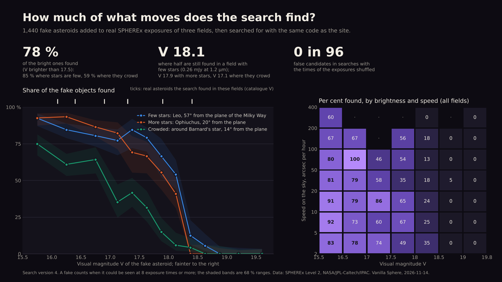

# Moving objects: how much the search finds

The blind search ([moving-objects.md](moving-objects.md)) lists what it found.
It cannot say what it missed. This document measures that: the share of the
moving objects in a field that the search finds (its completeness), as a
function of brightness, speed, direction and how crowded the field is, and how
often it reports a path where nothing moves (its false alarms).

- Method: `sphereblink/mover_completeness.py` (no network, no storage).
- Bench: `scripts/mover_completeness.py` (fetches fields, runs rounds, writes the report).
- Numbers the viewer shows: `web/data/mover-completeness.json`, drawn by `web/completeness.js`
  at the end of the Discoveries page.
- Tests: `tests/test_mover_completeness.py`.

## Results

Search version 4, measured on 2026-11-14: 240 rounds in three fields, 1,440 fake asteroids (983 of them could be seen at 8 exposure times or more and count) and 1,440 fake bodies without heat (938 count). The figures are about the asteroids unless a line says otherwise.

| | Few stars | More stars | Crowded | The three together |
| --- | --- | --- | --- | --- |
| Bright fakes found (V < 17.5) | 85 % (138 of 163) | 88 % (136 of 154) | 59 % (86 of 146) | 78 % (360 of 463) |
| Bright fakes strong (V < 17.5) | 75 % (122 of 163) | 81 % (125 of 154) | 49 % (71 of 146) | 69 % (318 of 463) |
| Magnitude where half are still found | V 18.1 | V 17.9 | V 17.1 | V 17.8 |
| Magnitude where half are still strong | V 18.0 | V 17.8 | V 16.9 | V 17.7 |
| 68 % range of that magnitude (found) | 18.05 to 18.22 | 17.75 to 18.02 | 16.97 to 17.27 | |
| That magnitude as flux at 1.24 µm (found) | 0.26 mJy | 0.32 mJy | 0.64 mJy | 0.36 mJy |
| Bright fakes found, body without heat | 86 % | 82 % | 44 % | 71 % |
| Half found, body without heat | V 18.3 | V 17.9 | - | V 18.1 |
| Fakes that count | 327 | 336 | 320 | 983 |
| Exposures of the field | 553 | 713 | 518 | |
| Paths of the search without fakes, kept | 80 of 80 | 616 of 640 | 80 of 80 | 776 of 800 |

**Found** is the evidence asked of an object a catalogue lists, **strong** the evidence asked of a path without a name. A found fake is placed to 0.38 arcsec (median) and its speed is right to 0.009 arcsec per hour (0.06 %).

The fields: **Few stars**: RA 167.1, Dec +5.22, Leo, 57° from the plane of the Milky Way; **More stars**: RA 248.34, Dec -16.98, Ophiuchus, 20° from the plane; **Crowded**: RA 269.46, Dec +4.74, around Barnard's star, 14° from the plane.

### What the numbers say

- **Where stars are few or moderately many, six of seven bright asteroids are
  found** (85 and 88 %). The seventh is not lost to noise: it crossed the
  field in two visits, moved less than three pixels while it was watched, or
  passed in front of a star (table "Why bright fakes are missed").
- **The limit is V 18.1 where stars are few**: 0.26 mJy at 1.24 µm, which puts
  about six times the noise of one exposure into the brightest pixel. It is
  set by the detection in single exposures, as it must be for a search that
  links detections. With more stars it is V 17.9: the leftovers of stars
  raise the noise, and 135 of the 713 exposures hold too many of them and
  are left out.
- **Where stars crowd, four of ten bright ones are lost** (59 % found, limit
  V 17.1). In the field around Barnard's star 267 of the 518 exposures hold
  more leftovers of stars than a frame may have (80) and are left out, and a
  quarter of the field is masked: 44 of the 60 bright fakes lost there were
  bright enough and still not detected in half of their exposures. This is
  the largest loss the measurement found, and the way out is known. With a
  limit of 250 per frame and 5000 detections per pass the same 12 rounds
  find 33 of 44 bright fakes instead of 22. They also gave one false path
  with the evidence asked of a nameless one: two leftovers of stars hours
  apart whose line passes a bright fast fake of the day before. The limit
  is therefore not raised yet; a rule that keeps that path out (detections
  at five or more exposure times, which 748 of the 753 strong fakes have)
  is being tested by the thread that owns the search.
- **A path without a name is held to more, and that costs 7 to 10 points**
  (75, 81 and 49 % strong). Version 4 asks for three visits with two
  sightings each, or four visits with any sighting. The second half of the
  rule came out of this measurement (see the versions below).
- **Speed matters little between 2 and 100 arcsec per hour.** Faster objects
  cross the 50 arcmin field in a few hours and are seen in fewer visits:
  at 100 to 400 arcsec per hour 16 of the 25 brightest (V below 16.5) are
  found.
- **Direction does not matter where stars are few or moderately many** (82
  to 95 %). In the
  crowded field fakes moving east or west are found less often than those
  moving north or south (48 % of 81 against 72 % of 65). The cause is not
  known.
- **A body without heat of its own gives nearly the same** where stars are
  few (86 % of the bright ones, half at V 18.3, range 18.25 to 18.32). Where
  they crowd the heat helps: 59 % of the asteroids against 44 % of the
  bodies without it, because the sky is emptier at 4 to 5 µm.
- **Nothing false was shown.** In 240 rounds the search returned 42 paths that
  are no fake. All are weak paths made of a few detections of one fake and
  something else; none has the evidence asked of a path without a name, so
  the site would show none of them unless a catalogue had an object there.
  96 searches with the times shuffled (32 per field, each once by exposure
  and once by visit) gave one weak path and no candidate: fewer than 0.03
  false candidates per search at 95 %.
- **The real objects agree.** The 11 asteroids the search found in these
  fields (V 11.8 to 18.4, 10.8 to 57 arcsec per hour) lie where the curve says
  objects are found, the faintest on its falling part. The paths of the
  search without fakes came back in 776 of 800 cases. The 24 misses are all
  in the field with more stars, where four of the eight such paths are weak
  ones.

### Version by version

The same measurement was made on every version of the search this evening,
and each time it changed the next one.

| Search | Bright fakes found (few stars, more stars, crowded) | Strong | What the measurement showed |
| --- | --- | --- | --- |
| Version 2, 120 rounds, bodies without heat only | 85, 85, 45 % | 81, 80, 43 % | Two false paths with the evidence then asked of a nameless one, both seen at 8 of 8 times. An earlier round had shown how: two fakes that hardly move, hours apart, joined into one fast path seen in two visits ([the static pair](moving-objects.md#the-static-pair-why-a-path-without-a-name-needs-three-visits)). |
| Version 3, 240 rounds | 85, 87, 56 % | 72, 77, 44 % | No false path any more. But the three visits with two sightings each cost 10 to 13 points: where a visit gives one exposure time, a fake seen at 11 of 11 times in 9 visits failed the rule. And in the crowded field half of the bright ones are lost. |
| Version 4, 240 rounds (this page; bodies without heat: 86, 82, 44 % found) | 85, 88, 59 % | 75, 81, 49 % | On the 36 rounds run on both versions with the same fakes: 7 more found and 12 more strong, none lost, no false path. The limit with more stars moved from V 17.6 to 17.9, because twice as many detections are linked per pass. |



### By brightness

Share found (found / fakes that count), evidence asked of a known object.

| V | Few stars | More stars | Crowded | Together |
| --- | --- | --- | --- | --- |
| 15.5 to 16.0 | 92 % (37/40) | 93 % (38/41) | 75 % (27/36) | 87 % (102/117) |
| 16.0 to 16.5 | 85 % (44/52) | 93 % (43/46) | 61 % (25/41) | 81 % (112/139) |
| 16.5 to 17.0 | 81 % (29/36) | 86 % (32/37) | 64 % (18/28) | 78 % (79/101) |
| 17.0 to 17.25 | 77 % (17/22) | 82 % (14/17) | 35 % (6/17) | 66 % (37/56) |
| 17.25 to 17.5 | 85 % (11/13) | 69 % (9/13) | 42 % (10/24) | 60 % (30/50) |
| 17.5 to 17.75 | 79 % (19/24) | 67 % (12/18) | 32 % (6/19) | 61 % (37/61) |
| 17.75 to 18.0 | 67 % (8/12) | 56 % (10/18) | 15 % (3/20) | 42 % (21/50) |
| 18.0 to 18.25 | 54 % (13/24) | 41 % (9/22) | 6 % (1/17) | 37 % (23/63) |
| 18.25 to 18.5 | 12 % (2/16) | 0 % (0/15) | 4 % (1/23) | 6 % (3/54) |
| 18.5 to 18.75 | 6 % (1/18) | 0 % (0/15) | 0 % (0/16) | 2 % (1/49) |
| 18.75 to 19.0 | 0 % (0/19) | 0 % (0/24) | 0 % (0/17) | 0 % (0/60) |
| 19.0 to 19.4 | 0 % (0/23) | 0 % (0/40) | 0 % (0/32) | 0 % (0/95) |
| 19.4 to 19.8 | 0 % (0/28) | 0 % (0/30) | 0 % (0/30) | 0 % (0/88) |

### By speed and brightness

Per cent found, the three fields together (a dot: fewer than 5 fakes).

| arcsec per hour | V 15.5 to 16.5 | V 16.5 to 17.0 | V 17.0 to 17.5 | V 17.5 to 18.0 | V 18.0 to 18.5 | V 18.5 to 19.0 | V 19.0 to 19.8 |
| --- | --- | --- | --- | --- | --- | --- | --- |
| 2 to 5 | 83 | 78 | 74 | 49 | 35 | 0 | 0 |
| 5 to 10 | 92 | 73 | 60 | 67 | 25 | 0 | 0 |
| 10 to 20 | 91 | 79 | 86 | 65 | 24 | 0 | 0 |
| 20 to 50 | 81 | 79 | 58 | 35 | 18 | 5 | 0 |
| 50 to 100 | 80 | 100 | 46 | 54 | 13 | 0 | 0 |
| 100 to 200 | 67 | 67 | · | 56 | 18 | 0 | 0 |
| 200 to 400 | 60 | · | · | · | 0 | · | 0 |

### By direction

Bright fakes found, by the direction they move in.

| Field | North | East | South | West |
| --- | --- | --- | --- | --- |
| Few stars | 83 % (35/42) | 82 % (27/33) | 90 % (36/40) | 83 % (40/48) |
| More stars | 95 % (41/43) | 83 % (25/30) | 90 % (34/38) | 84 % (36/43) |
| Crowded | 76 % (22/29) | 55 % (24/44) | 69 % (25/36) | 40 % (15/37) |
| Together | 86 % (98/114) | 71 % (76/107) | 83 % (95/114) | 71 % (91/128) |

### Why bright fakes are missed

| Field | Bright | Found | Path too short | Two visits or fewer | In front of stars | Other |
| --- | --- | --- | --- | --- | --- | --- |
| Few stars | 163 | 138 | 11 | 6 | 1 | 7 |
| More stars | 154 | 136 | 0 | 1 | 4 | 13 |
| Crowded | 146 | 86 | 0 | 7 | 44 | 9 |
| Together | 463 | 360 | 11 | 14 | 49 | 29 |

### False alarms

| Field | Rounds | Paths that are no fake | of them strong | Shuffled searches | Paths, exposures shuffled | Candidates, visits shuffled |
| --- | --- | --- | --- | --- | --- | --- |
| Few stars | 80 | 6 | 0 | 32 | 1 | 0 |
| More stars | 80 | 28 | 0 | 32 | 0 | 0 |
| Crowded | 80 | 8 | 0 | 32 | 0 | 0 |
| Together | 240 | 42 | 0 | 96 | 1 | 0 |

Seen in two visits only: 65 of the 983 fakes that count. Upper limit (95 %) on false candidates: 0.0312 per search.

## Method: injection and recovery

Surveys measure their completeness by adding objects they know to their own
data and counting how many their software finds. The same is done here.

1. **Real exposures.** Every exposure of a 50 arcmin field is fetched once, as
   the site fetches it, and kept as one file. Stars, noise, masked pixels,
   cosmic ray hits and detector defects are the real ones. Nothing about the
   field is simulated.
2. **Fake objects.** Twelve per round. Each moves on a straight line at
   constant speed. It starts at a random place of the field at the time of a
   random exposure, in a random direction, at a speed between 2 and 400 arcsec
   per hour (uniform in the logarithm), with a visual magnitude V between 15.5
   and 19.8. A fake exists in one pass of the telescope over the field, as a
   real object does: months later it is elsewhere.
3. **Brightness in every exposure.** Every SPHEREx exposure has another
   wavelength, so a fake needs a spectrum. Two kinds are used, in turn:
   - **an asteroid of the main belt**: the sunlight it reflects (the Sun's
     magnitudes from 0.55 to 5.2 µm of Willmer 2018, ApJS 236, 47) and the
     heat it gives off at 2.7 au from the Sun (the standard thermal model of
     near-Earth asteroids, NEATM, with albedo 0.15, beaming 1.0, emissivity
     0.9). The heat is 7 % of the reflected light at 3.5 µm, 1.5 times it at
     4.3 µm and 9 times it at 5.0 µm. These are the fakes of the figures.
   - **a body without heat of its own**: reflected sunlight only, which is
     what a distant object looks like. Its numbers are given beside the
     others.

   V 18.0 is 0.29 mJy at 1.24 µm for both. At 4.6 µm it is 0.20 mJy for the
   asteroid and 0.045 mJy for the body without heat.
4. **Shape.** A point source through the telescope is a narrow spot that
   falls on 6.15 arcsec detector pixels; the frames of a field are those
   pixels interpolated onto a common grid. A fake goes the same way: a
   Gaussian spot is integrated over detector pixels that lie at a random
   offset and angle to the grid (different in every exposure), and the result
   is interpolated onto the grid with the engine's own rule. While the
   113.6 seconds of an exposure pass the fake moves, and leaves a trail: 0.5
   pixel at 100 arcsec per hour, 2 pixels at 400.
5. **Before anything else.** The fakes are added to the frames before the
   search starts. The static sky of the search is the median of the frames,
   and a slow object partly ends up in it; that loss is part of the result.
6. **The unchanged search.** `movers.search` runs on the frames with the
   fakes, exactly as on the site. Nothing in it knows about the fakes.
7. **Counting.** A fake is found when the search returns a path that passes
   within 20 arcsec of the fake's true place (at the path's own reference
   time) with the fake's motion (within 15 % of its speed, or 3 arcsec per
   hour). Two levels are counted, because the search asks more of a path that
   no catalogue has an object on: **found** is the evidence asked of a known
   object, **strong** the evidence asked of a nameless one (see
   [moving-objects.md](moving-objects.md#steps)). A returned path that is
   neither a fake nor one of the paths the search finds without fakes is
   counted apart. It is a false alarm when it is strong, because only then
   would the site show it without a name from a catalogue.
8. **Who counts.** Completeness is the share found among the fakes whose
   place could be seen at 8 exposure times or more: inside the field, on
   pixels the exposure has. A fake that crosses a corner of the field in two
   exposures cannot be found at any brightness; such fakes are counted
   separately.

### Is a fake like a real star?

The width of the spot was set so that the brightest pixel of a fake holds the
share of the light it holds for real stars. Measured on isolated bright stars
in single frames of the three fields (237 to 2294 stars per detector and
field) and on 3000 fakes per width:

| | Brightest pixel / all light (median, 16 to 84 %) | 3 × 3 pixels / brightest pixel (median) |
| --- | --- | --- |
| Stars, detectors 1 to 3 | 0.29 to 0.32 (0.24 to 0.40) | 2.8 to 3.1 |
| Fakes, width 0.40 pixel | 0.315 (0.26 to 0.38) | 3.0 |
| Stars, detectors 4 to 6 | 0.24 to 0.27 (0.20 to 0.34) | 3.2 to 3.5 |
| Fakes, width 0.52 pixel | 0.255 (0.22 to 0.30) | 3.6 |

The spread comes from where the star falls on the detector pixels, and the
fakes have it too. On real asteroids the search measured 1.4 to 3.4 for the
second ratio.

### Is a fake like a real asteroid?

The asteroids that the search found in these fields have a magnitude V
predicted by their catalogue. Reading their measured flux as reflected
sunlight gives a V of its own:

| Asteroid | Catalogue V | V from 0.75 to 2.4 µm | V from 3.8 to 5 µm |
| --- | --- | --- | --- |
| (159) Aemilia | 14.0 | 14.3 | - |
| (412) Elisabetha | 13.9 | 14.5 | 12.6 |
| (8895) Nha, two passes | 16.9 | 17.1 and 17.3 | 15.9 and 16.3 |
| (3829) Gunma | 17.3 | 17.8 | 15.8 |
| (15101) 2000 AY150 | 18.4 | 18.3 | 15.6 |

Two things follow. At 0.75 to 2.4 µm a real asteroid is 0.3 magnitude
fainter (median) than a fake of its catalogue magnitude, so the magnitudes of
this document are good to about that. At 3.8 to 5 µm real asteroids are 1 to
3 magnitudes brighter than reflected sunlight: they glow with their own heat.
That is why the fakes of the figures have heat too. The model is a cautious
one: at 2.7 au it adds 0.8 magnitude at 4.2 µm and 1.6 at 4.6 µm, and the
asteroids of the table show 1.0 to 2.7 over those bands. The faintest asteroid found, (15101) at V 18.4, has
half of its sightings in those bands.

## What the measurement does not cover

- Objects slower than 2 arcsec per hour: the search does not look for them
  (they are the job of the shift and stack search).
- Objects brighter than V 15.5: their cores are flagged in the Level 2 images,
  which a fake does not reproduce. The asteroids found at V 11.8 to 14.0 show
  that the search handles them.
- Comets: a fake is a point; a coma is not.
- Paths that cross from one field into the next: each field was searched on
  its own.
- Names: whether the catalogues know an object is not part of the search that
  was measured.

## Running it

```
python scripts/mover_completeness.py fetch sparse 167.13 5.17      # 20 to 30 s, 0.5 GB
python scripts/mover_completeness.py prepare sparse                # noise maps and the search without fakes
python scripts/mover_completeness.py run sparse --trials 80        # 12 fakes per round, 35 to 75 s per round and core
python scripts/mover_completeness.py shuffle sparse --trials 32    # searches with the times shuffled, by exposure and by visit
python scripts/mover_completeness.py report sparse medium crowded --plot completeness.png
```

Files go to `.cache/mover-completeness` (`--dir`). A run can be stopped and
started again; rounds are numbered and each has its own seed, so the same
round gives the same fakes. `--search stack` and `--search both` measure the
shift and stack search with the same fakes. This is hours of computing: it
runs on a workstation, never on the server of the site.
