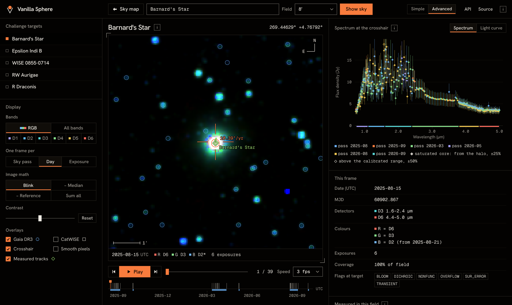
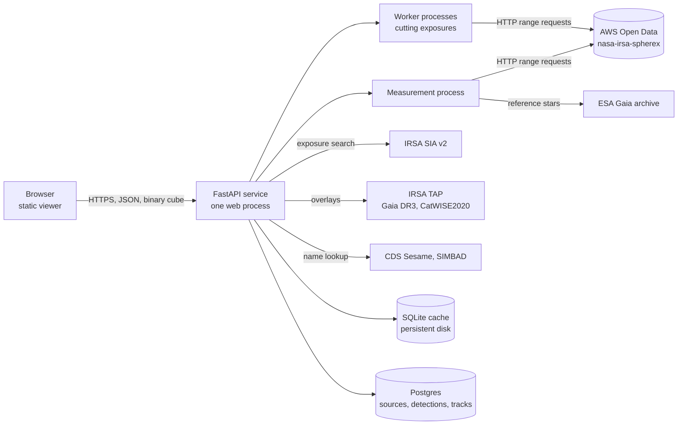

# Product overview

## The problem

NASA's SPHEREx mission images the whole sky repeatedly in 102 infrared colours
between 0.75 and 5.0 um. Each position is revisited about every six months, and
during a visit it is observed many times as the linear variable filters sweep
across it. That makes SPHEREx a time-domain and spectral data set at once: a
nearby star moves measurably between visits, a variable star changes brightness,
and a very cold object appears only at the longest wavelengths.

The challenge "Planet X and SPHEREx" asks teams to use these data to look for
objects that move or change. The obstacles are practical:

- The archive holds Level 2 files of about 65 MB each. A single position is
  covered by several hundred of them, so examining one object by downloading
  files means tens of gigabytes.
- The files are detector frames, not sky-aligned images. Each has its own
  orientation, distortion, quality flags and wavelength map.
- Each exposure samples the target at a different wavelength, so frames cannot
  be compared directly without care.
- Tools that hide these steps exist for specialists, not for the public.

## The product

Vanilla Sphere removes those obstacles. A user picks a point on a sky map, or
types coordinates or an object name, and within seconds the browser plays every
SPHEREx image of that patch of sky in time order. From the same data the product
derives:

- a **blink movie** in false colour or any detector band, with a shared contrast
  stretch so that brightness changes are real;
- **image arithmetic** that removes everything static, leaving movers and variables;
- a **spectrum** from 0.75 to 5.0 um and a **light curve** at the centre of the view;
- **catalogue overlays** (Gaia DR3, CatWISE2020) moved by proper motion to the
  date of each frame;
- **measured positions, proper motion and brightness** of the object, produced
  by an automatic pipeline and compared with the catalogue;
- **wide progressive fields** of 7 x 7 cells (0.84 degrees) that fill in from the
  centre outward;
- a **URL and an HTTP API** for every view, so that any image, movie or
  measurement can be linked, embedded or fetched by code.

Nothing is downloaded in advance. The server reads only the bytes it needs from
NASA's public archive at the moment a view is requested.

*Barnard's Star in Advanced mode: the blink movie with Gaia positions moved to
the date of the frame, the measured track, and the spectrum at the crosshair.*

## Users

| User | Need | How the product serves it |
| --- | --- | --- |
| Member of the public, student | See what SPHEREx sees; understand that the sky changes | Simple mode: sky map, one picture, a short description, play, share, download GIF. No settings. |
| Amateur or professional astronomer | Inspect a target across time and wavelength; check a candidate | Advanced mode: bands, grouping, image arithmetic, spectrum, light curve, overlays, quality flags, measured track |
| Search team (the challenge use case) | Survey areas for moving or variable sources on a common grid | Progressive fields on the `icrs012-v1` cell grid; measurement pipeline; shared measurement database |
| Developer, educator | Reuse images and measurements elsewhere | Stable URL parameters; PNG, GIF, JSON and binary endpoints; open CORS |

## Design principles

1. **On demand, any coordinates.** No pre-built tiles and no fixed target list.
   The cost of a view is paid when someone asks for it and then cached.
2. **Never download a whole file.** FITS files are read with HTTP range
   requests: an 8 arcmin view costs 1.3-1.9 MB per exposure instead of 65 MB,
   and the pixels are identical to a cut from the full download.
3. **Show the data honestly.** One contrast stretch for all frames of a movie.
   False-colour channels borrowed from another date are marked. Saturated
   stars are measured differently and labelled as such, with their larger
   error. Limits are stated next to results.
4. **Deterministic processing.** No machine-learning model runs in the product.
   Every image is SPHEREx data processed by documented arithmetic.
5. **Every view is a URL.** State lives in the address, so results are
   reproducible and shareable.
6. **Two audiences, one product.** Simple mode is the default and has nothing to
   configure; Advanced mode exposes the full instrument. Both show the same data.
7. **Measure automatically.** Positions and tracks come from a pipeline inside
   the product, not from manual work, so any object can be measured on request.

## System at a glance

The service runs on Render in the Virginia region, next to the AWS `us-east-1`
bucket that holds the SPHEREx data. See [architecture](architecture.md).

## Scope and limits

What the product does not do, by design or by the nature of the data:

- **It does not search the whole sky unattended.** It shows and measures what is
  requested. A blind search for unknown movers would run on top of the
  progressive-field and measurement interfaces.
- **Astrometric precision is bounded by the instrument.** SPHEREx pixels are
  6.15 arcsec and the point-spread function is undersampled. One exposure
  locates a source to 0.2-0.5 arcsec. With three or four sky passes over
  roughly a year, proper-motion errors are tens to hundreds of mas/yr.
- **Faint objects need stacking.** A source invisible in single exposures is
  found only by adding exposures along a predicted path, which requires a
  hypothesis for its motion.
- **Saturated stars have approximate fluxes.** Stars brighter than about K = 9
  saturate the detector core at the shorter wavelengths; their fluxes come
  from the halo and carry a 20-25 % systematic error.
- **Coverage follows the public releases.** The product reads the collections
  `spherex_dr1` and `spherex_qr3`. A position not yet observed returns no frames.
- **False colour is a composite.** A position is seen by only one or two
  detectors on a given day, so the three colour channels of an epoch generally
  come from different dates. The source of each channel is recorded and shown.

## Status

The system described here is deployed and serving traffic at
<https://vanillasphere.com> as of 14 November 2026. All source code was written
during the challenge, starting on 14 November 2026.
