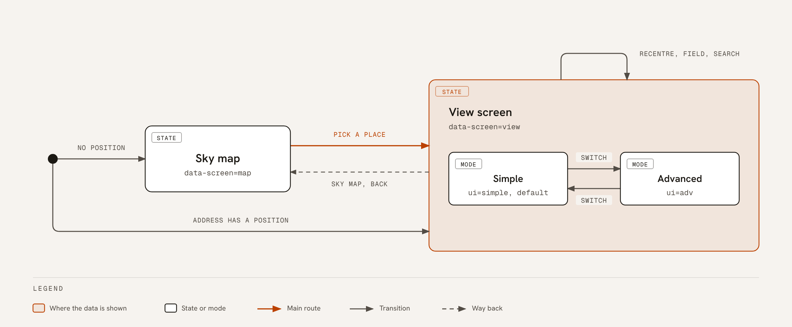

# Viewer

The web client in `web/`. It is plain HTML, CSS and JavaScript with no
framework, no dependencies and no build step; the API service serves the folder
as static files.

| File | Size | Role |
| --- | --- | --- |
| `index.html` | 225 lines | Page structure for both screens and both modes; all fixed text |
| `style.css` | 507 lines | Design tokens, layout, components, responsive rules |
| `app.js` | about 1100 lines | State, URL handling, loading, image arithmetic, drawing, plots, routing |
| `starmap.js` | about 570 lines | The sky map (`SkyMap`): projection, drawing, pan and zoom, picking |
| `ambient.js` | about 330 lines | The motion of the sky map screen (`Ambient`): deep star field, rim glow, slow turn, aiming frame, pings, meteors |
| `atlas.js` | 220 lines | The photograph of the real sky behind the zoomed-in map (`Atlas`): tiles of the 2MASS atlas, from our server's copy (`/api/atlas/2mass/`) or NASA/IPAC IRSA itself, drawn through the map's projection |
| `depth.js`, `depth.css` | about 480 and 80 lines | Distance and redshift: the card and the sentence of a view, the redshift layer of the sky map, the "Compare spectra" sheet; its own text (added to `STR.en`) and styles |
| `redshift.js` | about 400 lines | `Redshift.estimate(points, template)`: a redshift from the emission lines of a spectrum, or the reason there is none (continuum by visit, cross-correlation with the quasar template, line matching, quality 1 to 4); no text and no page elements of its own |
| `data/quasar-template.json` | 18 KB | The mean quasar spectrum from 0.1 to 3.5 µm at rest (Selsing et al. 2016, Glikman et al. 2006), loaded with the first spectrum that is read for lines |
| `data/redshift.json` | 600 KB | 10 037 galaxies and quasars with a spectroscopic redshift (SIMBAD), loaded when the redshift layer is first used |
| `movers.js` | about 240 lines | Moving objects found by the blind search: the card of a field, the paths on the image, votes, follow, and the "Discoveries" list |
| `completeness.js`, `completeness.css` | about 150 and 40 lines | "How much the search finds" at the end of the Discoveries page: three figures, a chart of the share of fake objects found against brightness (one line per test field, hover for the numbers), and the same numbers as tables. Reads `data/mover-completeness.json`; asks the server for nothing else |
| `data/mover-completeness.json` | 30 KB | The result of the injection test of the blind search (`scripts/mover_completeness.py report`, [how much the search finds](mover-completeness.md)) |
| `exports.js` | about 230 lines | What a researcher takes away: the plot's points as CSV, the plot as PNG with the credit, the "Source files" panel listing the Level 2 exposures with their IRSA links, its download script, URL list and table, and the "About the data" page |
| `showcase.js` | about 20 lines | The strip "What you can do here" of the first screen: six cards (`.do`, markup in `index.html`), each opening a live example through functions the other files already have (`openFeatured`, `setLog`, `setDepthPanel`, `setAbout`); it also sets the class `moving` on the map screen while the map is dragged or zoomed, which hides the strip until the visitor stops |
| `linelist.js` | about 110 lines | `LINE_CATALOG`: the reference wavelengths of the reading, 25 atomic lines (vacuum, NIST ASD 5.12) and 7 bands of molecules, ices and dust, each with its source, and the full references. Data only |
| `insight.js` | about 610 lines | The preliminary reading of a spectrum (`analyseSpectrum(points, {z, zSource})`): which points can be read, continuum shape, bands and lines at the wavelengths of `linelist.js` (moved by a published redshift when one is given), confidence and limits; `showReading` puts it under the plot with the table of reference wavelengths and `markFeatures` names the detected features on the plot. Pure rules, no network |
| `i18n.js` | 107 lines | Text that scripts put on the page (`STR.en`) and the `tr()` formatter |
| `overtime.js` | about 130 lines | The Over time plot without the page: the time axis cut into groups of days, and the comparison of visits that says whether the object changed. Tested with node (`tests/overtime_cases.js`) |
| `hints.js` | 74 lines | One-line notes on controls, shown on hover and keyboard focus |
| `lore.js` | 130 lines | What the sky map says about each of the 88 constellations and 31 famous stars under the pointer (`LORE`) |
| `data/sky.json` | - | Compact star chart: stars, names, constellations, Milky Way, boundary grid |
| `fonts/` | - | Hanken Grotesk and Geist Mono, self-hosted |

Scripts are loaded in the order `i18n.js`, `lore.js`, `hints.js`, `atlas.js`, `starmap.js`, `ambient.js`, `overtime.js`, `exports.js`, `movers.js`, `completeness.js`, `linelist.js`, `insight.js`, `redshift.js`, `depth.js`, `showcase.js`, `app.js`.
Asset URLs carry a version query (`?v=53`) that is raised when a file changes,
and `index.html` is served with `Cache-Control: no-cache`. A file asked for
with a version query is served as `public, max-age=604800, immutable`, so a
changed file must get a new version number; fonts and images are kept for a
day; a file asked for without a version is revalidated on every load.

## Screens and modes

The page has two screens and two modes, expressed as attributes on the root
element so that CSS alone decides what is visible:

```html
<html data-ui="simple|adv" data-screen="map|view">
```

| | `data-screen="map"` | `data-screen="view"` |
| --- | --- | --- |
| Content | Whole-sky map, featured targets, zoom buttons | Image stage, transport, and the panels of the current mode |
| Entered by | Opening `/` without a position; "Sky map" button; browser Back | Clicking the map; searching; opening a link with a position |

Elements that belong to one mode carry the class `adv` or `simple`.

<picture>
  <source media="(prefers-color-scheme: dark)" srcset="img/diagrams/viewer-screens-dark.png">
  
</picture>

*Figure: Screens and modes of the viewer. Source: [`diagrams/viewer-screens.html`](diagrams/viewer-screens.html).*

### Layout in Advanced mode

Three columns under a fixed top bar:

| Region | Content |
| --- | --- |
| Top bar | Brand, "Sky map" button, search box, Field menu, "Show sky", Simple/Advanced switch, API link, credits note |
| Left rail | Featured targets; Display panel: Bands, One frame per, Image math, Contrast, Overlays |
| Stage | Target name and coordinates; the image; progress bar; a status strip with date, channels, wavelength range, exposure count and pointer coordinates; transport; timeline |
| Right column | Spectrum or flux over time; "Distance and redshift"; "This frame"; "Measured in this field"; "Position of the crosshair" with cross-links; "Link or embed this view" |

### Layout in Simple mode

The image with play, slider and date, beside one panel: the object's name and
kind, a short description, one sentence on its distance when a catalogue
gives one, Share and Download GIF, and a link to Advanced. The
left rail and the analysis column are hidden.

## State

A single object `S` in `app.js` holds the state of the page:

| Group | Fields |
| --- | --- |
| Target and view | `target`, `ra`, `dec`, `fov`, `levels`, `t` (resolved target), `grid` |
| Display | `det`, `group`, `mode`, `gain`, `fps`, `i` (epoch on screen), `ref` (reference epoch), `playing` |
| Data | `cube`, `meta`, `npix`, `planes`, `limits`, `median`, `stack`, `spectrum`, `catalogs`, `tracks` |
| Progressive field | `field` (the server's report), `stage` (the stage on screen) |
| Interface | `ui`, `screen`, `plotmode`, `keep` (Advanced settings saved while in Simple) |
| Control | `loadId` (incremented on every load so that answers to superseded requests are discarded) |

## URL state

Everything needed to reproduce a view is in the address. `readUrl` applies it
at start; `writeUrl` keeps it current (`replaceState` for display changes,
`pushState` when a new view is opened from the map).

| Parameter | Values | Default | Meaning |
| --- | --- | --- | --- |
| `target` | text | - | Object name or challenge-target key |
| `ra`, `dec` | degrees | - | Position; used instead of `target` for map clicks and recentring |
| `fov` | 1-30 | `8` | Field of view in arcminutes |
| `levels` | 0-3 | `0` | Progressive field with this many rings (replaces `fov`) |
| `det` | `rgb`, `all`, list | `rgb` | Bands |
| `group` | `day`, `visit`, `exposure` | `day` | Frame grouping |
| `mode` | `blink`, `diffmed`, `diffref`, `stack` | `blink` | Image arithmetic |
| `gaia`, `catwise` | `1` | off | Catalogue overlays |
| `tracks` | `0` | on | Hide the measured-tracks overlay |
| `plot` | `lc` | `spec` | The plot tab: `lc` opens on "Over time" instead of the spectrum |
| `mover` | id (`VS-...`) | - | The moving object that is open in the "Moving objects" card |
| `seen` | exposure and detector (`2025W32_1A_0637_3:D3`) | - | With `mover`: the exposure of that object whose frame is on screen |
| `ui` | `simple`, `adv` | see below | Interface mode |

Only non-default display values are written. The interface mode is resolved in
this order: the `ui` parameter; Advanced if the link carries any display
parameter (a link made before modes existed); the last mode used in this
browser (`localStorage` key `vs.ui`); Simple.

Browser Back and Forward are handled by `route`: an address without a position
shows the map, the address of the current view shows it again without
reloading, and any other address loads that view.

## Loading a view

`load(next)` is the single entry point for opening or changing a view.

1. Call `/api/view` (or `/api/tiles` for a progressive field). If the name does
   not resolve, show the error under the search box and leave the current view
   untouched.
2. Reset the data state, show the target, switch to the view screen, write the URL.
3. Poll `/api/cube` every 0.9-1.3 s until the job is ready. Each answer replaces
   the cube, rebuilds the timeline and redraws, so the movie grows as exposures
   arrive. The epoch on screen is preserved across refreshes by its label.
4. When ready, request the spectrum, the selected catalogues and the measured tracks.

For a progressive field, `loadField` polls `/api/tiles` and fetches the cube of
the widest finished stage; stages wider than 300 pixels are requested with
`bin=2`.

Changing bands or grouping calls `reloadCube`, which fetches the cube again for
the same view; the frames are already cached on the server, so only the
stacking is repeated. A sequence number discards answers that a newer request
has overtaken.

## Rendering

### Decoding

The cube is decoded once into a `Float32Array` (see
[binary cube format](api-reference.md#binary-cube-format)); "no data" becomes NaN.

### Image arithmetic

Computed on the decoded cube, plane by plane:

| Mode | Computation |
| --- | --- |
| Blink | The epoch as decoded |
| - Median | Epoch minus the per-pixel median over all epochs (cached after first use) |
| - Reference | Epoch minus the chosen reference epoch |
| Sum all | Per-pixel mean over all epochs multiplied by the square root of their number |

### Stretch

`limits()` samples about 20 000 pixels per plane from each of up to about 30
epochs and derives one pair of limits per plane for the whole movie: the 2nd and 99.7th
percentiles (colour planes start one robust sigma above the median); for
difference modes, plus and minus the 99.7th percentile of absolute values. The
contrast slider scales the upper limit by a power of ten between 10^-1.5 and
10^1.5.

`draw()` applies the same curves as the server's renderer: `asinh(10 t)` for
grey images, the asinh of the mean of three channels with preserved ratios for
colour, and a symmetric `asinh(4 t)` for differences. The image is written to an
off-screen canvas at native size and scaled to the display canvas, with
smoothing in Simple mode and true pixels in Advanced unless "Smooth pixels" is
ticked.

### Overlays

Drawn on the image canvas after every frame by `drawOverlays`:

| Overlay | Drawing |
| --- | --- |
| Cell grid (progressive fields) | Cell outlines and a block map filling in ring by ring |
| Crosshair | On the target; in a progressive field it stays on the target while the mosaic is centred on the seed cell |
| Gaia DR3 / CatWISE | Circle or square at the position propagated to the date of the frame; fast, significant movers highlighted with a path and a label |
| Measured tracks | Every measured position as a dot, the fitted track as a line, a diamond on positions measured in the frame on screen, the object's name |
| Moving objects (progressive fields, `drawMovers` in `movers.js`) | Each object's path over the time it was seen, with an arrowhead and its name; a ring where it is in the frame on screen; the detections of the open object |
| Scale bar and compass | 1, 2 or 5 arcmin bar depending on the field; N up, E left |

In Advanced both catalogues are fetched as soon as a view opens (`loadCatalogs`),
so ticking an overlay shows it without a wait; Simple fetches none.

Marks and text keep a constant size in CSS pixels on any display density and
carry a thin dark edge so they remain legible over bright pixels. Canvas colours
are read from the CSS custom properties, so the canvas follows the design tokens.

### Moving objects

`movers.js` is loaded before `app.js`, which calls four of its functions:
`initMovers()` once, `clearMovers()` when a new view starts, `loadMovers()`
when a progressive field has finished loading, and `drawMovers()` with every
frame. `loadMovers` asks `/api/movers/field` and asks again every 4 seconds
while the search is queued or running. Its state is the object `MV`. Two
things are kept in `localStorage`: `vs.voter`, a random id the browser makes
up once and sends with its votes, and `vs.follow`, the ids of the objects it
follows. "Discoveries" is a sheet like "About the data"; its Fast and Slow
tabs filter the list of `/api/movers` at 20 arcsec per hour.

The open object lists the exposures along its path (`points` of
`/api/movers/{id}`; the file links come from one `/api/exposures` request at
the object's place). `showMoverFrame` opens the place of one of them as a
plain 8 arcmin view with `group=exposure` and that exposure's detector, and
puts its frame on screen. The object is carried into that view as `MV.pin`
(`clearMovers` keeps it when `MV.hold` is set), so the card, the ring and the
path are there without a field; `moverLink`, called at the end of `load`,
does the same for a link that carries `mover` and `seen`.

### Distance and redshift

`depth.js` is loaded before `app.js`, which calls `initDepth()` once,
`clearDepth()` when a new view starts and `depthTarget(t)` when a view has its
target. `depthTarget` asks `/api/object` (twice at most); with no answer it
looks for the object in `data/redshift.json` and, failing that, hides the
card, so the viewer also works against a server without the endpoint.

When the spectrum of the view has arrived, `app.js` calls
`depthSpectrum(points)`. It runs `Redshift.estimate` on them with the quasar
template (`zTemplate`, fetched once) and keeps the result in `DP.est` when
its quality is 3 or 4; `showDepth` then adds the rows "From its lines" and
"Lines found", and shows the card for the estimate alone when the catalogues
know nothing. An object the lookup calls a star gets no such rows. The
compare sheet does the same for each of its objects (`it.est`).

The redshift layer uses one hook of the sky map: `SkyMap.layer({groups, dim})`
draws groups of objects (one colour each; dots, or diamonds for `kind: "q"`)
over the stars and dims the chart behind by `dim`; `SkyMap.layer(null)` takes
it away. An object of the layer under the pointer wins over a star and comes
to `onHover` and `onPick` as `obj`; `app.js` passes it to `depthTag()` and
`depthOpen()`.

"Compare spectra" is a sheet like "About the data" (`setCompare`). Its state
is `CMP`: the list of objects (each with its `/api/spectrum` points, published
and current z, colour), the axis, the scale and the zoom range. `cmpBins`
turns the points of an object into medians in bins of 1/45 in log wavelength,
`cmpDraw` draws all objects on a canvas (linear wavelength axis when observed,
logarithmic at rest), and `cosmoOf(z)` computes light-travel time and distance
in the browser with the same Planck 2018 parameters as the server (it agrees
with astropy to 0.01%).

### Plots

`drawPlot` draws the spectrum or the flux over time on a canvas without a charting
library: axes with rounded tick steps, points coloured by sky pass (spectrum) or
by detector (over time), hollow points for flagged apertures (left out until the reader shows them
with the button in the legend, unless a plot has no other points), diamonds for
halo-measured fluxes, hollow diamonds above the calibrated range, and a legend.
The vertical axis reads in mJy and switches to Jy when the 98th percentile of
the fluxes exceeds 1 Jy. The time axis of the Over time plot is cut into the
groups of days in which SPHEREx observed the place (`groupedAxis` in
`overtime.js`), and `changeText`/`showChange` write the line under it that says
whether the object changed between visits (`brightnessChange`, and band by
band `bandChanges` when the total is steady); see
[features](features.md#9-spectrum-and-flux-over-time).

## Sky map

`SkyMap` in `starmap.js` exposes `init`, `show`, `redraw`, `zoom`, `home`,
`lookAt`, `setMark`, `setPins`, `highlight`, `idle` and `constellation` (and
`attach`, `state`, `toXY`, `turn` and `rest` for `ambient.js`), and
takes the callbacks `onPick`, `onHover`, `onView` and `onReady`. `onHover` reports
the sky position, the constellation, a target pin, the star the pointer has
snapped to and the celestial pole whose mark it is on; `app.js` turns that into
the map tag (pin, then a pole, then a star with a name or a designation, then
constellation, with the text from `lore.js`), and the map brightens the figure
of the constellation under the pointer.

**The first view.** The first time the map is shown it looks at the centre of
the Milky Way (`OPEN` in `starmap.js`: RA 266.4, Dec -29) instead of the whole
sky, so the photograph of the real sky is on screen from the start. The zoom
(`openZoom`) is set by how much sky fits: 64 degrees across the width, never
less than 28 degrees over the height, at least 4 times the whole-sky zoom
(where the photograph is fully in) and just short of 6 times, where every
star to the third magnitude would get its name. That is 5.2 times the
whole-sky zoom at 1440 x 900, 5.6 at 1920 x 1000 and 4 on a phone. A view
asked for by `lookAt` before the map is shown wins over it. Until the visitor
moves the map, `onView` reports `opening: true` and `app.js` keeps the class
`opening` on `#mapscreen`, which keeps the heading on the map although it is
zoomed in. Zooming out is not limited: the whole sky is one button or a few
wheel steps away. Star names are counted from the whole-sky zoom
(`view.k / homeZoom()`), so a phone, which starts closer, does not fill up
with names.

**Snapping to stars.** Pointing and picking snap to the nearest drawn star
(`starAt`): the aiming frame jumps onto it, the readout shows the star's own
coordinates and a click opens the star, not a place a few pixels beside it. A
star is within reach when the pointer is within 6 px of its disc at the
whole-sky zoom, growing by 3 px for each doubling of the zoom up to 16 px, and 1.6 times
that for a finger; a finger also prefers the brighter of two close stars.
Holding Alt points and picks freely, between the stars. A star with a proper
name (493 of them) is opened by that name, so the view carries the name and the
position corrected for proper motion; if the name services do not know the name
or place it more than 0.3 degrees away, the star's catalogue coordinates
(J2000, to 0.001 degree) are opened instead. Any other star is opened by its
coordinates.

- **Projection.** Hammer equal-area about a movable centre. Positions are
  rotated as unit vectors so the centre can be any point of the sky.
- **Data.** `data/sky.json` holds stars as a flat integer array (RA and Dec in
  thousandths of a degree, magnitude, colour index), one designation per star
  (Bayer, Flamsteed or variable-star name, when it has one), the proper names
  of 493 stars with their index in the star list, constellation lines and label
  positions, the Milky Way as a dot grid with five brightness levels, and a
  run-length-encoded 1 degree grid naming the constellation of each cell. It is
  built by `scripts/build_sky.py` from d3-celestial data and Astropy's
  constellation boundaries.
- **Level of detail.** Fainter stars appear as the map is zoomed.
- **How the Milky Way is drawn.** As a soft glow along the galactic plane,
  from the same grid of cells (1.25 degrees apart, five brightness levels).
  Each frame the cells are painted on a small black canvas (about one pixel
  per cell), each as a patch as bright as its level, the brighter of two
  overlapping patches winning; the small canvas is then stretched over the
  map and added as light, and the stretch blurs the patches into one cloud.
  It used to be a halftone of grey squares, which read as unexplained
  blotches once the map was zoomed in. `SkyMap.milky(soft, glow)` sets how
  blurred and how bright it is.
- **How a star is drawn.** Its colour comes from its measured colour index
  (B-V): the index gives a temperature (Ballesteros 2012) and the temperature
  the colour of a black body, from blue-white through white and yellow to
  orange. Its size comes from its magnitude. At the opening zoom a star is
  close to the flat dot of a chart. Zooming in turns it, step by step, into
  what a camera records: a core burnt out to white, a glow in the star's
  colour that falls off like a telescope's point spread (a Moffat profile),
  and a faint wide halo; the brightest stars get a wider glow and four thin
  diffraction spikes. The spikes are a drawing convention borrowed from
  telescope pictures, not data. The pictures
  are small sprites made once per colour and step (`sprite()` in
  `starmap.js`); faint stars are soft points, drawn as sprites when fewer
  than 500 are on screen and as batched dots otherwise. `SkyMap.look(v)` sets
  how strong the halo, the spikes and the colour are (0 to 1). Nothing here
  moves: stars do not twinkle, because that would redraw the whole map on
  every frame.
- **The photograph behind the zoomed-in map.** From a little past twice the
  opening zoom a photograph of the real sky comes up behind the chart, and
  the drawn Milky Way makes way for it: the galaxy's dust lanes, nebulae,
  clusters and the many stars too faint for the chart are then really there.
  It is the 2MASS near-infrared atlas (J, H and K bands shown as blue, green
  and red), chosen because SPHEREx looks at the same kind of light. It is a
  backdrop and not SPHEREx data; a line at the top of the map says so while
  it shows, and the credits name the survey. `atlas.js` (`Atlas`) does it
  without a library:
  - The atlas is published in the HiPS format (by CDS) and served by the
    NASA/IPAC Infrared Science Archive, the same archive the SPHEREx images
    come from. HiPS cuts the sky into the diamonds of the HEALPix grid;
    order *k* has 12 x 4^k of them, each a 512 pixel JPEG at
    `Norder{k}/Dir{d}/Npix{n}.jpg`.
  - The tiles come from our own server (`/api/atlas/2mass/`, same layout),
    which fetches a tile from the archive once and keeps it, and holds the
    whole sky at orders 0-6 from the start
    ([API](api-reference.md#get-apiatlas2mass)). A tile the server cannot
    give is asked of the archive itself; after three such failures in a row
    the archive is asked first for a minute.
  - Each redraw the map asks `Atlas.draw()` for the view. It picks the order
    whose tiles are 300 to 600 px wide on screen, finds the diamonds under a
    net of screen points, and lays each tile over its diamond in pieces
    whose corners go through the map's own `project()`. A diamond is cut
    into as few pieces as keep the picture within about half a pixel of its
    true place, from 1 at high zoom to 10 x 10 where the projection bends
    most, so the photograph lies under the drawn stars (checked
    on Orion, the Pleiades, the pole and the galactic centre). A piece is
    one `drawImage` under the straight map that fits its four corners best,
    a little wider than its place so no hairline shows. Nothing is clipped:
    the first version cut every piece into two clipped triangles, which
    cost about 15 ms a frame on a laptop's graphics card at low zoom.
  - A tile is cleaned once when it arrives (`clean()`): the atlas' faint
    magenta floor of noise becomes black, patches of a single colour that
    the survey's detectors left near bright stars are removed (a real source
    shines in all three bands), the colour is muted a little and faint stars
    are lifted. The result is kept as a bitmap; a few screens' worth stay in
    memory.
  - It never holds the map up. Tiles arrive six at a time, nearest the
    centre first, and fade in; a coarser tile already in memory stands in
    meanwhile. If neither source gives a tile, the drawn map simply stays;
    after six failures in a row both are left alone for a minute. Visitors who ask their
    browser to save data get no photograph. With all of it missing the map
    is the drawn chart it was before.
  - Cost: about 1 to 5 ms more per frame without a graphics card (measured
    at 1440 x 900, two device pixels per pixel), and tiles of 30 to 80 kB
    each. Canvas smoothing is left on "low": "high" rebuilt a smaller copy
    of every tile on every frame.
  - `SkyMap.photo(from, show)` sets the zoom at which it starts (in
    doublings past the whole sky) and its strength; `Atlas.mute(v, lift)`
    the colour and the lift of faint stars; `Atlas.set(false)` turns it off.
  The page's content security policy allows pictures from
  `irsa.ipac.caltech.edu` for the second source and nothing else from outside
  ([security](security.md#response-headers)).
- **The axis of the sky.** The map can be turned and tilted freely, and a
  tilted whole-sky oval is hard to read: nothing says where north went (an
  astronomer who tried it lost his bearings after one turn). So the two
  celestial poles are marked, N beside Polaris and S, and one dashed line
  runs from pole to pole. The line is the meridian of 0h right ascension,
  which is fixed among the stars: it turns with the sky and shows how far the
  map has been turned, and with the map level and centred on 0h it is the
  straight line down the middle. A pole on the far side of a tilted map falls
  on the cut of the projection, so it is marked on both rims (it is one point
  of the sky). Pointing at a mark gives a note saying what it is; a star
  nearer the pointer keeps its own note, so Polaris can still be pointed at.
  `SkyMap.axis("sky" | "view" | "off")` switches it; `"view"` draws the
  straight line down the middle of the map instead, which stays put while the
  sky turns past it.
- **Input.** Pointer events for drag, pinch and click; wheel zoom about the
  pointer so the sky under it stays under it; keyboard pan, zoom and select.
- **Drawing** is batched with `requestAnimationFrame` and only runs while the
  map screen is shown. The canvas is clear outside the ellipse of the sky, so
  the ambient layer behind it shows through.

### Motion on the map screen

`ambient.js` (`Ambient`) adds the motion. It is decoration: the map works the
same without it, and none of its layers takes a pointer event. It attaches with
`SkyMap.attach({sync})`; the map calls `sync()` after every redraw, and
`SkyMap.state()`, `toXY(ra, dec)`, `turn(degrees)` and `rest()` give it what
the map shows, where a sky position is on the canvas, a slow turn, and a way
to clear the pointer state.

| Layer | Element | What it does |
| --- | --- | --- |
| Behind the map | `.mapbg .neb canvas` | A muted Milky Way: a diagonal band of violet and indigo cloud with dark dust lanes, fine star dust that follows the band and a few warm stars. `milkyWay()` renders the cloud once from seeded noise into a small buffer (long side 420 px) and `backdrop()` scales it onto a still canvas and adds the dust; it is drawn again only when the window changes size. Its slow breathing is a CSS opacity and transform animation. `Ambient.dim(v)` sets its strength (0 to 1, 0.5 by default) |
| Behind the map | `.mapbg .skyglow` | A glow around the rim of the sky: a 200 x 100 ellipse whose shadow is moved and scaled onto the rim |
| Behind the map | `.mapbg canvas` | A deep field of faint stars at different depths. They twinkle, slide slowly, lean towards the pointer and slide when the map is turned (parallax). Stars behind the sky are skipped; nothing is drawn once the zoomed sky covers the screen |
| The map | `SkyMap.turn` | The map turns 0.55 degrees a second while nobody uses it, only at the opening zoom |
| Above the map | `.mapfx .reticle` | The aiming frame: four corners that follow the pointer, snap around a featured target, close on the picked point and ping while the view is fetched. It replaces the crosshair the map used to draw |
| Above the map | `.mapfx .pinping` | A ping on each featured target, one after the other |
| Above the map | `.mapfx .meteor` | A meteor every 20 to 30 seconds, the first a few seconds after the page opens |
| Heading | `.blinkmark` | Two squares that alternate: one object seen at two dates |
| Map tag | `#mapcoord` | On a pick, the coordinates of the point; the digits run and settle (`Ambient.roll`) |

Rules it keeps:

- **Light.** Everything that moves on its own is a CSS animation of
  `transform` and `opacity`, or the deep-field canvas (at most 1.5 device
  pixels per CSS pixel, about 30 pictures a second, 10 on a touch screen).
  The Milky Way is painted once, not every frame.
- **The turn pauses** while the pointer moves over the map screen (8 s of
  stillness resume it, 2.5 s after the pointer has left, 4 s after a touch),
  during a drag, while a view is opening, when the map is zoomed in, and while
  the map has keyboard focus.
- **A page left open goes quiet.** The turn stops 2.5 minutes after the last
  input and the deep field after 5 minutes. Nothing runs while the tab is
  hidden or a view is open.
- **Slow machines.** Turning redraws the whole map. If frames keep arriving
  late while it turns (a computer drawing without a graphics chip), the turn
  drops to a third of its rate and then stops for the rest of the visit.
- **Reduced motion.** With `prefers-reduced-motion: reduce` nothing moves by
  itself: the star field, the Milky Way and the glows are a still picture, there is no turn,
  ping or meteor, and the aiming frame and the coordinates appear at once.

## Text and notes

- Fixed text is written in `index.html`. Text produced by scripts comes from
  `STR.en` through `tr(key, vars)`, which fills `{name}` placeholders.
- The interface is in English.
- **Explanations stay out of the way.** The screen carries minimal text. Longer
  explanations are behind small "i" buttons (`.tip`, `.tipbtn`, `.tipbody`) that
  open on hover, focus or tap and close on Escape.
- **Every control has a one-line note.** A control opts in with
  `data-hint="key"` (text in `STR.en`) or `data-hint-text`. `hints.js` shows the
  note after a short delay on hover or keyboard focus, never on touch. A
  container with `data-hint-side="right"` or `"top"` positions the note so that
  it does not cover the next control. Native `title` tooltips are not used.

## Design system

The visual language is the "Rim" theme of Hallmark in its night colourway, laid
out by the tool-interface rules of Impeccable (both MIT-licensed design
references).

| Token group | Definition |
| --- | --- |
| Surfaces | Near-black "paper" with a violet cast in three steps (`--color-paper`, `-2`, `-3`) and a lift tone |
| Text | Warm off-white "ink" in two steps and two muted steps |
| Rules | Hairlines in two strengths; zero corner radius throughout |
| Signal | Nebula violet `oklch(72% 0.165 300)` for actions and current state only; pale cyan as the second accent |
| Logo | Its own two colours, independent of the accent: an orange V (`--brand-v`) holding a vanilla-cream sphere (`--brand-sphere`) |
| Data series | Six detector colours in wavelength order (`--d1` ... `--d6`), three channel colours, one colour for measured tracks, one for "no data" |
| Type | Hanken Grotesk for interface text; Geist Mono with tabular figures for every measured value |
| Motion | One easing curve, 140 ms; disabled under `prefers-reduced-motion` |

Rules applied throughout:

- Violet marks what can be acted on or what is current, nothing else.
- Every measurement is set in the monospaced face; every time is labelled UTC.
- Pixels without data have their own colour so they are never mistaken for sky.
- Colours are defined in OKLCH and referenced only through custom properties.

## Responsive behaviour and accessibility

- **Breakpoints** at 1180, 1000, 900, 760 and 480 px. From 1180 px the three
  columns sit side by side in a fixed shell and each scrolls on its own. Below
  that the stage stays in view beside one column holding the settings and the
  analysis. Below 1000 px the search box moves to its own row; below 900 px
  Simple mode becomes a single centred column. Below 760 px the whole layout is
  one scrolling column with controls at least 40 px high, and below 480 px the
  brand collapses to its mark.
- **Image size** is derived from the viewport so the image, transport and
  timeline fit one screen without scrolling on a desktop display.
- **Touch.** Enlarged hit areas for the "i" buttons under `pointer: coarse`;
  pinch zoom on the map; the system share sheet for Share; hover notes are
  suppressed.
- **Keyboard.** All controls are reachable by Tab with a visible focus ring.
  Space plays and pauses, arrow keys step frames; on the map, arrow keys pan,
  `+` and `-` zoom and Enter opens the centre.
- **Semantics.** Landmarks (`header`, `main`, `aside`, `nav`), labelled groups
  for segmented controls, `aria-pressed` on mode buttons, `role="alert"` for
  search errors, `role="status"` for progress text, `role="tooltip"` for notes,
  and descriptive labels on canvases and icon buttons.
- **Document title** follows the target ("Barnard's Star - Vanilla Sphere").

## Conventions for changes

- New interface elements follow the tokens above and go in the correct mode
  (class `adv` or `simple`).
- Every new control gets a hover note through `data-hint`.
- Script-made text goes in `STR.en`; fixed text in `index.html`.
- Raise the `?v=` version on the asset references in `index.html` when a script
  or the stylesheet changes.
- Several workstreams edit `web/app.js`; rebase on `main` before changing it.
